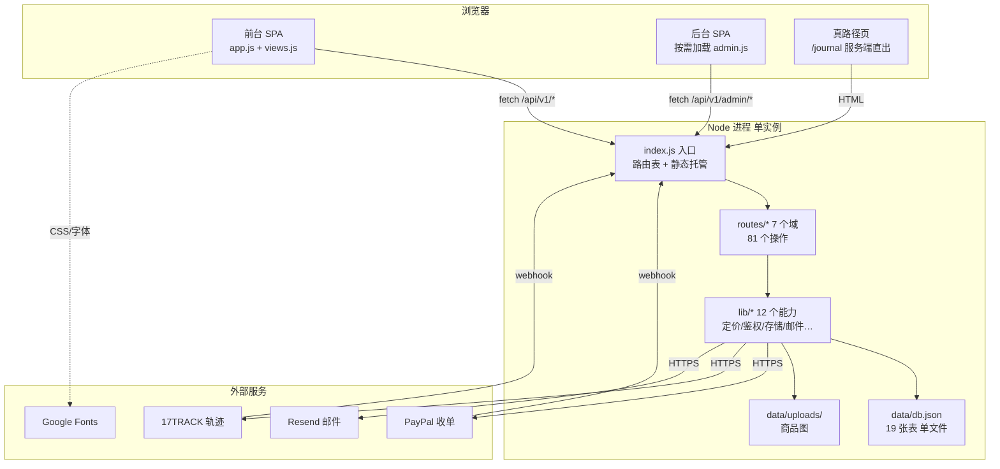
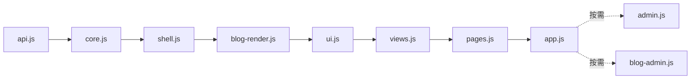
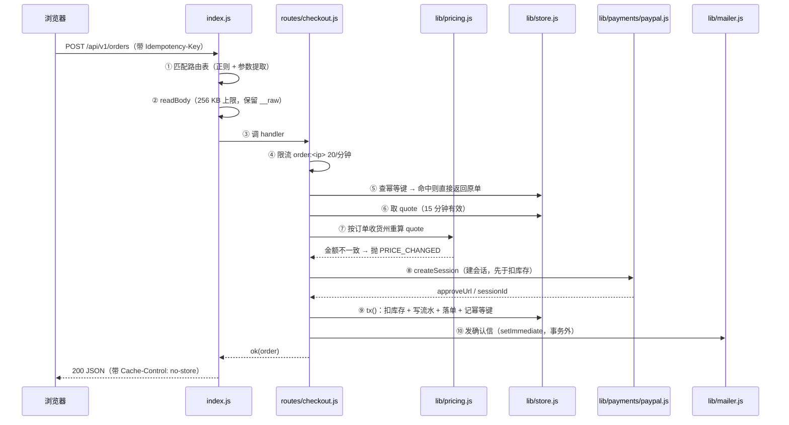
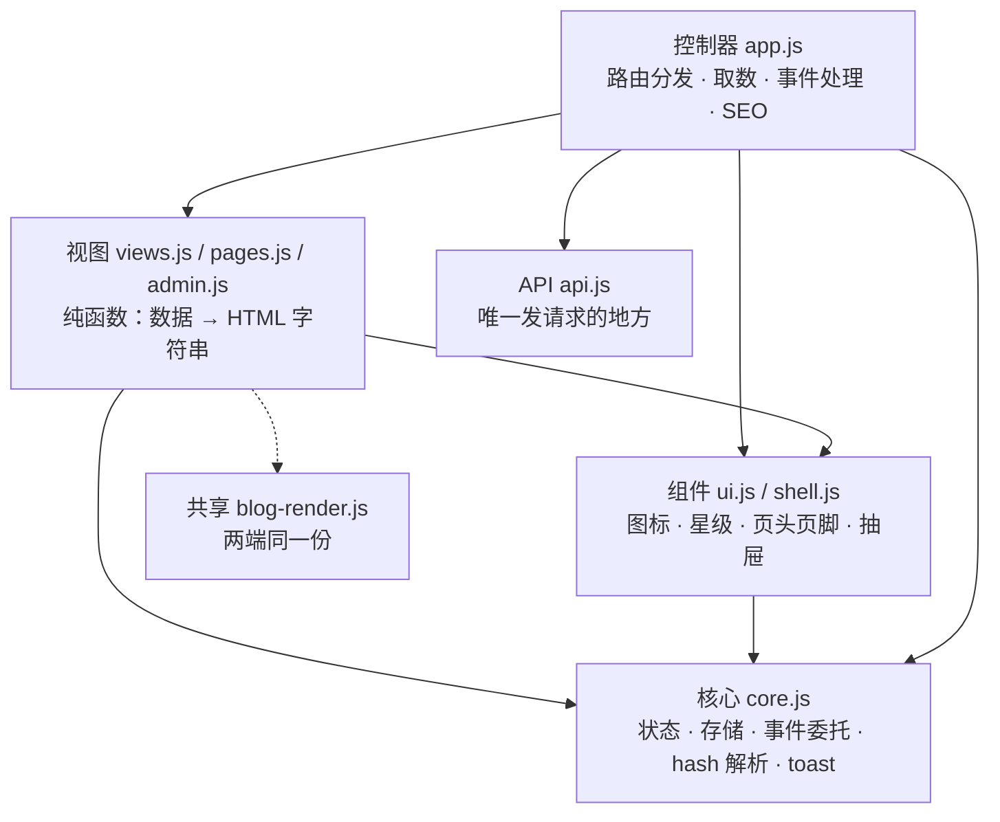
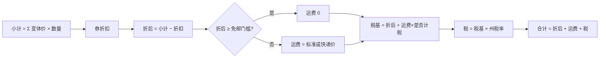

# LASTGROVE 前后端技术详解（接手者手册）

| 项 | 内容 |
| --- | --- |
| 文档编号 | LG-TECH-001 |
| 版本 | v1.0 |
| 日期 | 2026-11-16 |
| 读者 | **要接手这个项目的工程师**（不需要产品背景） |
| 目标 | 3 天内能独立改功能、查故障、发版 |
| 对应代码 | `app/server`（8,084 行）+ `app/web`（9,094 行），commit `9da5b92` |
| 配套 | SDD v2.7（为什么这么设计）、API v1.6（接口契约）、测试报告 v1.8（哪些验过） |

---

## 0 怎么读这份文档

这份文档不按"知识体系"排，按**你会遇到的问题**排。三条路线，按你的时间选：

| 你有多少时间 | 读哪几节 | 读完能做到 |
| --- | --- | --- |
| **20 分钟** | §1 架构全景 → §2 技术栈取舍 → §13 常见陷阱 | 知道这套东西为什么长这样，以及最容易被它坑的地方 |
| **2 小时** | 上面 + §4 请求的一生 → §5 服务端模块 → §6 前端模块 | 能定位"这个功能在哪个文件" |
| **3 天** | 全部，尤其 §7 数据存储 → §8 关键算法 → §9 安全 | 能独立改功能、改价规则、加接口、发版 |

> **一句话先说清这套代码的特殊性**：它**没有框架、没有构建步骤、没有 npm 依赖**。`package.json` 里没有 `dependencies`，前端没有 bundler，CSS 直接引用。所以**改完刷新就是改完**，不存在"编译过了但运行不对"这一类问题。代价是所有 Web 框架替你做的事（路由、中间件、模板、ORM、校验）都是手写的 8,000 行——你得知道它们在哪儿。

---

## 1 架构全景



**三个形态并存**，这是最容易让人迷惑的地方：

| 形态 | 地址 | 谁渲染 | 为什么这样 |
| --- | --- | --- | --- |
| 前台 SPA | `/#/products/xxx` | 浏览器 | 交互流畅，改版不用刷新 |
| 后台 SPA | `/#/admin/orders` | 浏览器（脚本按需加载） | 买家永远用不到这 100 KB |
| 博客真路径 | `/journal`、`/journal/<slug>` | **服务端** | `#` 之后的内容爬虫不认，文章必须真路径 |

> 同一个站里并存两套路由是**刻意的取舍**，不是没做完。全站迁 `history` 路由要引入 `pushState` + `popstate` + 滚动恢复三件套，那是 SPA 路由 bug 的主要产地；而收益只在内容页。详见 SDD §20.1。

---

## 2 技术栈与"为什么不用框架"

### 2.1 用了什么

| 层 | 技术 | 版本/约束 |
| --- | --- | --- |
| 运行时 | Node.js | 18+（用的是 `node:` 内置模块，无外部包） |
| HTTP 服务 | `node:http` | 手写路由表，81 个操作 |
| 数据 | 单个 JSON 文件 + 内存镜像 | `app/server/data/db.json` |
| 前端 | 原生 ES5 风格 JS（IIFE 模块） | 无 bundler、无框架、无 TS |
| 样式 | 三层手写 CSS | 自定义属性 + grid/flex，无预处理器 |
| 模板 | JS 字符串拼接 + `esc()` 转义 | 无模板引擎 |
| 路由（前端） | `location.hash` + 手写 `parseHash` | 无 router 库 |
| 事件 | DOM 事件委托 + `data-act` 属性 | 无事件库 |
| 进程管理 | systemd 或 Docker | 单实例（硬约束） |
| 反向代理 | Nginx | HTTPS 终结 + gzip 可选 |

### 2.2 为什么这么选（以及代价）

| 选择 | 好处 | 代价（你必须知道） |
| --- | --- | --- |
| **零第三方依赖** | 没有供应链投毒面；没有大版本升级要跟；`git clone` 完就能跑；容器镜像极小 | 路由、校验、CSV、HTTP 客户端全要手写；没有 ORM，改数据结构要自己写迁移 |
| **单 JSON 文件** | 备份就是 `cp` 一个文件；可以直接 `cat` 看数据；调试时改一行就能复现 | **只能单实例**（内存限流、内存会话、写队列都在进程内）；数据量上千单后每次写盘是全量序列化 |
| **无构建步骤** | 改完刷新即生效；线上可以直接改一个文件再重启 | 没有模块系统，靠 `<script>` 顺序 + 全局变量；没有 tree-shaking，只能靠"按需加载脚本"手工优化 |
| **服务端算钱** | 前端改价改不动；前后台永远一致 | 每个金额变化都要一次网络往返；离线不可用 |
| **IIFE + 全局对象** | 直接在浏览器里断点调试，堆栈清楚 | 全局命名空间靠约定（`S` / `UI` / `Views` / `AdminViews` / `BlogAdmin` / `API`），加载顺序错就 `undefined` |

> **一句话判断标准**：这个项目的所有技术选择都指向同一件事——**一个人能维护**。所以它宁可手写 8,000 行，也不要一条 `npm install` 带来的隐式契约。你改代码时请守住这条：**不要为了省事引入依赖**，一旦引入，"clone 完就能跑"这个最大优势就没了。

---

### 2.3 关于「类」：这个项目几乎没有类

如果你习惯了"每个模块一个 class"，这里会有点意外：**全项目只有一个 class** —— `lib/http.js` 的 `ApiError`（因为要 `instanceof` 判断错误类型）。其余全是**模块对象**。

| 形态 | 服务端 | 前端 | 怎么"实例化" |
| --- | --- | --- | --- |
| CommonJS 单例对象 | `module.exports = { ... }` | — | 不需要，`require()` 拿到的就是唯一实例 |
| IIFE 挂全局 | — | `(function(){ … window.Views = {...} })()` | 不需要，脚本加载即注册 |
| class | 只有 `ApiError` | 无 | `new ApiError(status, code, message, details)` |

**为什么不用类**：这些模块全是无状态或"进程内唯一状态"，没有多实例需求。用类会多出 `new` 与依赖注入的样板，而收益（可替换、可 mock）在这个规模下用不上。

**所以你找代码的方式不是"找那个类"，而是"找那个导出的名字"**：

| 你要找的能力 | 去哪 | 导出名 |
| --- | --- | --- |
| 算钱 | `lib/pricing.js` | `quote()` 等 12 个函数 |
| 存数据 | `lib/store.js` | `get / flush / tx` |
| 鉴权 | `lib/auth.js` | `requireAuth / requirePerm` |
| 发邮件 | `lib/mailer.js` | `orderConfirmed / orderShipped / refundIssued` |
| 物流 | `lib/tracking.js` + `tracking-sync.js` | `register / syncOrder` |
| 图片 | `lib/uploads.js` | `saveDataUrl / resolve` |
| 前端渲染 | `views.js` / `pages.js` / `admin.js` / `blog-admin.js` | `window.Views` / `PageViews` / `AdminViews` / `BlogAdmin` |
| 前端状态与事件 | `core.js` | `window.S` |
| 前端组件 | `ui.js` | `window.UI` |
| 站点外壳（页头页脚） | `shell.js` | **UMD**：`window.Shell` / `module.exports`，服务端预渲染博客页也用它 |
| 前端请求 | `api.js` | `window.API` |
| 博客渲染 | `blog-render.js` | `window.BlogRender` / `module.exports`（两端同一份） |

## 3 目录地图

### 3.1 服务端 `app/server`（8,084 行）

| 文件 | 行数 | 职责 | 你什么时候会打开它 |
| --- | --- | --- | --- |
| `index.js` | 617 | 入口：路由表注册、静态托管、gzip/ETag/`?v=`、CSP、robots/sitemap、`/uploads/*`、博客真路径分流、测试复位端点、孤儿图清理定时器 | 加新路由前缀、改缓存策略、改 CSP |
| `seed.js` | 177 | 生成初始数据（首次部署、测试基线） | 重置数据、加种子字段 |

### 3.2 `app/server/routes`（3,853 行，7 个域，81 个操作）

| 文件 | 行数 | 操作数 | 域 | 权限 |
| --- | --- | --- | --- | --- |
| `catalog.js` | 458 | 10 | 公开目录：health / bootstrap / products / search / collections / reviews 提交 / 定制单提交 | 无（匿名） |
| `checkout.js` | 704 | 7 | 购物车校验 / 券校验 / 报价 / 下单 / 访客查单 / 访客取消 | 无（匿名，限流 + 幂等） |
| `payments.js` | 274 | 3 | 支付方式列表 / capture / webhook | webhook 靠签名 |
| `tracking.js` | 133 | 4 | 物流 webhook / 手动刷新 / 额度 / 健康 | 后台三操作需 `orders:read` |
| `admin.js` | 1,902 | 49 | 后台全部：登录、员工、看板、订单、商品、库存、客户、导出、券、评价、设置、税、审计、集合、定制单、内容 | 各操作各自的权限位 |
| `posts.js` | 116 | 8 | 博客公开 2 + 后台 6 | `posts:write` |
| `blog-page.js` | 266 | — | `/journal` 与 `/journal/<slug>` 的服务端渲染 | 无（页面） |

### 3.3 `app/server/lib`（2,520 行，16 个文件）

| 文件 | 行数 | 职责 | 关键导出 |
| --- | --- | --- | --- |
| `store.js` | 126 | 数据层：加载、内存镜像、原子写、串行队列、事务、启动迁移 | `get / load / reload / flush / tx` |
| `http.js` | 161 | 统一响应、错误类型、CORS、body 解析、限流 | `send / ok / fail / E / ApiError / rateLimit` |
| `auth.js` | 125 | 密码哈希、令牌、权限位 | `hashPassword / verifyPassword / requireAuth / requirePerm` |
| `pricing.js` | 237 | **定价引擎**（纯函数）：券、运费、税、赠品、库存校验 | `quote / normalizeItems / resolveCoupon / taxFor` |
| `audit.js` | 31 | 审计日志（最近 2000 条） | `audit` |
| `notify.js` | 42 | 邮件去重标记（`claim`） | `claim` |
| `mailer.js` | 169 | Resend 发送：重试、幂等键、dry-run | `orderConfirmed / orderShipped / refundIssued` |
| `mail-templates.js` | 282 | 三封信的 HTML + 纯文本双版本（纯函数） | `confirmed / shipped / refunded` |
| `tracking.js` | 371 | 17TRACK 客户端：订阅、查询、额度、状态映射 | `register / info / quota / verifySignature` |
| `tracking-sync.js` | 163 | 物流编排：订阅 → 查询 → 落库 → 审计 | `syncOrder / refresh` |
| `uploads.js` | 103 | 图片落盘：文件头嗅探、路径穿越防护、孤儿清理 | `saveDataUrl / resolve / sweepOrphans` |
| `csv.js` | 84 | CSV 解析与生成（RFC 4180 子集，带 BOM） | `parse / build` |
| `us-states.js` | 58 | 州名归一化（`California`/`CA`/`calif` → `CA`） | `normalizeState` |
| `posts.js` | 421 | 文章的校验、slug 生成、块清洗、阅读时长 | 由 `routes/posts.js` 调用 |
| `pages-default.js` / `posts-default.js` | 23 / 124 | 首次启动的种子内容 | 数据迁移用 |

### 3.4 `app/server/lib/payments`（917 行，4 通道）

| 文件 | 行数 | 状态 |
| --- | --- | --- |
| `index.js` | 81 | 通道注册与选择（`PAYMENT_PROVIDER`） |
| `mock.js` | 55 | 同步成功，永不扣款。本地与自动化回归全走它 |
| `paypal.js` | 292 | 已联调（沙盒）。两段式 capture + 回传验签 |
| `stripe.js` | 270 | 骨架，**未用真实账号验证** |
| `airwallex.js` | 219 | 骨架，**未用真实账号验证** |

### 3.5 前端 `app/web/assets/js`（6,532 行）

| 文件 | 行数 | 层次 | 职责 | 依赖谁 |
| --- | --- | --- | --- | --- |
| `api.js` | 86 | 基础设施 | 唯一发请求的地方：错误解析、令牌注入、401 清理 | 无 |
| `core.js` | 441 | 基础设施 | `S`：工具函数、localStorage 购物车、hash 解析、事件委托注册、toast | `api` 无依赖，core 也不依赖它 |
| `shell.js` | 353 | 渲染（**UMD**） | 站点外壳：页头、导航、页脚。服务端也 require 它，保证博客页与 SPA 的页头页脚是同一份 | 无（数据由调用方传入） |
| `blog-render.js` | 343 | 共享库 | **UMD**：博客块渲染与 meta 生成，服务端也 require 它 | 无 |
| `ui.js` | 420 | 渲染 | 共用组件：图标、星级、商品卡、购物车抽屉、搜索层、移动菜单、Cookie 条 | `S` |
| `views.js` | 795 | 渲染 | 前台 11 个视图（home / collection / product / cart / checkout / order / lookup / search / wishlist / notFound / payCta） | `S`、`UI` |
| `pages.js` | 298 | 渲染 | 11 个静态内容页的**正文**（about / privacy / terms …） | `S` |
| `app.js` | 2,357 | 控制器 | 路由分发、取数、事件处理器（100+ 个 `S.onClick`）、后台按需加载、SEO 写入 | 全部 |
| `admin.js` | 1,214 | 后台视图 | 16 个后台模块的视图 + 侧栏 | `S` |
| `blog-admin.js` | 225 | 后台视图 | 文章列表 + 块编辑器 | `S`、`BlogRender` |

**加载顺序不能改**（`index.html` 里的顺序就是依赖顺序）：



> `admin.js` 与 `blog-admin.js` **不在 `index.html` 里**。它们由 `app.js` 的 `loadAdminScripts()` 在进入 `#/admin` 时才插入，地址来自服务端注入的 `window.LG_ASSETS`（带 `?v=mtime`）。**不要在前端硬拼 `/assets/js/admin.js`** ——那样拿不到版本号，会从浏览器缓存里取到旧副本，表现是"发了版，但某个人还在跑旧后台"。

### 3.6 CSS 三层（2,562 行）

| 文件 | 行数 | 管什么 | 什么时候改 |
| --- | --- | --- | --- |
| `app.css` | 1,002 | 设计令牌、排版、按钮、表单、栅格、响应式骨架 | 改基础观感 |
| `refine.css` | 748 | 细节修正层：间距、对齐、hover 态、后台表格 | 改"哪里差一点" |
| `web.css` | 812 | 页面级布局：hero 轮播、商品栅格、详情页、抽屉 | 改具体页面结构 |

> 三层不是"新盖旧"，是**职责分层**：`app.css` 是地基，`refine.css` 是补丁层，`web.css` 是页面层。查一个样式为什么没生效，按这个顺序往上看，最后才怀疑 `!important`。

---

## 4 一次请求的一生

以「客户点结算 → 落单」为例，把中间每一层都摊开：



### 4.1 各层的固定动作

| 层 | 固定做什么 | 代码 |
| --- | --- | --- |
| 入口 | 解析 URL、OPTIONS 预检、记录耗时日志、分流（API / 静态 / 博客 / uploads / robots / sitemap） | `index.js` 主处理器 |
| 路由 | 正则匹配，同路径不同方法返回 **405 而不是 404** | `compile()` + 匹配循环 |
| body | 默认上限 256 KB；仅 `/admin/uploads` 放宽到 8 MB；JSON / 表单 / 原文三种解析 | `lib/http.js readBody` |
| handler | 鉴权 → 权限 → 业务 → `ok(res, data)` | 各 route |
| 错误 | 只认 `ApiError`；其它一律 500 且不泄露堆栈 | `lib/http.js fail` |
| 写数据 | 先改内存镜像，再 `flush()`（临时文件 + rename） | `lib/store.js` |
| 响应 | `Cache-Control: no-store`，`nosniff`，CORS | `lib/http.js send` |

### 4.2 一个容易踩的点：原始字节

支付与物流 webhook 的验签必须用**原始请求体字节**。`readBody` 解析完 JSON 后会用 `Object.defineProperty` 把原文挂在 `__raw` 上（**不可枚举**，否则会跟着 `JSON.stringify` 进日志、进响应、进幂等键）。

```js
req.rawBody = (body && typeof body === 'object' && body.__raw) ? body.__raw : '';
```

> 为什么不能重新 `JSON.stringify`：空格、键序、数字格式都可能变，签名必然对不上。这个坑在支付和物流两边各踩过一次。

---

## 5 服务端逐模块详解

### 5.1 入口 `index.js`（617 行）

七件事，按代码顺序：

| # | 做什么 | 为什么值得单独说 |
| --- | --- | --- |
| ① | 路由表（`routes[]` + `compile()` 正则） | 手写路由。`:id` 这种参数段编译成 `([^/]+)`，匹配时按注册顺序取第一个命中 |
| ② | 测试复位端点（`ALLOW_TEST_RESET=1` 才注册） | **不是靠权限挡，而是压根不注册**。且复位时保留 `sessions`——否则测试脚本重新登录能过，真实用户"点一下菜单就退出登录"这个坑测不出来 |
| ③ | 静态托管 + gzip + ETag + `?v=` | 见 §8.12 |
| ④ | CSP | 首页与博客页共用一份；`img-src` 必须含 `blob:`（后台上传前用 `URL.createObjectURL` 预览裁切） |
| ⑤ | `/uploads/*` 独立路由 | **不能走 SPA 兜底**，否则图片 404 会返回一段 HTML，前台显示裂图 + 控制台奇怪的 MIME 错 |
| ⑥ | robots.txt / sitemap.xml 动态生成 | 按请求的 Host 拼绝对地址，换域名不改代码 |
| ⑦ | 孤儿图清理（每小时） | 上传后未保存、删商品、换图都会留孤儿文件 |

**`headStatic()` 的四个剥离**（v1.6 补，很容易再犯）：首页 head 现在常驻 canonical / OG / Twitter / Organization JSON-LD。真路径页复用这段 head 时必须**把页面级 meta 全部剥掉**，否则 `/journal` 会同时出现两套 `og:url`，抓取方按"后出现的算"，结果**一篇讲 PVD 的文章在社媒上预览成首页**。

```js
.replace(/<link rel="canonical"[^>]*>/gi, '')
.replace(/<meta property="og:[^"]*"[^>]*>/gi, '')
.replace(/<meta name="twitter:[^"]*"[^>]*>/gi, '')
.replace(/<script type="application\/ld\+json">[\s\S]*?<\/script>/gi, '');
```

### 5.2 `lib/store.js`：数据层的四个设计

| 设计 | 实现 | 为什么 |
| --- | --- | --- |
| **内存镜像** | 启动 `load()` 一次进内存，之后所有读走内存 | JSON 解析一次比每次读盘快两个数量级 |
| **原子写** | 写 `db.json.tmp` 再 `rename` | 进程被杀不会留下半个 JSON（半写文件 = 站直接起不来） |
| **串行队列** | `writeQueue = writeQueue.then(...)` | 并发 flush 会互相覆盖 |
| **事务** | `tx(fn)`：进来先 `JSON.stringify` 快照，抛错就回滚整个内存镜像 | 单进程内有效。这是"上生产换 DB"的边界之一 |

**启动迁移 `normalize()`**：老数据文件缺字段时补默认值，**只在缺失时补，不覆盖已有值**。新增字段时在这里加一行，否则升级代码后老库一读就报错。这也是唯一一处"改数据结构不用写迁移脚本"的地方。

### 5.3 `lib/pricing.js`：定价引擎

**纯函数，无副作用，不碰数据库写**。前台每一次金额显示、结算页每一行、订单里存的每一个数字，都必须经过 `quote()`。前端只做展示，不参与定价——这是"前后台同一份数据"在金额上的落地方式。

| 函数 | 输入 → 输出 | 关键约束 |
| --- | --- | --- |
| `normalizeItems` | 前端购物车 → 服务端认可的行 | **丢弃前端所有价格字段**，只采信 `productId / metal / size / qty`。单行最多 10 件，整单最多 30 行 |
| `assertStock` | 行 → 抛错或通过 | **整单拒绝，不做部分成交**（部分成交会让用户收到一个自己没确认过的金额） |
| `resolveCoupon` | 券码 + 小计 → 券或抛 422 | 错误码细分到原因（过期 / 未启用 / 未开始 / 用完 / 不满门槛） |
| `taxFor` | 应税基数 + 州 → `{amount, rate, state}` | 没配税率的州一分不收 |
| `giftFor` | 折后金额 → 赠品或 null | 赠品缺货**静默不送**，不能挡住主单 |
| `quote` | 全部 → 一份完整金额明细 | 顺序固定：小计 → 券 → 折后 → 运费 → 税 → 合计 |

### 5.4 `lib/auth.js`：权限位

**只判权限位，不判角色**。角色只决定"默认授予哪些位"。

| 项 | 实现 |
| --- | --- |
| 密码 | `scryptSync(N=16384, r=8, p=1)`，16 字节随机盐，32 字节输出 |
| 比较 | `timingSafeEqual`，定长比较防时序泄漏 |
| 令牌 | `randomBytes(24).toString('hex')`，存 `db.sessions`，**12 小时过期**，可吊销 |
| 权限 | 13 个位；`owner` **恒返回全权限**，不读库里那份数组 |
| 登录 | 账号不存在也走一次哈希比较（防用响应时间枚举邮箱） |

> **owner 恒全权限**这条是为了防一个很阴的故障：权限位存在库里、可被单条改写。如果只读库里那份数组，将来任何一次新增权限位，已经存在的 owner 就凭空少一位，然后把自己锁在门外——**而这个后台没有找回密码入口**。

### 5.5 `lib/uploads.js`：图片

| 设计 | 原因 |
| --- | --- |
| 只认文件头（魔数），不认扩展名与 `content-type` | 改后缀的可执行文件、塞了脚本的 SVG 都在这一步被挡掉 |
| 单张 5 MB、每商品 6 张 | 前端已压到 200–400 KB，留足余量 |
| `resolve` 三重校验 | 文件名白名单字符 + `path.resolve` 后必须仍在目录内 + 前缀匹配。挡 `/uploads/../../data/db.json` |
| 孤儿清理 | 只删"没被任何商品引用**且**超过 24 小时"的，避免误删正在编辑的图 |

### 5.6 `lib/csv.js`：逐字符扫描

不用 `split(',')` —— 描述里一个逗号就能把整行拆错，而这类错误在 100 行的表里极难肉眼发现。实现是 RFC 4180 的够用子集：逗号分隔、双引号包裹、`""` 转义、`\r\n` 或 `\n`、忽略 BOM。

生成的 CSV **必须带 UTF-8 BOM**，否则 Excel 双击打开会把中文认成 GBK 而乱码。

### 5.7 `routes/checkout.js`：最复杂的一个文件（704 行）

除了 §4 的主链路，还有两个必须理解的机制：

**报价锁（quote）**

```
POST /checkout/quote → 存一条 quotes[]（15 分钟有效）→ 返回 quoteId
POST /orders 带 quoteId → 找到它 → 按**订单收货州**重算 → 不一致抛 PRICE_CHANGED
```

为什么重算而不是直接用：报价里的州是前端传的，可以被改；下单时的州来自地址表单，是要落库的那份。两者不一致（客户改过地址）就让他再确认一次金额——**宁可让用户多看一眼，也不"按报价收钱、按新地址记账"**。

`quotes` 只保留最近 200 条，防止文件无限增长。

**幂等下单**

`Idempotency-Key` 请求头 → 命中 `db.idempotency[key]` 就直接返回原单（带 `replayed: true`）。前端在进入结算页时生成一次 key，重试时复用。**没有这把锁，用户手抖点两下就是两单。**

### 5.8 `routes/admin.js`：1,902 行的组织方式

49 个操作挤在一个文件里，靠注释分区。定位方法：**搜路由路径**，不要从上往下读。

| 分区（文件里的注释标题） | 起始行 |
| --- | --- |
| 常量与辅助：状态标签、税汇总口径、状态机 `TRANSITIONS`、库存流水 `ledger()` | 1 |
| 登录 / 登出 / me | 519 |
| 员工账号 | 557 |
| 看板 metrics | 705 |
| 订单（列表 / 详情 / 改状态 / 退款 / 运单） | 725 |
| 商品（列表 / 详情 / 新建 / 复制 / 删除 / 上传 / 变体 / 补货） | 872 |
| CSV 批量导入（模板 / 预检 / 导入） | 1051 |
| 库存与流水（`/admin/inventory`、`/admin/stock-ledger`） | 1311 |
| 客户 | 1341 |
| 导出（四个 CSV + 审计） | 1352 |
| 优惠券 | 1479 |
| 评价 | 1532 |
| 设置（含税率配置 1612、税报表 1695、审计日志 1704） | 1575 |
| 集合 | 1710 |
| 定制需求单 | 1813 |
| 内容 | 1853 |

> 行号是 v1.0 的实测值，改动后会漂移。**拿当前真值用两条命令**：
>
> ```bash
> grep -n "^  /\* ---------------- " app/server/routes/admin.js
> grep -n "router\.\(get\|post\|patch\|delete\)" app/server/routes/admin.js
> ```

四个导出端点（orders / tax / products / customers）都写一条 `export.<kind>` 审计并在写后**显式 `flush()`**：GET 不 flush 就只存在内存里，进程重启即丢，等于没记。

### 5.9 其余四个 route 文件

| 文件 | 要点 |
| --- | --- |
| `catalog.js` | `bootstrap` 一次返回设置 + 导航 + 集合 + 赠品规则 + `socials`。原本要 4 个串行请求，合并后弱网首屏快一档 |
| `payments.js` | 三个动作：列通道、capture、webhook。webhook 的三条硬规则见 SDD §17.3 |
| `tracking.js` | webhook 验签（`SHA256(rawBody + "/" + KEY)`，**中间那个斜杠**少了就全站失败）+ 手动刷新 |
| `posts.js` | 草稿对公开接口返回**与不存在完全同形的 404**（区分开就等于承认这里有篇没写完的文章） |
| `blog-page.js` | 真路径预渲染；结果缓存在内存，`meta.postsRev` 一变整表作废 |

---

## 6 前端逐模块详解

### 6.1 六层分工



**一条硬规矩：视图层不发请求、不读 localStorage。**`views.js` 里每个函数只接收"已经从 API 取到的数据"。这样视图可以被单测，也可以被复用（后台预览与前台详情用的是同一份博客渲染器，就是这个道理）。

### 6.2 `core.js`：`S` 对象

| 能力 | 实现 | 注意 |
| --- | --- | --- |
| 工具 | `S.U.money / esc / fmtDate / stars …` | `money` 整数不带小数（`$48` 而不是 `$48.00`）——全线带两位像后台截图 |
| 购物车 | `localStorage['lastgrove_cart_v1']` | 访客可用，**下单时服务端全量复核**；前端只是"记住你想买什么" |
| 券 / 收藏 | `lastgrove_coupon_v1` / `lastgrove_wish_v1` | 收藏纯本地，不发请求——浏览行为不该为它写库 |
| 路由解析 | `parseHash()` | **先铺 `location.search` 再用 hash 覆盖**：PayPal 回跳把 `?token=&PayerID=` 放在 `#` 之前，只看 hash 会读不到 token，而钱已经扣了 |
| 事件 | `S.onClick / onSubmit / onChange(act, fn)` + 三个 document 级委托 | 页面重渲染后不需要重新绑事件；`data-act="xxx"` 就是分发键 |
| 跳转 | `S.go(path)` / `S.parseHash()` | 站内链接有两种写法：`#/x`（hash 页内）与 `/#/x`（真路径页面上必须带前导斜杠，否则变成 `/journal/x#/x`，页面不换而 SPA 以为跳了） |

### 6.3 `api.js`：86 行，但别绕开它

| 机制 | 说明 |
| --- | --- |
| 令牌 | 从 `localStorage['lastgrove_admin']` 取，`Authorization: Bearer` |
| 401 | 清本地会话 + 写一条 `sessionStorage` 提示，登录页显示"为什么被踢出来" |
| 错误 | 统一成 `{status, code, message, details}` 四个字段，业务代码只判 `code` |
| `NETWORK` | fetch 本身抛错时给 `status:0`，文案是"检查网络"而不是"请求失败" |

> 不要在别处写 `fetch`。绕开它的后果是错误结构不一致，某处就会把 `{"error":{...}}` 当成功数据处理。

### 6.4 `app.js`：2,357 行的控制器

| 区段 | 做什么 |
| --- | --- |
| `loadAdminScripts()` | 进 `#/admin` 时插 `<script>`，地址取 `window.LG_ASSETS`（带 `?v=`）。**失败不 reject**——后台打不开是"这一页出不来"，不该把整个 SPA 的 boot 卡死 |
| `render()` | 一个 `switch (seg[0])` 分发到 11 个前台视图 + `renderAdmin()`；用 `renderSeq` 丢弃过期渲染（快速连点两次导航，先回来的那次丢掉） |
| `renderHome()` | 首页数据一次拿全（`/bootstrap?with=home`），原本 5 个串行请求 |
| `renderAdmin()` | 后台子路由分发（16 个模块），**每个分支自己取数再调视图** |
| `applySeo()` | 每次渲染后统一写 title / og / canonical / JSON-LD |
| 事件处理器 | 100+ 个 `S.onClick('xxx', fn)`：加购、改数量、下单、支付、后台的每一个按钮 |
| `boot()` | 启动：挂 overlays、监听 `hashchange`、首次渲染 |

**为什么后台要按需加载**：`admin.js` 80,520 B + `blog-admin.js` 12,499 B，买家一个页面都用不到。移出首屏后 **首屏 JS 从 344,099 B 降到 251,092 B（−27%）**。

### 6.5 `admin.js`：16 个模块

`NAV` 常量定义侧栏，第三项是权限位：

```js
{ g: 'System', items: [['content','Content'], ['articles','Articles','posts:write'], …] }
```

第三项是权限位，不填就是"所有人都显示"。**目前只有 `articles`（`posts:write`）与 `staff`（`staff:read`）两项做了门控**——其余 14 项对所有能登录的人可见，点进去才由接口返回 403，前端落到 `Not allowed` 面板。

> 这是一个已知的不一致（设计意图是"没权限就不渲染"，实现只做了两项）。补法很机械：给 `NAV` 每一项加上它真正需要的权限位即可（`settings` / `audit` → `settings:write`，`coupons` → `coupons:write`，`inventory` → `inventory:write`，`tax` → `settings:write`……）。改之前先确认 `support` 看到什么才是对的，否则会把客服锁在门外。

加新模块就三步：`NAV` 加一行 → `app.js` 的 `renderAdmin` 加一个分支 → `admin.js` 加一个 `renderXxx()`。

### 6.6 `blog-render.js`：两端共用一份（UMD）

```js
(function (root, factory) {
  if (typeof module === 'object' && module.exports) module.exports = factory();
  else root.BlogRender = factory();
}(globalThis, function () { … }));
```

服务端 `require()` 它生成预渲染 HTML，浏览器 `<script>` 引它渲染后台预览。**各写一份的话，漂移后的症状是"view-source 是一种正文、页面里是另一种"**——最难查的一类 bug，而且 SEO 收益直接归零。

三条硬约束：正文永远先 `esc` 再解析标记；块类型白名单 7 种，非法块**静默丢弃**不抛错（历史数据脏了不该让整页 500）；`meta()` 是唯一实现。

---


---

## 7 数据存储

### 7.1 形态与理由

**一个文件：`app/server/data/db.json`（当前 299,559 B，约 293 KB）**，加一个 `data/uploads/` 目录存商品图。没有数据库进程、没有 schema 文件、没有迁移脚本。

为什么能这样：38 个商品、90 张订单、单写入进程。为什么不该一直这样：

| 现在没问题 | 什么时候会出问题 |
|---|---|
| 读全在内存，微秒级 | 商品上万后启动加载变慢（现在是几十毫秒） |
| 每次写盘是全量序列化 | 订单几千单后，每次 `flush()` 要序列化几百 KB，写入从 ~2ms 涨到几十毫秒 |
| 单进程串行写 | 一旦要双实例（滚动发布、多机），两个进程会互相覆盖整个文件 |
| 内存限流 + 内存会话 | 同上，双实例后限流失效、会话查不到 |

**结论**：这套存储的上限是"单机、万级记录、一个人维护"。越过这条线就换 PostgreSQL（SDD 方案 A），换的时候 `store.js` 的四个函数签名保持不变，路由层不用改。

### 7.2 19 张"表"

全部是 `db.json` 的顶层键。规模是当前值。

| 键 | 形态 | 规模 | 存什么 | 关键字段 |
|---|---|---|---|---|
| `meta` | 对象 | 6 键 | 品牌、版本、`postsRev`（预渲染缓存失效键） | `postsRev` |
| `settings` | 对象 | 15 键 | 全局设置：运费、免邮门槛、赠品门槛、低库存阈值、营业开关、内容文案、税配置、社交账号、栏目 | `freeShip` `tax` `socials` `storeOpen` |
| `collections` | 数组 | 45 | 集合（= 商品身上的 handle 数组，**商品数永远现算不落库**） | `handle` `title` `parent` `nav` `visible` |
| `products` | 数组 | 38 | 商品，含变体 | `id` `handle` `price` `cost` `variants[]` `images[]` `collections[]` `active` |
| `orders` | 数组 | 90 | 订单（快照式：商品名、单价、税、地址全部固化） | `number` `status` `items[]` `total` `address` `tracking` `payment` `refunds[]` |
| `customers` | 数组 | 56 | 客户，由订单聚合而来（不是登录主体） | `email` `orders` `spent` `tier` |
| `coupons` | 数组 | 4 | 优惠券 | `code` `type` `value` `minSubtotal` `limit` `used` `startsAt` `endsAt` |
| `reviews` | 数组 | 60 | 评价，默认 `pending` | `productId` `rating` `status` `moderatedBy` |
| `giftRule` | 对象 | 5 键 | 满额赠品规则 | `threshold` `sku` `maxPerOrder` |
| `staff` | 数组 | 4 | 后台账号 | `id` `email` `salt` `hash` `role` `permissions[]` `status` |
| `sessions` | 数组 | 115 | 登录令牌 | `token` `staffId` `expiresAt` |
| `quotes` | 数组 | 0（滚动 200） | 报价快照，15 分钟有效 | `id` `expiresAt` `lines[]` `total` |
| `idempotency` | 对象 | 0 | 幂等键 → 订单号 | `<key>` → `{ orderNumber }` |
| `stockLedger` | 数组 | 212 | 库存流水，**每一次增减都在这里** | `sku` `delta` `reason` `refType` `refId` `balanceAfter` |
| `auditLog` | 数组 | 105（滚动 2000） | 后台操作审计 | `staffId` `action` `target` `meta{before,after}` |
| `sequences` | 对象 | 3 键 | 订单号等自增 | `order` |
| `pages` | 对象 | 12 键（11 在用 + 1 历史残留 `journal`） | 内容页的标题与导语（**正文在 `pages.js`**，接口改不了） | `title` `intro` |
| `customRequests` | 数组 | 0 | 定制需求单 | `id` `status` `quote` |
| `posts` | 数组 | 3 | 博客文章 | `slug` `blocks[]` `status` `readMinutes` |

**三个"表"其实是派生数据**，别当原件：

- `customers` —— 由订单聚合，`orders` / `spent` / `tier` 是算出来的；
- `collections` 的 `count` —— 永远现算，**存了就会和商品对不上**；
- `products.stock`（总数）—— 由 `variants[].stock` 求和。

### 7.3 写入路径

```
handler 改内存镜像 → store.flush()
                        └→ writeQueue（串行）
                              └→ 写 db.json.tmp → fs.rename → 原子替换
```

需要"要么全成要么全不成"的地方用 `store.tx(fn)`：进去先 `JSON.stringify(db)` 快照，`fn` 抛错就整个回滚。

**事务的边界必须知道**：它只回滚**内存**，不回滚已经发出去的 HTTP 请求、已经扣掉的外部款项、已经落盘的图片。所以：

| 操作 | 能不能放进 `tx` |
|---|---|
| 扣库存 + 建订单 + 记幂等键 | ✅ 必须放（否则会留下"库存扣了、单没建"） |
| 发邮件 | ❌ 放外面（在事务里发 HTTP 会把写锁占住几秒，所有下单排队） |
| 建支付会话 | ❌ 放外面，且**必须在扣库存之前**（会话建失败不能留下僵尸单） |

### 7.4 新增字段的正确做法

1. 在 `lib/store.js` 的 `normalize()` 里加一行"缺失时补默认值"，**只在缺失时补，不覆盖已有值**；
2. 在写入端接受这个字段；
3. 在读取端做兜底（`|| ''` / `|| []`）。

不做第 1 步的后果：老库读进来 `undefined`，某处 `undefined.map()` 直接 500，而本地新库跑得好好的——**这类 bug 只会在生产出现**。

---

## 8 关键算法

这一节按"你会被问到的问题"组织。每条都给出输入、输出、边界。

### 8.1 定价 `quote()`

```
输入：items[]（只有 productId/metal/size/qty 被采信）、couponCode、shippingMethod、state
输出：lines / subtotal / discount / shipping / tax / total / gift / freeShipGap / giftGap
```

固定顺序，**顺序本身就是业务规则**：



**两个反直觉但正确的地方**：

- **免邮看折后金额**。客户用 15% 券后从 $95 掉到 $85，就要付运费。客户一定会问"我不是买够了吗"——答案是"免邮门槛看折后"。
- **税基包含运费**（多数州如此），但可以按 `settings.tax.shipTaxable=false` 关掉。漏收的风险大于多收，所以缺省计税。

### 8.2 券校验顺序

顺序是**刻意的**，改它会让错误提示变得没用：

| 顺序 | 判什么 | 为什么排这里 |
|---|---|---|
| 1 | 券码存在吗 | 先排除打错字 |
| 2 | 过期了吗 | **过期优先于"未启用"**：用户看到 "expired" 比 "not active" 更知道下一步做什么 |
| 3 | 未启用？ | |
| 4 | 还没开始？ | 有 `startsAt` 但 `status=scheduled` 且没时间 → 按未启用 |
| 5 | 用完了？ | `used >= limit` |
| 6 | 不满门槛？ | 报错里带上"还差多少" |

### 8.3 销售税 `taxFor()`

```
if 总开关关 → 0
if 州名归一化失败 → 0
if 该州没配税率 → 0
else → 税基 × 税率
```

**默认为什么全 0**：美国销售税是 destination-based，只有在该州达到经济 nexus 后才有代收义务。所以不是"全州都收"，而是"配了才收"。宁可少收（可以事后补申报），不可错收（错收要退款 + 修正申报，退比收难十倍）。

**州名归一化不能取前两位**：`New York` 取两位是 `NE`（Nebraska），税就收到错的州去了。规则是先精确匹配全称，再匹配两位码，都不中返回空。

### 8.4 幂等下单

```
请求带 Idempotency-Key → db.idempotency[key] 命中 → 返回原单（replayed: true）
                      → 未命中 → 正常下单 → 落单时写 idempotency[key] = { orderNumber }
```

前端在**进入结算页时生成一次** key，重试复用同一个。没有它，用户手抖点两下就是两单，而第二单的库存是真的扣掉的。

### 8.5 库存流水 `ledger()`

**库存数字的每一次变化都必须写一条流水**，字段：`sku / delta / reason / refType / refId / balanceAfter`。

对账公式：`当前库存 == 该 SKU 所有 delta 之和`。这条不成立就说明有代码绕过了流水入口——当缺陷处理。

`reason` 的取值决定月结对账时能不能看清原因：

| reason | 什么时候 |
|---|---|
| `seed` | 初始库存 |
| `sale` | 下单扣减 |
| `refund` | 退款回补 |
| `cancelled` | 取消订单回补 |
| `restock` / `manual-restock` | 手工补货（接口接受负数做盘亏调整，前端只发 `+20`） |
| `purchase-order` | 采购入库 |
| `variant-add` | 新增变体 |
| `payment_failed_release` | 支付失败释放占用 |

### 8.6 退款金额分摊（最容易算错的一段）

**问题**：一张单三件商品、有 $10 券、有税，退其中一件该退多少？

**做法**：全部换成**整数分**，用「累计目标法」而不是「每次算增量」。

```
① 每行毛额 gross[i] = unitPrice × qty（单位：分）
② 券按毛额权重分摊 → discShare[i]（余数给最后一个非零行）
③ 净额 net[i] = gross[i] − discShare[i]
④ 税按净额权重分摊 → taxShare[i]
⑤ 本次应退 = 目标累计额 − 已退额
```

**为什么用累计目标法**：同一行分三次退、每次 1 件，如果每次算增量，四舍五入会攒出偏差（可能多退几毛，也可能少退几毛）。按"累计目标 − 已退"算，三次加起来必然等于一次退完的金额。

**运费只在整单退完时才退**，部分退不退运费——行业常规，也写在代码注释里。

**整单退与按件退不能混用**：`restockOrder`（整单）与 `restockLine`（按件）两套函数，混用的后果是同一件货被回补两次，库存凭空多出来。

### 8.7 订单状态机

```
paid       → fulfilling | cancelled | refunded
fulfilling → fulfilled  | cancelled | refunded
fulfilled  → completed  | refunded
completed  → refunded
refunded   → （终态）
cancelled  → （终态）
```

不在表里的跳转一律 405/409 拒绝。**终态是真的终态**——没有任何接口能把它改回来，因为钱的流向不能来回改。

### 8.8 支付两段式与三条分支

PayPal 的关键：**买家点同意 ≠ 钱到账**。必须服务端再 capture 一次。

| PayPal 返回 | 我们怎么当 | 为什么 |
|---|---|---|
| `COMPLETED` | 成功，转 `paid` | — |
| `ORDER_ALREADY_CAPTURED` | **成功** | 回跳与 webhook 两条路都会 capture，钱已到账，报失败会让订单永远挂在未付 |
| `ORDER_NOT_APPROVED` / `PAYER_ACTION_REQUIRED` | **正常分支**，`ok:false` | 买家取消了。订单留在 `pending_payment` 可重试，**不标 cancelled**（标了换张卡就付不了了） |
| 其它 | 抛 502 | 让对方重试 |

### 8.9 SEO 的三个手写件

| 件 | 做法 | 坑 |
|---|---|---|
| 页面 meta | `app.js` 渲染后统一写 title / og / canonical / JSON-LD | 首页 head 常驻 `Organization`，详情页断言不能只取第一个 `ld+json` |
| 博客页 meta | 服务端写进 HTML | 必须先从复用的 head 里**剥掉**首页的 canonical/OG，否则两套 `og:url` |
| sitemap | 只输出真路径：`/`、`/journal`、每篇文章 + `lastmod` | 绝对不要输出 `/#/xxx` ——`#` 之后不是 URL，80 条全等于首页 |

### 8.10 静态资源：`?v=` + gzip + ETag + 304

四个机制叠在一起，缺一个都会出问题：

| 机制 | 作用 | 少了会怎样 |
|---|---|---|
| `?v=<mtime36>` | URL 随文件变，可以放心 `immutable` 缓存一年 | 要么每次回访重新下载，要么改版后老用户拿不到新 JS |
| **assets 指纹进入 HTML 缓存键** | 只改 JS 不改 HTML 时，HTML 里的 `?v=` 也要更新 | 本地热改"改了没变化"，很容易误判成逻辑没生效 |
| gzip（按 文件+mtime+size 缓存，上限 200 条） | 文本压缩率约 4–5 倍 | 350 kbps 链路上多等 1.5 秒 |
| ETag + `If-None-Match` → 304 | 回访零字节 | 每次都全量传 |

**只有文本类才压**（`text/*`、`javascript`、`json`、`xml`、`svg`）。图片字体已是压缩格式，再压反而更大。

### 8.11 图片文件头嗅探

```js
JPG  FF D8 FF
PNG  89 50 4E 47 0D 0A 1A 0A
WebP "RIFF" ....  "WEBP"
```

只认这三个，**不认扩展名也不认 `content-type`**。改后缀的可执行文件、塞了脚本的 SVG 都在这一步被挡掉——SVG 走 `` 时不能执行脚本，但只要有人直接打开链接就是 XSS。

---

## 9 安全设计

按"攻击者能做什么"排，每条给出代码位置。

| 威胁 | 措施 | 位置 |
|---|---|---|
| 撞库 / 爆破 | 登录限流 10 次 / 5 分钟 / IP；账号不存在也走一次哈希比较（防时序枚举） | `admin.js` 登录、`lib/http.js rateLimit` |
| 密码泄露后果 | `scrypt(N=16384)` + 16 字节随机盐；`timingSafeEqual` 定长比较 | `lib/auth.js` |
| 令牌被盗用 | 12 小时过期；服务端存 `sessions` 可吊销；改密码/停用账号立即失效 | `lib/auth.js` |
| 越权 | 13 个权限位，**只判权限位不判角色**；`owner` 恒全权限；侧栏按权限渲染 | `lib/auth.js`、`admin.js shell()` |
| 把最后一个 owner 删掉 | 三条护栏：不能动自己 / 不能动最后一个 owner / 非 owner 不能造 owner | `admin.js` 员工段 |
| 前端改价 | 服务端丢弃前端所有价格字段，只采信 id/metal/size/qty | `lib/pricing.js normalizeItems` |
| 目录穿越 | 静态与上传都做 `path.normalize` + 前缀校验；上传文件名白名单字符 | `index.js serveStatic`、`lib/uploads.js resolve` |
| XSS | 全站 `esc()` 转义；博客正文存纯文本块而非 HTML；CSP 限制外链脚本与外链表单 | `core.js U.esc`、`blog-render.js`、`index.js CSP` |
| 伪造支付回调 | 验签基于**原始字节**；失败返回 400 让对方停止重投 | `payments.js`、`lib/http.js withRaw` |
| 伪造物流推送 | `SHA256(rawBody + "/" + KEY)`，注意中间斜杠 | `lib/tracking.js verifySignature` |
| 请求体打爆内存 | 默认 256 KB，仅上传接口 8 MB；超限先发 413 再关连接 | `lib/http.js readBody` |
| 接口被刷 | 七个桶按 IP（其中评价按邮箱），见下表 | 各 route 开头 |
| 爬虫抓后台 | `robots.txt` 里 `Disallow: /api/ /admin /checkout /account` | `index.js serveRobots` |
| 导出客户名单不留痕 | 四个导出端点写 `export.*` 审计 + 显式 flush | `admin.js auditExport` |
| 测试端点误开 | 只在 `ALLOW_TEST_RESET=1` 时**注册**（不是靠权限挡） | `index.js` |

### 9.1 限流的七个桶

单机内存计数（`Map`），按 `key` 分桶。多实例部署时退化为"每实例各自计数"——这是**必须换 Redis** 的原因之一。

| 桶 | 键 | 阈值 | 目的 |
|---|---|---|---|
| `login` | `login:<ip>` | 10 次 / 5 分钟 | 防爆破 |
| `quote` | `quote:<ip>` | 60 次 / 分钟 | 报价是重计算，防刷 |
| `order` | `order:<ip>` | 20 次 / 分钟 | 真下单，防批量假单 |
| `lookup` | `lookup:<ip>` | 30 次 / 分钟 | 访客查单，防枚举单号 |
| `review-raw` | `review-raw:<ip>` | 40 次 / 小时 | 评价提交，防灌水 |
| `review-mail` | `review-mail:<email>` | 6 次 / 24 小时 | **按邮箱而不是 IP**，防同一人换 IP 灌同一商品 |
| `custom` | `custom:<ip>` | 6 次 / 10 分钟 | 定制需求单是人工处理，防刷爆 inbox |

超限统一返回 `429 RATE_LIMITED`，`details.retryAfter` 带秒数，文案里直接写"再等 N 秒"。

> **测试时会被自己的护栏挡住**：一套接口用例连发几十个下单请求，第二遍必然 429。解法是 `resetRateLimits()`（`__test/rate-limits` 端点或重启服务），**不要为了提高测试通过率去调大阈值**。

**CSP 当前形状与一个未来的坑**：

```
script-src 'self' 'unsafe-inline'
```

允许内联（前端有内联事件与内联 JSON-LD），但外部脚本全挡。**如果哪天改用 PayPal JS SDK 内嵌按钮，必须放开 `script-src` 的 `paypal.com` 与 `frame-src`** ——现在走的是整页跳转（`window.location.href = approveUrl`），不受 CSP 限制，这也是先不换 SDK 的一个理由。

---

## 10 性能：几个实测数字

| 指标 | 值 | 怎么来的 |
|---|---|---|
| 首屏 JS（gzip 前） | 344,099 B → **251,092 B（−27%）** | 把 `admin.js`(80,520) + `blog-admin.js`(12,499) 移出首屏，按需加载 |
| 首屏对 `admin.js` 的请求数 | **0** | 已实测 |
| 首页请求数 | 1 个（`/bootstrap?with=home`） | 原来 5 个串行，弱网下光等待 6 秒多 |
| gzip 缓存命中 | 按 文件+mtime+size 命中，上限 200 条 | 避免每请求重复压缩 |
| 回访静态资源 | 304 零字节（带 `?v=` 时直接 `immutable` 一年） | |
| 图片 | 双档 WebP，11–104 KB（原 PNG 1.2–3.3 MB） | 首屏图片体积 1.2 MB → 256 KB |
| 数据写入 | 全量序列化 293 KB，约几毫秒 | 万级记录前可接受 |

**优化时的判断顺序**：先看是不是多打了一个请求（请求数 > 字节数），再看是不是没压缩/没缓存，最后才看单文件大小。

---

## 11 第三方集成索引

不在本文重复，见 SDD v2.7 §21：

| 你要做什么 | 看哪节 |
|---|---|
| 开通 PayPal / 查支付为什么没到账 | SDD §17（设计）+ §21.2 PayPal（运维） |
| 物流没轨迹 / 额度用完 / 错误码含义 | SDD §18（设计）+ §21.2 17TRACK（运维） |
| 邮件没发出去 / 想知道现在是 dry-run 还是真发 | SDD §19（设计）+ §21.2 Resend（运维） |
| 想知道缺哪个环境变量就瘸了哪块 | SDD §21.4 凭证矩阵 |
| 30 秒判断"是不是三方没接上" | SDD §21.5 连通性自检 |
| 部署时配这些变量 | 服务器部署手册 v1.3 §6.4.1 |

---

## 12 本地运行与测试

### 12.1 起服务

```bash
# 前台 + 后台 + API，同一个端口
node app/server/index.js          # 默认 4600

# Windows 双击 start.bat 亦可（内含 ADMIN_PASSWORD 提示）
```

| 地址 | 是什么 |
|---|---|
| `http://localhost:4600/` | 前台 |
| `http://localhost:4600/#/admin` | 后台 |
| `http://localhost:4600/journal` | 博客（服务端渲染） |
| `http://localhost:4600/api/v1/health` | 探活 |

**没有任何构建步骤。**改 JS / CSS 后刷新即可；服务端代码改完要重启进程。

### 12.2 重置数据

```bash
node app/server/seed.js           # 重新生成 db.json 与 db.seed.json
```

或起服务时设 `ALLOW_TEST_RESET=1`，然后 `POST /api/v1/__test/reset`（会把库打回基线快照，**但保留 sessions**）。

### 12.3 七个自动化套件

| 套件 | 命令 | 规模 | 需要 |
|---|---|---|---|
| 接口 | `node tools/api-test.js` | 147 | 服务在跑 + `ALLOW_TEST_RESET=1` |
| 员工接口 | `node tools/api-test-staff.js` | 53 | 同上 |
| 博客接口 | `node tools/api-test-blog.js` | 46 | 同上 |
| 前台界面 | `node tools/accept-ui.js` | 82 | CDP 浏览器 |
| 后台界面 | `node tools/staff-ui-check.js` | 27 | CDP 浏览器 |
| 博客后台 | `node tools/blog-admin-check.js` | 23 | CDP 浏览器 |
| 博客前台 e2e | `node tools/e2e-blog.js` | 29 | CDP 浏览器 |

> **跑之前先知道两件事**：① 接口套件会真的下单、退款、改价，必须开 `ALLOW_TEST_RESET` 并在跑完后复位；② 登录限流 10 次 / 5 分钟，**同一套连跑第三遍会被 429 挡住**，那不是 bug，重启服务清计数即可。

### 12.4 容器

```bash
cd deploy && cp .env.example .env && nano .env
docker compose up -d --build
```

数据卷 `lastgrove-data` 挂在 `/app/app/server/data`——**容器重建不会丢数据，但 `docker compose down -v` 会**。

---

## 13 上手路径与 12 个陷阱

### 13.1 三天路径

| 天 | 做什么 | 产出 |
|---|---|---|
| **第 1 天** | 起服务 → 前台下一单（用 mock 支付）→ 后台把这一单从 Paid 走到 Delivered → 读 §4 请求的一生 | 能说清"一笔订单经过了哪些文件" |
| **第 2 天** | 读 `lib/pricing.js` 全文 → 改一次运费规则并在前台验证 → 读 `lib/store.js` + §7 | 能独立改业务规则 |
| **第 3 天** | 加一个小接口（比如"按 SKU 查库存"）→ 加一个后台页面入口 → 跑一遍七个套件 | 能独立交付一个功能 |

### 13.2 十二个陷阱（按踩到的概率排）

| # | 陷阱 | 症状 | 正确做法 |
|---|---|---|---|
| 1 | 忘记服务端算钱 | 前端算了一个金额显示，后台金额不同 | 所有金额从 `quote()` 拿，前端只格式化 |
| 2 | 直接改库存数字 | 对账对不上，且查不出原因 | 一律走 `ledger()` 写流水 |
| 3 | 新增字段没加进 `normalize()` | 本地好、生产 500 | §7.4 三步 |
| 4 | 在事务里发 HTTP | 下单偶发卡几秒 | 邮件与会话建在事务外 |
| 5 | 前端硬拼后台脚本路径 | "发了版，但某个人还跑旧后台" | 用 `window.LG_ASSETS` |
| 6 | 复用 index.html 的 head 不剥离页面级 meta | 文章在社媒预览成首页 | `headStatic()` 的四个剥离 |
| 7 | 改设置忘了 `postsRev++` | 页脚改了、博客页还是旧的 | 见 API v1.6 §5.10 |
| 8 | 验签用了 `JSON.stringify` 后的 body | 全站回调 400 | 用 `req.rawBody` |
| 9 | 断言写死数字（权限位 12、接口 81） | 每加一个就红一次 | 从 `allPermissions` / `routes.length` 派生 |
| 10 | 给 `waitFor` 传会抛异常的表达式 | 导航瞬间判为"就绪"，断言打在空白页 | 排除 `ERR ` 开头的返回值 |
| 11 | 用持久化浏览器 profile 跑界面测试 | 第二遍必红（上一轮的登录态还在） | 每轮独立 profile + 清 localStorage + reload |
| 12 | 把 `PAYMENT_PROVIDER` 留在 `mock` 上线 | 订单全是"已支付"，钱一分没进 | 部署后肉眼确认启动日志那一行 |

---

## 14 改代码前的检查清单

动任何一个功能前，把这七条过一遍：

- [ ] **这次改动会不会影响金额？** 会 → 必须改 `lib/pricing.js`，不能在前端或某个路由里另算。
- [ ] **有没有新的写操作？** 有 → 要不要写审计？要不要写库存流水？
- [ ] **有没有新字段？** 有 → `normalize()` 加兜底，读取端加 `||`。
- [ ] **有没有新权限？** 有 → `ALL_PERMISSIONS` 加一位 + `ROLE_PRESETS` 决定给谁 + 侧栏 `NAV` 第三项 + 接口 `requirePerm`。**别忘了 owner 恒全权限这条会自动覆盖新位。**
- [ ] **改完要不要发版才生效？** 前端不用（刷新即可），服务端要重启。静态资源带了 `?v=` 会自动变。
- [ ] **哪个套件该跑？** 改金额跑 `api-test`；改后台界面跑 `staff-ui-check`；改博客跑 `blog-admin-check` + `e2e-blog`。
- [ ] **文档要不要同步？** 改了接口 → API 文档升版；改了外部依赖 → SDD §21；改了后台操作 → 员工教程。

---

## 15 术语与缩写

| 词 | 含义 |
|---|---|
| quote | 报价快照，15 分钟有效，下单必须带 `quoteId` |
| 幂等键 | `Idempotency-Key`，同一键重复提交只产生一单 |
| 变体 / variant | 同一款的不同颜色或尺寸，库存与价格各自独立 |
| SKU | 变体级唯一编码，如 `LG-101-GO` |
| 流水 / ledger | 库存的每一次增减记录 |
| 审计 / audit | 后台的每一次特权操作记录 |
| 预渲染 / prerender | 服务端把正文直接写进 HTML（博客用） |
| `postsRev` | 预渲染缓存的失效版本号 |
| CSP | 内容安全策略，限制页面能加载哪些外部资源 |
| ETag | 文件指纹，用于条件请求返回 304 |
| `?v=` | 静态资源版本查询串，按 mtime 生成 |
| UMD | 一份代码同时支持 `require()` 与 `<script>` 引用 |
| nexus | 美国州级"经济关联"门槛，达到才有代收销售税义务 |

---

— 文档结束 · LG-TECH-001 v1.0 · 对应 commit `9da5b92` · 服务端 8,084 行 / 前端 9,094 行 / 81 个接口 / 19 张表 —
