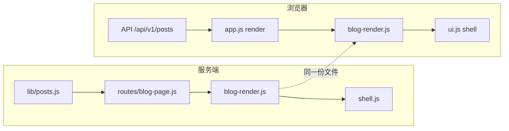
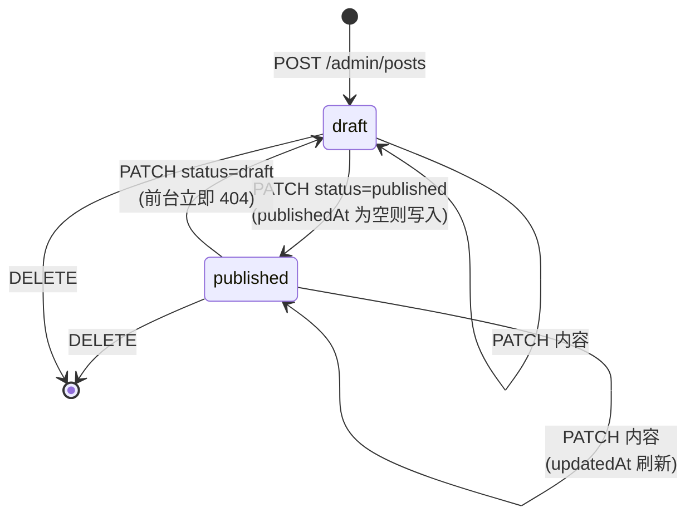

# 博客模块 · 系统设计说明书（SDS）

- **文档编号**：LG-BLOG-SDS-001
- **版本**：v1.0（待评审）
- **编写日期**：2026-11-15
- **上游文档**：`01-产品需求/博客模块-FRS-v1.1.md`（42 条需求，已定稿）
- **前置决策**：**Q-01 选 B** —— 只给博客开真路径 `/journal` 与 `/journal/<slug>`，其余站点继续用 hash 路由
- **本轮范围**：🔴 30 条 + 🟡 中 FR-B-028（顶栏入口，不做等于文章没人找得到）
- **文档状态**：🟡 待评审。评审通过后按第 17 节排期编码

---

## 0 决策摘要（先看这一页）

| # | 决策点 | 结论 | 为什么 |
|---|---|---|---|
| D-1 | 路由形态 | `/journal` 与 `/journal/<slug>` 走**服务端真路径**；站内其余仍是 hash | Q-01 已定 B。用最小改动拿到收录能力 |
| D-2 | 博客页与 SPA 的边界 | 博客是**独立的多页文档**：从博客点站内链接 = 整页导航；从 hash 页点 Journal = 整页导航 | 不引入 `history.pushState` 状态机。理由见 §6.3 |
| D-3 | 正文渲染器 | **一份代码两端跑**：`app/web/assets/js/blog-render.js` 用 UMD，服务端 `require`、前端 `<script>` 引入 | 两份渲染器必然漂移，且漂移后是"线上正文和服务端 HTML 不一致"这种最难查的 bug |
| D-4 | 页头页脚 | 从 `ui.js` 抽出 `shell.js`（UMD），服务端传静态数据渲染 | 不抽的话，`/journal/x` 首屏是无页头的裸文章，JS 补上页头时整页跳一下 |
| D-5 | 正文格式 | 块存储 + 块内**轻量标记**（`**粗**` / `*斜*` / `[文字](链接)`），不存 HTML、不上 Markdown | 先 `esc` 再解析标记 = 天然免疫 XSS；运营不需要学语法 |
| D-6 | 预渲染数据 | `window.__LG_SSR__` 只带 `{kind, slug, meta}`，正文和列表已写进 `#app` | 首屏不依赖任何 XHR；SEO 爬虫直接读到正文 |
| D-7 | 草稿可见性 | 公开接口一律只认 `published`，草稿访问返回 **404**（不说"草稿"） | 说"草稿"等于告诉外人"这里有一篇没写完的文章" |
| D-8 | 3 篇旧文 | 迁移为 **published** 文章，日期沿用原文标注 | 原来就在前台可见，迁移后设为草稿等于内容下线，是功能回退 |
| D-9 | 缓存 | 预渲染 HTML 走内存缓存 + `ETag` + `must-revalidate`，写操作后按 `postsRev` 失效 | 文章改动要立刻可见，不能靠 TTL 等 |

---

## 1 范围

### 1.1 本设计覆盖

数据模型、服务端真路径渲染、共享渲染器、8 个接口、后台分块编辑器、SEO 元信息注入、sitemap 改造、安全边界、迁移与测试。

### 1.2 本设计不覆盖（沿用 FRS §1.3 非目标）

评论、用户投稿、所见即所得编辑器、定时发布、多作者、相关推荐算法、RSS/AMP、编辑器内实时预览（FR-B-023 为 🟢，本期不做）。

### 1.3 与既有文档的关系

| 文档 | 变化 |
|---|---|
| FRD v2.9 §5.14 | 本期实现其中的 6 条博客需求；A-08 内容管理边界从"只能改标题导语"扩到"文章可增删改发" |
| SDD v2.6 §20.4 | 本节是该草案的定稿替代，草案作废 |
| API 接口文档 v1.3 | 编码完成后出 v1.4，新增 8 个操作（本文第 7 节已给出完整契约，可直接转写） |
| 编码完成度矩阵 v1.4 | 博客行从 ❌ 改为 ✅ |

---

## 2 总体架构

### 2.1 请求分域

```mermaid
flowchart TD
    A[浏览器请求] --> B{路径判断}
    B -->|"/" 或 "index.html"| C[hash SPA 入口<br/>服务端只注入资源版本号]
    B -->|"/journal"| D[博客列表预渲染]
    B -->|"/journal/:slug"| E[博客详情预渲染]
    B -->|"/sitemap.xml"| F[动态 sitemap<br/>含全部已发布文章]
    B -->|"/uploads/*"| G[图片静态服务]
    B -->|"/api/v1/*"| H[JSON 接口]
    B -->|其余未知路径| I[404 + index.html 内容]
    D --> J[渲染器 blog-render]
    E --> J
    J --> K[shell.js 出页头页脚]
    K --> L[HTML 响应<br/>head 含 title/description/canonical/og/JSON-LD]
```

### 2.2 两条渲染路径，一套模板



`blog-render.js` 与 `shell.js` 都是 UMD 模块：有 `module` 就走 `module.exports`，否则挂 `window`。服务端 `require('../web/assets/js/blog-render.js')` 直接拿到同一份函数。**零构建、零依赖、零重复实现**。

### 2.3 新增文件清单

| 文件 | 层 | 职责 | 约行数 |
|---|---|---|---|
| `app/server/lib/posts.js` | 服务端 | 读取/筛选/排序/分页、slug 生成与唯一性、状态迁移、`postsRev` 递增 | 160 |
| `app/server/routes/blog-page.js` | 服务端 | `/journal`、`/journal/:slug` 的真路径渲染、meta 注入、404、缓存与 ETag | 180 |
| `app/server/routes/posts.js` | 服务端 | 2 个公开接口 + 6 个后台接口 | 210 |
| `app/server/lib/posts-default.js` | 服务端 | 3 篇旧文的种子数据（迁移用） | 90 |
| `app/web/assets/js/blog-render.js` | 共享 | 块渲染器、行内标记解析、文章与卡片模板、转义 | 220 |
| `app/web/assets/js/shell.js` | 共享 | 页头 / 页脚 / 外壳（从 ui.js 抽出，两端共用） | 140 |
| `app/web/assets/js/blog-admin.js` | 前端 | 后台文章列表与分块编辑器 | 380 |

改动文件：`app/server/index.js`（路由挂载 + sitemap + 预渲染缓存失效）、`app/server/lib/store.js`（`normalize` 补 `posts`）、`app/server/lib/auth.js`（新增权限位）、`app/web/assets/js/ui.js`（改调 shell.js、顶栏加 Journal）、`app/web/assets/js/admin.js`（菜单 + 路由 + 表单提交）、`app/web/assets/js/app.js`（SSR 接管）、`app/web/assets/js/pages.js`（journal 页改为重定向）、`app/web/index.html`（引入两个新脚本）。

---

## 3 数据模型

### 3.1 Post 实体

```js
{
  id: "P1a2b3c",                  // 'P' + base36 时间戳，与现有 id 惯例一致
  slug: "why-pvd-is-not-plating", // 唯一，一经发布不建议改
  title: "Why PVD is not plating",
  excerpt: "Plating sits on top. PVD bonds.",  // 列表摘要，≤ 200 字
  coverImage: "/uploads/k3n8x2ab.jpg",         // 可空
  coverAlt: "Gold necklace on wet stone",
  section: "materials",            // materials | studio | giving | care
  blocks: [ /* 见 3.3 */ ],
  status: "published",             // draft | published
  publishedAt: "2026-11-02T09:00:00.000Z",
  updatedAt: "2026-11-02T09:00:00.000Z",
  createdAt: "2026-11-02T08:40:00.000Z",
  seoTitle: "",                    // 空则回落 title
  seoDescription: "",              // 空则回落 excerpt
  cta: { label: "Shop the necklace", href: "/#/collections/necklaces" }, // 可空
  relatedProduct: "",              // 可空，商品 handle
  readMinutes: 2                   // 写入时算好，避免每次渲染都算
}
```

**为什么把 `readMinutes` 存下来**：正文长度只有写入时才需要重算，渲染时算一遍等于每次请求多一次全文字符遍历——列表 9 篇就是 9 次。存字段是零成本的。

### 3.2 存哪儿

落到 `db.posts`（`app/server/data/db.json`），与 `products` / `collections` 同级。

`store.js` 的 `normalize()` 增加：

```js
if (!Array.isArray(d.posts)) d.posts = JSON.parse(JSON.stringify(require('./posts-default')));
if (!d.meta) d.meta = {};
if (typeof d.meta.postsRev !== 'number') d.meta.postsRev = 1;
```

- 只在**缺失**时灌种子，不覆盖已有数据 —— 与现有 `pages` / `customRequests` 的迁移方式一致。
- `postsRev` 是预渲染缓存的版本号，任何写操作 `++`。

### 3.3 块结构（正文的唯一真相）

```js
{ type: 'p',      text: 'Plating sits on top of the metal and **flakes** off it.' }
{ type: 'h2',     text: 'What PVD actually is' }
{ type: 'h3',     text: 'The 0.3 micron question' }
{ type: 'quote',  text: 'The colour is not a coating. It is the surface.', cite: 'Studio notes' }
{ type: 'ul',     items: ['Pool', 'Sea', 'Shower'] }
{ type: 'image',  src: '/uploads/k3n8x2ab.jpg', alt: 'Tide glass on rock', caption: 'Hainan, March' }
{ type: 'hr' }
```

| 约束 | 规则 |
|---|---|
| `type` | 白名单 7 种，其余整块丢弃（不是报错，是静默跳过——历史数据脏了也不该 500） |
| `text` | ≤ 4000 字/块，超出截断并记审计 |
| `items` | `ul` 最多 20 项，每项 ≤ 400 字 |
| `src` | **必须以 `/uploads/` 开头**，否则整块丢弃 |
| `alt` | ≤ 200 字，可空（前台渲染 `alt=""`） |
| 块数 | 每篇 ≤ 120 块 |

### 3.4 行内标记（唯一允许的"格式语法"）

| 写法 | 输出 | 说明 |
|---|---|---|
| `**bold**` | `<strong>` | 不支持嵌套 |
| `*italic*` | `<em>` | 不支持嵌套 |
| `[text](url)` | `<a href>` | `url` 必须匹配 `^(https?://\|/upload$\|/...)`，否则降级为纯文本 |

解析顺序是硬约束：**先 `esc()` 整段，再替换标记**。反过来就是把 XSS 入口焊死在 CMS 里。替换时用带捕获组的正则，且捕获到的 URL 再过一次协议白名单。

```js
function inline(raw) {
  var s = esc(raw);                                  // 第一步永远是转义
  s = s.replace(/\*\*([^*]{1,200})\*\*/g, '<strong>$1</strong>');
  s = s.replace(/(^|[^*])\*([^*]{1,200})\*(?!\*)/g, '$1<em>$2</em>');
  s = s.replace(/\[([^\]]{1,120})\]\(([^)\s]{1,300})\)/g, function (m, t, u) {
    return safeUrl(u) ? '<a href="' + u + '" rel="noopener">' + t + '</a>' : t;
  });
  return s;
}
function safeUrl(u) {
  return /^https?:\/\//i.test(u) || /^\/(?![\/\\])/.test(u);
}
```

`safeUrl` 的第二条分支排除了 `//evil.com`（协议相对 URL）和 `/\evil.com`（浏览器会当协议相对处理）。这两个是 `javascript:` 之外最常被漏掉的绕过方式。

---

## 4 共享渲染器 `blog-render.js`

### 4.1 接口

```js
BlogRender.blocks(list)                // → 正文 HTML
BlogRender.article(post, opts)         // → 文章主体 HTML（不含页头页脚）
BlogRender.card(post)                  // → 列表卡片 HTML
BlogRender.meta(post, origin)          // → { title, description, canonical, og:{}, jsonLd:{} }
```

`meta()` 两端共用是关键：**服务端写进 `<head>` 的那份 meta 和前端 `applySeo` 算出来的必须一模一样**，否则会出现"分享预览是一种描述、页面里是另一种"。

### 4.2 输出示例（详情页主体）

```html
<article class="post" data-slug="why-pvd-is-not-plating">
  <div class="wrap post__head">
    <div class="eyebrow">Materials</div>
    <h1 class="post__title">Why PVD is not plating</h1>
    <div class="post__meta">2 November 2026 · 2 min read</div>
  </div>
  <figure class="post__cover"></figure>
  <div class="wrap"><div class="prose post__body">
    <p>Plating sits on top of the metal and <strong>flakes</strong> off it.</p>
    ...
  </div></div>
  <div class="wrap post__cta">
    <a class="btn" href="/#/collections/necklaces">Shop the necklace</a>
  </div>
  <nav class="wrap post__pager">…上一篇 / 下一篇…</nav>
</article>
```

### 4.3 列表卡片

复用现有 `.pcard` 的视觉语言但独立类名 `.jcard`（避免和商品卡样式互相牵连）：

```html
<a class="jcard" href="/journal/why-pvd-is-not-plating">
  <div class="jcard__img"></div>
  <div class="jcard__body">
    <div class="eyebrow">Materials</div>
    <h2 class="jcard__title">Why PVD is not plating</h2>
    <p class="jcard__ex">Plating sits on top. PVD bonds.</p>
    <div class="jcard__date">2 November 2026</div>
  </div>
</a>
```

`width`/`height` 必带：没有尺寸的 `` 会在加载时把整页往下推，CLS 直接崩。`loading="lazy"` 只给第 2 张之后的（首图 lazy 会拖慢 LCP）。

---

## 5 服务端真路径渲染

### 5.1 路由挂载

`app/server/index.js` 在 `serveStatic` **之前**插入：

```js
if (pathname === '/journal' || pathname.indexOf('/journal/') === 0) {
  return blogPage.handle(req, res, pathname, siteOrigin(req));
}
```

顺序很关键：必须早于 SPA 兜底，否则 `/journal/x` 会落进 404 分支（内容给 index.html、状态码 404）。

### 5.2 路径规则

| 请求 | 行为 |
|---|---|
| `/journal` | 200，列表第 1 页（9 篇） |
| `/journal?section=materials` | 200，筛选列表；`canonical` 指 `/journal`，加 `noindex,follow` |
| `/journal?page=2` | 200，第 2 页；`canonical` 指自身 |
| `/journal/<slug>` | 200，详情 |
| `/journal/<slug>/` | 301 → `/journal/<slug>` |
| `/journal/<不存在>` | **404** + 404 页面 HTML（不是 index.html 兜底） |
| `/journal/<草稿 slug>` | **404**，与不存在完全同形 |
| `/journal/<slug>?utm=...` | 200，`canonical` 去掉查询参数 |

尾部斜杠必须 301 而不是都返回 200：否则 `a` 和 `a/` 是两个 URL，内容相同 → 重复内容。

### 5.3 HTML 组装

沿用 `renderIndex` 的资源版本号逻辑（`?v=<mtime>`），但把 `<head>` 换成按文章生成的版本：

```js
function renderPost(post, origin, assets) {
  var meta = BlogRender.meta(post, origin);
  return {
    html:
      '<!DOCTYPE html><html lang="en"><head>' +
      '<meta charset="utf-8">' +
      '<meta name="viewport" content="width=device-width,initial-scale=1">' +
      '<title>' + esc(meta.title) + '</title>' +
      '<meta name="description" content="' + esc(meta.description) + '">' +
      '<link rel="canonical" href="' + esc(meta.canonical) + '">' +
      ogTags(meta) +
      '<script type="application/ld+json">' + JSON.stringify(meta.jsonLd) + '</script>' +
      assets.css +
      '</head><body>' +
      '<div id="app" data-ssr="post" data-slug="' + esc(post.slug) + '">' +
        Shell.header({ static: true, route: { seg: ['journal'] } }) +
        '<main id="main">' + BlogRender.article(post, { origin: origin }) + '</main>' +
        Shell.footer({ static: true }) +
      '</div>' +
      ssrBoot({ kind: 'post', slug: post.slug, meta: meta }) +
      assets.js +
      '</body></html>',
  };
}
```

`assets.css` / `assets.js` 复用现有 `renderIndex` 里那段 `?v=<mtime>` 替换逻辑 —— 抽成 `assetsBlock()` 函数两边共用，避免第二份实现。

### 5.4 `__LG_SSR__` 的内容

```html
<script>window.__LG_SSR__={"kind":"post","slug":"why-pvd-is-not-plating","meta":{...}};</script>
```

**不带正文**。正文已经在 `#app` 里，前端接管时直接从 DOM 取 `main#main` 的 `innerHTML`，不重新渲染。这样：
- 首屏零 XHR、零重排；
- 不会出现"服务端一版、前端又一版"的正文差异。

必须放在 `</body>` 之前、`app.js` 之前；且用 `JSON.stringify` 输出后要防 `</script>` 注入（`JSON.stringify(...).replace(/</g,'\\u003c')`）。

### 5.5 缓存与失效

```js
var cache = { rev: -1, pages: Object.create(null) };

function get(slug) {
  var db = store.get();
  if (cache.rev !== db.meta.postsRev) { cache = { rev: db.meta.postsRev, pages: Object.create(null) }; }
  if (slug in cache.pages) return cache.pages[slug];
  return (cache.pages[slug] = build(slug));
}
```

响应头：

```
Cache-Control: public, max-age=0, must-revalidate
ETag: W/"<postsRev>-<slug>-<updatedAt 的毫秒>"
```

- `max-age=0` + ETag：浏览器每次条件请求，命中就 304（几百字节），比传整页 HTML 省得多。
- 不用 `max-age=600`：运营刚点发布、刷新还是旧页面，第一反应是"你的系统坏了"。
- 服务端侧 `postsRev` 一变整张表作废 —— 比按 slug 精细失效简单，且文章总量在千级以内，重建成本可忽略。

### 5.6 与 gzip

复用现有 `acceptsGzip()`：预渲染 HTML 一般 15–40 KB，gzip 后 5–9 KB。压缩结果一并缓存（`{ html, gz }`），不要在每次请求时现压。

---

## 6 前端接管

### 6.1 启动流程

```js
// app.js 顶部
var SSR = window.__LG_SSR__ || null;

function boot() {
  if (SSR && SSR.kind === 'post') return hydratePost();
  if (SSR && SSR.kind === 'journal') return hydrateList();
  /* 原逻辑 */
  window.addEventListener('hashchange', render);
  render();
}
```

```js
function hydratePost() {
  var main = document.querySelector('#app main#main');
  if (!main) return render();                 // 兜底：SSR 结构异常就退回常规渲染
  Root.setInnerHTML(main.innerHTML);          // 只替换 <main>，页头页脚已经在 DOM 里
  S.state.boot = S.state.boot || null;
  applySeoFromSSR(SSR.meta);                  // 用同一份 meta 补齐前端 head
  bindCommon();                               // 购物车抽屉、搜索层、移动菜单、cookie 条
}
```

`bindCommon()` 是把现在 `render()` 末尾那堆"渲染完要挂的事件"抽出来复用（今天它们和 `root.innerHTML = html` 写在一起）。抽出来后 hash 渲染与 SSR 接管走同一条绑定路径，不会出现"SSR 页面点了没反应"。

### 6.2 站内链接策略（这条最容易踩坑）

博客页里的**所有**站内链接必须是**前导斜杠的绝对路径**：

| 位置 | 正确 | 错误（相对/裸 hash） |
|---|---|---|
| 顶栏集合 | `/#/collections/necklaces` | `#/collections/necklaces` |
| 页脚 | `/#/pages/shipping` | `#/pages/shipping` |
| 文章本身 | `/journal/<slug>` | `#/journal/<slug>` |

原因：当前 URL 是 `/journal/x`。裸 `#/collections/y` 会变成 `/journal/x#/collections/y` —— 同文档内 hash 变化，浏览器不重新加载，SPA 会当路由处理并渲染商品页，但地址栏停在 `/journal/x#/...`，**一刷新就回到文章**。这是最难查的一类 bug（用户只会说"点进去不对"）。

带上 `/` 之后：pathname 从 `/journal/x` 变 `/`，浏览器整页导航，行为完全正确。

改动点：`shell.js` 里的所有 `href` 改成 `/` 开头；`blog-render.js` 里的链接同样。hash 页面用这些链接也没问题（`href="/#/products/x"` 在 `/#/` 页面点击 = 同文档 hash 变化，行为不变）。

### 6.3 为什么不做 pushState 拦截

可选方案是"点文章链接时 `pushState` + 局部渲染"，体验更顺（无刷新）。不做，理由：

1. 博客是低频导航路径。一篇文章读 2 分钟，省掉一次 200ms 的整页加载没有感知。
2. 预渲染 HTML 本身就是内容，整页导航**不会有白屏**——浏览器在等 HTML 时，上一页还停在屏幕上。
3. `pushState` 要配套 `popstate` 回退、滚动位置恢复、`hashchange` 与 `popstate` 互相干扰的判定。这三块是 SPA 路由 bug 的三大来源，而收益只有"少一次加载"。

**取舍写在明处**：宁可慢 200ms，不要多一套状态机。

### 6.4 旧地址兼容

`#/pages/journal` 在 `app.js` 的 `case 'pages'` 里拦一层：

```js
if (seg[1] === 'journal') { location.replace('/journal'); return; }
```

用 `replace` 不用 `assign`：不往历史里压一条"进过 journal 的 hash"，否则用户点返回会回到一个立刻又跳走的地址，形成返回死循环。

---

## 7 接口设计

统一沿用现有约定：`ok(res, data, status)` 包 `{ data }`，错误 `{ error: { code, message } }`，列表带 `meta`。

### 7.1 公开（无需鉴权）

#### `GET /api/v1/posts`

| 参数 | 默认 | 说明 |
|---|---|---|
| `section` | — | 按栏目筛选，未知值返回空列表（不报错） |
| `page` | 1 | 从 1 起 |
| `limit` | 9 | 上限 24 |

```json
{
  "data": [ { "slug": "…", "title": "…", "excerpt": "…", "section": "materials",
              "coverImage": "/uploads/…", "coverAlt": "…",
              "publishedAt": "2026-11-02T09:00:00.000Z", "readMinutes": 2 } ],
  "meta": { "page": 1, "limit": 9, "total": 12, "hasMore": true, "sections": [ … ] }
}
```

只返 `published`，按 `publishedAt` 倒序。**不返 `blocks`**——列表不需要正文，一篇 30 KB 的正文乘 9 就是 270 KB。

#### `GET /api/v1/posts/:slug`

```json
{
  "data": {
    "slug": "…", "title": "…", "excerpt": "…", "section": "materials",
    "coverImage": "…", "coverAlt": "…", "publishedAt": "…", "updatedAt": "…",
    "readMinutes": 2, "blocks": [ … ], "cta": { … },
    "prev": { "slug": "…", "title": "…" },
    "next": { "slug": "…", "title": "…" }
  }
}
```

不存在或草稿：`404 { code: "POST_NOT_FOUND", message: "Article not found." }` —— 两种情况文案完全一致。

### 7.2 后台（`posts:write` 权限位）

| 方法 | 路径 | 说明 |
|---|---|---|
| GET | `/api/v1/admin/posts?status=&page=&limit=` | 含草稿，返回 `blocks` 摘要（不计正文以控体积） |
| GET | `/api/v1/admin/posts/:id` | 编辑用全量，含 `blocks` |
| POST | `/api/v1/admin/posts` | 新建，默认 `draft`；slug 冲突 → 409 `SLUG_TAKEN` |
| PATCH | `/api/v1/admin/posts/:id` | 局部更新；`status` 切到 `published` 且 `publishedAt` 为空时写当前时间 |
| DELETE | `/api/v1/admin/posts/:id` | 物理删除（文章量小，不做软删） |

请求体（PATCH，字段全部可选）：

```json
{
  "title": "…", "slug": "…", "excerpt": "…", "section": "materials",
  "coverImage": "/uploads/…", "coverAlt": "…",
  "blocks": [ … ], "seoTitle": "…", "seoDescription": "…",
  "cta": { "label": "…", "href": "/#/collections/necklaces" },
  "status": "published"
}
```

服务端校验（任一不过 → 400，返回 `{ field, message }`）：

| 字段 | 规则 |
|---|---|
| `title` | 1–90 字，必填 |
| `slug` | `^[a-z0-9]+(-[a-z0-9]+)*$`，3–80 字符；空则从 title 生成 |
| `excerpt` | 0–200 字 |
| `seoDescription` | 0–158 字（超出会被搜索引擎截断，限制比 excerpt 严） |
| `section` | 必须在 `settings.postSections` 内 |
| `blocks` | 见 §3.3 约束；非法块静默丢弃，但整体清空会拒绝（防"手抖全丢"） |
| `status` | `draft` \| `published` |

所有写操作后：`db.meta.postsRev++`，`store.flush()`，`audit(me, 'post.update', id, { before, after })`。

`audit()` 里 `before/after` 只存 `{ title, status, slug }` —— 存整个 `blocks` 会让审计日志变成第二份数据库。

### 7.3 接口规模变化

现有 58 路径 / 67 操作 → **66 路径 / 75 操作**（新增 8 个）。

---

## 8 后台编辑器

### 8.1 导航

`admin.js` 的 `NAV` 里 `System` 组加一项，放在 `Content` 之后：

```js
{ g: 'System', items: [['content', 'Content'], ['articles', 'Articles'], ['ledger', …], …] }
```

`Articles` 管文章，`Content` 继续管页面导语与首页文案 —— 与 FRS FR-B-016 一致。

### 8.2 列表页

列：Title / Slug / Section / Status / Published / Updated / ⋯
筛选：All / Published / Draft（`?status=`，服务端筛，不在前端筛）
操作：Edit、View（新标签打开真 URL）、Delete（二次确认输入标题）

### 8.3 编辑页（分块）

```
┌─ Article ─────────────────────────────── [Save draft] [Publish] ─┐
│ Title    [___________________________________________]           │
│ Slug     [/journal/][___________________]  ○ auto from title     │
│ Excerpt  [___________________________________________] 2/200     │
│ Section  [Materials ▾]     Read time 2 min · 412 words           │
│ Cover    [ Choose image ] [preview 4:3]   Alt: [__________]       │
├─ Body ───────────────────────────────────────────────────────────┤
│ ┌ 1 ▾ Paragraph ............ [↑][↓][✕] ┐                          │
│ │ [textarea                                    ]                  │
│ │ ** B   * I   [ Link ]                          │                │
│ └────────────────────────────────────────────────┘ [ + Insert ]  │
│ ┌ 2 ▾ Image .............................. [↑][↓][✕] ┐            │
│ │ [ Choose image ]  Alt: [______]  Caption: [______] │            │
│ └────────────────────────────────────────────────────┘            │
├─ SEO ────────────────────────────────────────────────────────────┤
│ SEO title  [_______________________]  42/60                       │
│ SEO desc   [_______________________]  118/158                     │
│ CTA label  [__________]  CTA link [/#/collections/…]              │
└──────────────────────────────────────────────────────────────────┘
```

**块操作**：类型下拉（Paragraph / H2 / H3 / Quote / List / Image / Divider）、上移、下移、删除、在下方插入。
**格式按钮**：`**B**`、`*I*`、`[Link]` 是往 textarea 里插入标记，不是富文本工具栏 —— 与 D-5 一致，所见即标记。
**字数/阅读时长**：前端按 `blocks` 实时算（200 词/分钟），只作参考，保存时服务端重算覆盖。
**未保存提示**：`dirty` 标记 + `beforeunload`；保存成功后清除。表单提交用 `fetch` 而非 `<form>` 默认提交，否则 `beforeunload` 与提交互相打架。

### 8.4 状态机



---

## 9 SEO

### 9.1 meta 映射（`BlogRender.meta()` 唯一实现）

| 目标 | 来源 | 规则 |
|---|---|---|
| `<title>` | `seoTitle` \|\| `title` | 加 ` — LASTGROVE` 后缀；总长 > 60 字时截断标题而非后缀 |
| `description` | `seoDescription` \|\| `excerpt` | 硬截 158 字 |
| `canonical` | `origin + /journal/<slug>` | 列表页：`origin + /journal` |
| `og:type` | 固定 `article` | 列表页 `website` |
| `og:title` / `og:description` | 同 title / description | — |
| `og:image` | `origin + coverImage` | 无封面用站点默认图；补 `og:image:width/height` |
| `og:url` | canonical | — |
| `twitter:card` | `summary_large_image`（有封面）\| `summary` | — |
| `article:published_time` | `publishedAt` | ISO 8601 |
| `robots` | 草稿/筛选页 `noindex,follow`；正常页不输出 | — |

### 9.2 JSON-LD（`BlogPosting`）

```json
{
  "@context": "https://schema.org",
  "@type": "BlogPosting",
  "headline": "Why PVD is not plating",
  "description": "…",
  "image": ["https://lastgrove.com/uploads/….jpg"],
  "datePublished": "2026-11-02T09:00:00.000Z",
  "dateModified": "2026-11-02T09:00:00.000Z",
  "author": { "@type": "Organization", "name": "LASTGROVE" },
  "publisher": { "@type": "Organization", "name": "LASTGROVE",
                 "logo": { "@type": "ImageObject", "url": "https://lastgrove.com/assets/logo.png" } },
  "mainEntityOfPage": { "@type": "WebPage", "@id": "https://lastgrove.com/journal/why-pvd-is-not-plating" }
}
```

列表页输出 `Blog` + `ItemList`（FR-B-039，🟡，一并做，成本 15 行）。

### 9.3 sitemap 改造

```js
urls.push({ loc: origin + '/journal', pr: '0.7', freq: 'weekly' });
for (const p of db.posts.filter(x => x.status === 'published')) {
  urls.push({ loc: origin + '/journal/' + p.slug, pr: '0.6',
              freq: 'monthly', lastmod: p.updatedAt.slice(0, 10) });
}
```

同时把 `#/pages/journal` 从 `pages` 循环里排除（它现在是重定向壳，不该出现在 sitemap）。

`lastmod` 现在整份 sitemap 都没有输出，本次一并补上（`<lastmod>2026-11-15</lastmod>`）——Google 靠它判断要不要重抓。

### 9.4 robots

`Allow: /` 已覆盖 `/journal`，无需改动。**注意不要**写 `Disallow: /journal/*`（草稿已经由 404 兜住，robots 拦不住草稿泄漏，只会浪费抓取预算）。

### 9.5 顺带发现的既有缺陷（不属本模块，建议一并修）

sitemap 目前输出的是 `origin + '/#/collections/<handle>'` 与 `origin + '/#/products/<handle>'`。**`#` 之后的内容不会被当作 URL 的一部分**，这些条目在爬虫眼里全部等于 `origin + '/'` —— 等于告诉 Google "本站有 80 个相同的首页"。

处理建议：本期先把博客的真路径条目加进去（这部分是对的），商品与集合条目改成**只保留 `/`**，等哪天商品页按同一套路迁移再逐个加回来。留着错误的 80 条比只有 1 条更有害。

---

## 10 安全

| 风险 | 处置 |
|---|---|
| 存储型 XSS（正文） | 块白名单 + 先 `esc` 后解析标记；**永不** `innerHTML = raw` |
| 存储型 XSS（标题/slug/摘要/alt/caption/SEO） | 全部 `esc`，且写入时按字段长度截断 |
| `javascript:` 链接 | `safeUrl()` 协议白名单；不匹配则降级纯文本 |
| 协议相对 URL 绕过（`//evil.com`、`/\evil.com`） | 同上，正则显式排除 |
| 图片 src 外链 | 必须以 `/uploads/` 开头，否则整块丢弃 |
| 草稿泄漏 | 公开接口硬过滤 `status === 'published'`；草稿详情返回 404 |
| 预览 token（FR-B-023 🟢 不做） | 本期不做，故无 token 面 |
| 后台越权 | `posts:write` 权限位；`auth.requireAuth` + `requirePerm` 前置 |
| 图片上传 | 复用现有 `uploads.js`：文件头嗅探、5 MB 上限，SVG 不接受 |
| 内容投毒（超长正文） | 块数 ≤ 120、单块 ≤ 4000 字，超出截断 + 审计 |
| CSP | 不新增任何白名单域名；JSON-LD 用 `<script type="application/ld+json">`，不需要放宽 `script-src` |

**验收必须逐条打靶**（AC-5）：在 title / excerpt / alt / caption / 正文 / SEO description 六个入口分别输入
``、`<script>alert(1)</script>`、`[x](javascript:alert(1))`、`[x](//evil.com)`，前台只能是文本或不带链接的文本。

---

## 11 性能

| 指标 | 目标 | 手段 |
|---|---|---|
| 详情页 HTML 体积 | ≤ 45 KB（未压缩） | 正文不重复进 `__LG_SSR__`；预渲染一次性 |
| gzip 后 | ≤ 10 KB | 复用现有 gzip + 缓存压缩结果 |
| 首屏请求数 | 预渲染页 **0 个 XHR**，1 个 HTML + 3 个静态资源 | 正文与列表已在 HTML 里 |
| LCP | 不劣于集合页 × 1.2 | 封面图加 `width/height`、非首屏图 `loading=lazy`、`fetchpriority="high"` 给封面 |
| 首图 | 建议 1600×1200、≤ 250 KB | 上传时前端已有压缩；后台提示封面建议尺寸 |
| 缓存 | 命中 304 时 < 1 KB | ETag + `must-revalidate` |
| 服务端渲染耗时 | < 5 ms | 内存缓存；`readMinutes` 预存，不在渲染时重算 |

---

## 12 可访问性

| 项 | 要求 |
|---|---|
| 标题层级 | 页面唯一 `h1`（文章标题），正文块从 `h2` 起，不跳级 |
| 焦点 | 封面图无 tabindex；卡片整体可点则用 `<a>` 包整块（已有 `.pcard` 先例） |
| 图片 | `alt` 必填字段在后台可见标注；缺失时前台 `alt=""` 而非省略属性 |
| 对比度 | 正文用 `var(--ink)`，≥ 4.5:1；`.jcard__date` 用 `var(--muted)` 需实测，若不足改深一档 |
| 移动端 | 390px 无横向滚动；卡片单列 |
| 键盘 | 分块编辑器的上移/下移/删除全部是真 `<button>`，可 Tab 可达 |

---

## 13 与现有系统的集成点

| 集成对象 | 接入方式 | 注意事项 |
|---|---|---|
| `store.tx()` | 写操作包在事务里 | 与订单一致，中途抛错不能留半写数据 |
| `auth` | 新增权限位 `posts:write`，加入 `ALL_PERMISSIONS`；`owner` / `ops` 默认有，`support` 无 | 只加权限位，不动 `requirePerm` 逻辑 |
| `audit()` | `post.create` / `post.update` / `post.delete` | `meta` 只存 `{title, slug, status}` |
| `uploads.js` | 复用现有 `/api/v1/admin/uploads` | 文章封面与正文图共用；每篇上限 20 张（复用 `MAX_PER_PRODUCT` 的另一种上限常量） |
| `settings.content` | 列表页介绍文案仍读 `pages.journal.intro`（FR-B-029 🟢） | 不改数据位置，避免两套来源 |
| `notify` / `mailer` | **不涉及** | 本期不发任何邮件 |
| `tracking` | 不涉及 | — |

---

## 14 数据迁移

3 篇旧文按 FRS FR-B-041 转为真实文章：

| slug | title | section | publishedAt | 来源 |
|---|---|---|---|---|
| `why-pvd-is-not-plating` | Why PVD is not plating | materials | 2026-11-02 | `pages.js` 第一段 |
| `reading-a-tide-glass` | Reading a tide glass | studio | 2026-10-18 | 第二段 |
| `where-the-1-percent-went` | Where the 1% went | giving | 2026-09-30 | 第三段 |

正文一律拆成块（`h2` + `p` 形态），不追求排版还原 —— 原文本来就只有两段。**封面暂空**（没有素材），列表页无图时用纯文字卡（`.jcard--ni`，两列栅格，同订单行 `--ni` 的处理思路）。

迁移时机：`normalize()` 首次补 `posts` 时灌入。线上容器重建即生效，无需手工执行脚本。

> **上线影响要提前说**：`/journal` 一上线就有 3 篇公开文章。这是"保持现状"的正确选择（现在前台本来就可见），但如果这批文案要先审一遍，就在上线前把它们改成 `draft`。

---

## 15 测试方案

| 组 | 条数 | 覆盖 |
|---|---|---|
| 渲染器单测 | 12 | 7 种块、3 种行内标记、非法块丢弃、超长截断、`alt` 缺失 |
| 安全 | 10 | 6 个入口 × 4 种 payload；`javascript:` / `//evil` / `/\evil` |
| 状态与可见性 | 6 | 草稿 404、发布即可见、下架即消失、sitemap 同步、slug 冲突 409 |
| SEO | 6 | `view-source` 断言 title/description/canonical/og/JSON-LD；筛选页 `noindex`；尾斜杠 301 |
| 后台 | 4 | 新建→保存→发布；未保存离开提示；块上移下移删除；删除二次确认 |
| 集成 | 4 | 真浏览器走通"列表 → 详情 → 点商品链接到 hash 页"；390px 无溢出 |

合计 **42 条**。全部进 `tools/api-test-blog.js` + `tools/e2e-blog.js`，与现有 121 + 37 例并存。

**必须真浏览器验的两条**（本地 curl 验不出来）：
1. 从 `/journal/x` 点顶栏集合链接 → 落到 `/#/collections/y` 且刷新后仍在商品页（验 §6.2 的链接策略）
2. `view-source:` 里能看到文章标题（验真预渲染，不是 JS 写入）

---

## 16 风险与取舍

| 风险 | 影响 | 处置 |
|---|---|---|
| 抽 `shell.js` 改动现有页头页脚 | 全站视觉回归 | 抽完先跑 `accept-ui` 78 条；`shell.js` 输出与旧 `ui.js` 做逐字符 diff（临时脚本，一次性） |
| 两份渲染器漂移 | 服务端与前端正文不一致 | 用 UMD 单文件从结构上消除；`meta()` 也放同一文件 |
| hash 与真路径共存导致链接错 | 最难查的一类 bug | §6.2 的绝对路径规则 + 两条真浏览器用例；代码审查时全局搜 `href="#/` 是否只剩 hash 页面的入口 |
| 整页导航被当成 bug 报上来 | 体验预期不一致 | 本文 §6.3 写明取舍；上线说明里明说"博客是独立页面，点击会整页跳转" |
| 3 篇旧文直接公开 | 内容未经复审 | §14 已提示；上线前可改 `draft` |
| 预渲染缓存与写操作竞态 | 发布后仍见旧页 | 写操作在同一进程内 `postsRev++`，缓存按版本整体作废；单进程无跨实例问题 |
| 图片缺失导致卡片塌陷 | 列表视觉破碎 | `.jcard--ni` 无图形态；`width/height` 必填 |

---

## 17 排期与交付物

| 阶段 | 内容 | 产出 | 估时 |
|---|---|---|---|
| 1 | 抽 `shell.js` + 全站回归 | 页头页脚零变化（78 条 UI 用例全绿） | 0.5 天 |
| 2 | 数据层 + 渲染器 + 种子迁移 | `posts.js` / `blog-render.js` / 单测 12 条 | 0.8 天 |
| 3 | 真路径渲染 + meta + sitemap | `/journal` 与详情可被 `view-source` 验 | 0.8 天 |
| 4 | 接口 8 个 + 权限位 + 审计 | `tools/api-test-blog.js` 30 条 | 0.6 天 |
| 5 | 后台列表 + 分块编辑器 | `blog-admin.js`，4 条交互用例 | 1 天 |
| 6 | 前端接管 + 顶栏入口 + 旧地址重定向 | 真浏览器集成 4 条 | 0.5 天 |
| 7 | 全量回归 + 文档回填 | 测试报告 v1.6、API v1.4、矩阵 v1.5、FRD 状态行 | 0.4 天 |
| **合计** | | | **约 4.6 个工作日** |

比 FRS §10 的 3.5 天多 1.1 天，多出来的部分是 **shell 抽取（0.5）** 与 **回归+文档（0.6）**。前者是 D-4 的代价，后者原来漏估了。

---

## 18 待确认（SDS 级，3 条）

| # | 问题 | 我的建议 | 不定会怎样 |
|---|---|---|---|
| S-1 | 栏目的最终取值？ | `materials` / `studio` / `giving` / `care` 四个，存 `settings.postSections` 可在后台增删 | 先用这 4 个，不影响编码 |
| S-2 | 3 篇旧文上线时是否直接公开？ | 直接公开（保持现状） | 若要先审，改成 `draft`，列表会空 |
| S-3 | 是否接受"博客页点击 = 整页跳转"？ | 接受（§6.3 的取舍） | 不接受就要加 pushState + popstate，+1.5 天且引入路由 bug 面 |

---

*—— 本文为设计评审稿。评审通过后按第 17 节编码；未通过前不改任何代码。——*
