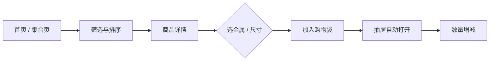
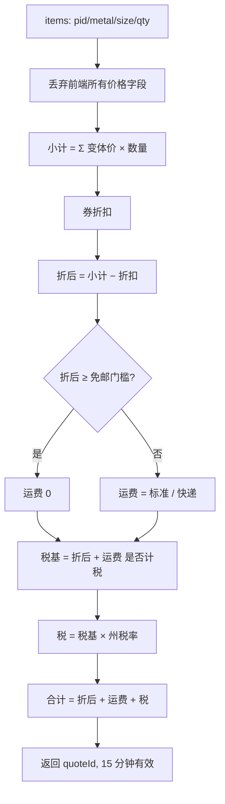
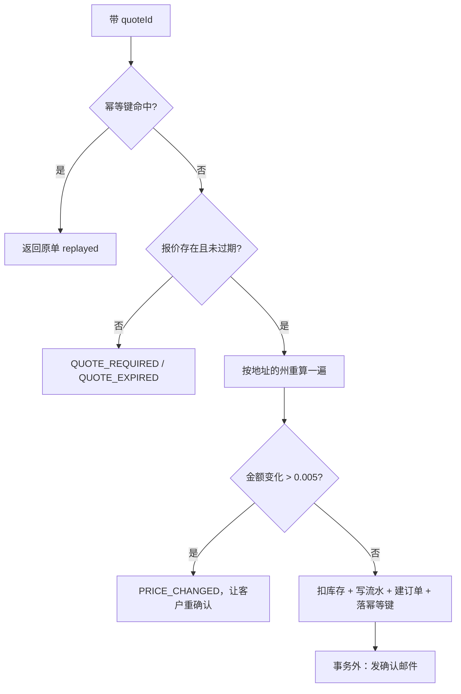
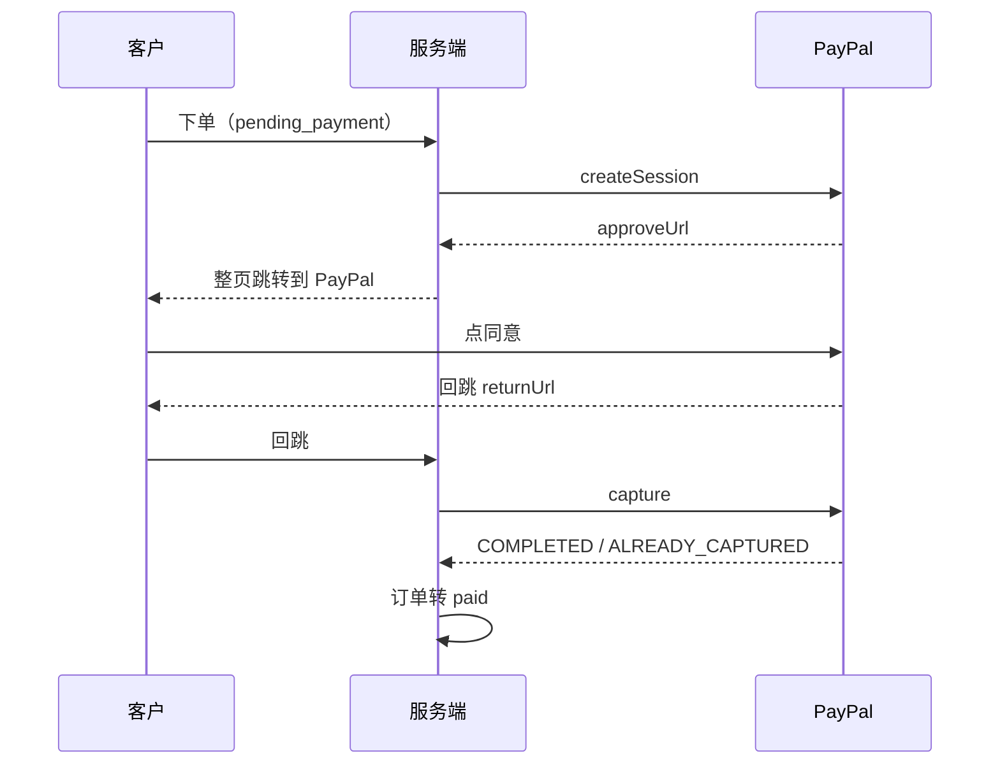
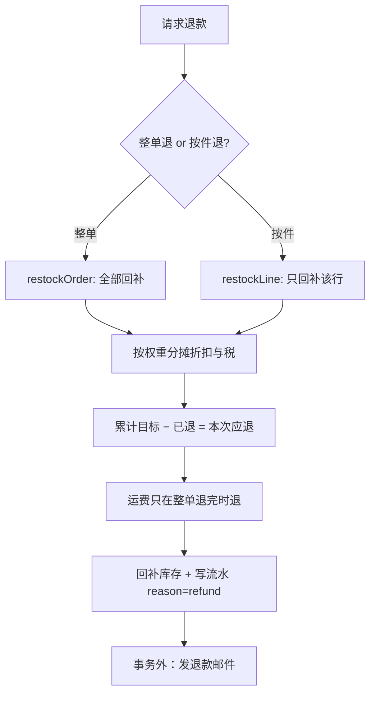

# LASTGROVE 测试方案 v2.0

| 项 | 内容 |
| --- | --- |
| 文档编号 | LG-TP-002（取代 TG-TP-001 v1.0） |
| 版本 | v2.0 |
| 编写日期 | 2026-11-16 |
| 依据 | FRD v2.10、SDD v2.7、API 接口文档 v1.6、测试报告 v1.8、运营体检评估 v1.0 |
| 被测对象 | `app/server`（Node 原生服务端）+ `app/web`（无构建 SPA）+ `/journal` 真路径预渲染 |
| 现行资产 | 9 个脚本、**456 条断言**（7 个 HTTP/浏览器套件 407 条 + 2 个单元脚本 49 条）、25 个缺陷已关闭 |
| 审视方式 | 逐文件读代码 + 起服务实测（`ALLOW_TEST_RESET=1`，端口 4600） |
| 结论 | 主链路覆盖够用；「**有校验但从未被触发的分支**」上有 8 处空洞，其中 1 处是接口契约缺陷（测试与实现一起错） |

---

## 1 这份方案解决什么问题

### 1.1 与测试报告的分工

| 文档 | 回答 | 什么时候看 |
| --- | --- | --- |
| 测试报告 v1.8 | **跑了什么、结果如何、哪些缺陷关掉了** | 验收时、复盘时 |
| 测试方案 v2.0（本文） | **该跑什么、为什么是这些、跑到什么程度算够** | 每次改动前、每次加功能前 |

两者不能互相替代。报告越写越像流水账，是因为没有方案约束"该测什么"——只能把跑过的都记一遍。

### 1.2 三个要回答的问题

| # | 问题 | 判据 |
| --- | --- | --- |
| 1 | **账算得对不对** | 每一个金额都能从输入独立复算出来，且报价与订单、订单与退款三处口径一致 |
| 2 | **违规操作挡不挡得住** | 改价、超卖、越权、非法状态流转、伪造回调，逐个构造 |
| 3 | **改了 A 会不会坏 B** | 变更能映射到要跑的套件，且映射关系是"按数据/权限/金额"判断，不是"按我改了哪个文件" |

### 1.3 一条原则

**测试力度按失败后果分配，不按模块数量平均分配。**

一个 SKU 的封面图丑了，客户照买；退款少退一分钱，客户投诉、账对不上、还可能多退。两者的测试投入不该一样。本文第 3 节把这条原则落成了分级表。

---

## 2 被测系统的事实基线

规划测试前先接受这些事实，否则会写出跑不起来的用例。

| 项 | 事实 | 对测试的影响 |
| --- | --- | --- |
| 服务端 | 8,084 行 / 67 路径 / 81 操作 / 零第三方运行时依赖 | 不需要 mock 库，直接用 `fetch` 打真实服务 |
| 前端 | 6,532 行 / 无构建步骤 / IIFE 挂 `window` | 改完刷新即生效，**没有编译期检查兜底**，只能靠浏览器套件 |
| 存储 | 单文件 `db.json`（约 293 KB）/ 19 张表 / 单写入进程 | 测试必须能**复位到基线**，否则只能跑一次 |
| 支付 | 四通道代码齐备，**交付版默认 `mock`** | 真实扣款不可测；`mock` 会把单标成已付 |
| 邮件 | `MAIL_DRY_RUN` 模式，信打进日志不发 | 只能验"触发时机"，不能验"送达" |
| 物流 | 17TRACK 未配置 | 只能验"单号存得下、降级文案对"，不能验轨迹 |
| 博客 | `/journal` 服务端预渲染，`meta.postsRev` 整表失效 | 只能验"HTML 里有正文"，不能验"Google 收录了" |
| 浏览器 | 只验 Chromium 内核（headless Edge + CDP） | Safari / Firefox 未验 |

**一处需要先说明的事实**：当前订单号前缀是 `#TG`（`checkout.js:22` 返回 `'#TG' + n`），数据里是 `#TG1041` 这样的值，而品牌是 LASTGROVE。功能无影响（客户看到的是订单号本身），但旧品牌残留会出现在邮件主题、查单页、发票上。**改不改需要拍板**——改动会让现有 90 单与新单前缀不一致，所以本文只记录，不动。

---

## 3 风险分级：先决定哪里值得测

按「失败后果 × 暴露频率」分成四级。分级决定用例密度与自动化层次。

| 级别 | 定义 | 涉及 | 用例密度 | 层次 |
| --- | --- | --- | --- | --- |
| 🔴 **一级** | 错了直接**亏钱、丢数据、法律风险** | 定价、折扣、税、退款分摊、库存扣减、幂等下单、支付回调验签、权限越权、客户名单导出 | 每条规则 ≥ 3 例（正常 / 边界 / 逆向） | 单元 + 接口，**必须有断言能独立复算** |
| 🟠 **二级** | 错了**客户看得见**，但不直接亏钱 | 下单流程、状态流转、邮件触发、物流降级、查单、博客渲染与链接 | 每流程 1 条 E2E + 接口边界 | 接口 + 浏览器 |
| 🟡 **三级** | 错了**内部麻烦**，客户无感 | 看板统计、导出、审计日志、库存流水展示、券列表 | 主路径覆盖即可 | 接口 |
| 🟢 **四级** | 好看 / 手感 | 动效、间距、图标风格 | 不自动化 | UI 评审 |

**为什么退款要放在一级的最前面**：退款是唯一"做错了要赔两次"的动作——多退要追回，少退要补发。而它的算法最复杂（按权重分摊 + 累计目标法）。历史上这一块出过缺陷（D-100 系列），代价是真实的钱。

---

## 4 分层策略

### 4.1 现行结构

```
┌──────────────────────────────────────────────────────┐
│ 浏览器层  161 条   accept-ui 82 / staff-ui 27         │  慢（每轮 3–6 分钟）、脆（渲染时序）
│                   blog-admin 23 / e2e-blog 29        │  只放"只有真浏览器能验"的
├──────────────────────────────────────────────────────┤
│ 接口层    246 条   api-test 147 / staff 53 / blog 46 │  中（每轮 30–60 秒）、稳（只依赖 HTTP 契约）
│                                                      │  主战场：金额、权限、状态、边界
├──────────────────────────────────────────────────────┤
│ 单元层     49 条   unit-core 38 / unit-tracking 11   │  快（<1 秒）、最稳（纯函数 + 桩）
│                                                      │  只覆盖已抽成纯函数的逻辑
└──────────────────────────────────────────────────────┘
        越往下越便宜、越稳 → 能往下压的逻辑就往下压
```

### 4.2 一个必须承认的结构问题

单元测试只有 49 条，不是因为逻辑简单，是因为**能脱离 HTTP 调用的纯函数不够多**。

| 逻辑 | 在哪 | 能否单测 | 后果 |
| --- | --- | --- | --- |
| `quote()` 定价全链路 | `lib/pricing.js` | ✅ 能 | — |
| `assertStock()` 库存判定 | `lib/pricing.js` | ✅ 能 | 但**接口层断言写错了**，见 §7.1 |
| `taxFor()` 税额 | `lib/pricing.js` | ✅ 能 | — |
| 退款分摊 `splitByWeight` | `routes/checkout.js` | ⚠️ 抽得不彻底，夹在路由里 | 只能用接口测，覆盖组合受限 |
| 券校验 `resolveCoupon` | `lib/pricing.js` | ✅ 能 | 但**从未单测过耗尽分支**，见 §7.3 |
| 状态机 `TRANSITIONS` | `routes/admin.js` 常量 | ⚠️ 常量可读，迁移执行在路由里 | 只能接口测 |

**结论**：退款分摊与状态机两块最贵的逻辑，恰好是最难单测的两块。这是下一轮重构的候选（把 `splitByWeight` 提到 `lib/refund.js`），但**不是现在的缺陷**——接口层已经覆盖了主要组合。

---

## 5 八条主业务流程

每条给出：流程、**关键判定点（不变量）**、现有覆盖、缺口。判定点是断言的设计依据——不变量破了就是缺陷，跟"页面看起来对不对"无关。

### F1 浏览 → 加购



| 不变量 | 现状 |
| --- | --- |
| 列表与详情**永不外泄成本价** `cost` | ✅ api-test 断言 |
| 筛选后条数 ≤ 筛选前 | ✅ accept-ui U2 |
| 加购数量 1–10，超 10 拒绝且文案说明"更大订单请联系我们" | ✅ api-test |
| 库存为 0 的变体**不可加购** | ⚠️ 真实数据里没有库存 0 的变体，被跳过了 |

### F2 报价（`POST /checkout/quote`）



| 不变量 | 现状 |
| --- | --- |
| 前端传的任何 `unitPrice` / `total` 一律丢弃 | ✅ api-test「前端伪造价格被忽略」 |
| **免邮看折后金额**，不看小计 | ✅ api-test「满 $95 免标准运费」 |
| 合计恒等式 `total = 折后 + 运费 + 税` | ✅ api-test「合计 = 小计 + 税」 |
| 每行数量 1–10 | ✅ api-test「超量数量被拒」 |
| **购物车最多 30 行** | ❌ **零覆盖**（实测行为正确，见 §7.4） |
| 库存不足时分「完全没货」与「只剩几件」 | ❌ **顶层码不区分**，见 §7.1 |
| 报价 15 分钟过期后下单必须拒绝 | ✅ api-test「报价用后失效」 |
| 报价的州与下单地址的州不一致时要求重报 | ✅ api-test |

### F3 下单（`POST /orders`）



| 不变量 | 现状 |
| --- | --- |
| 同幂等键重放**只产生一单**，且不重复扣库存 | ✅ api-test「同幂等键重放不再建单」 |
| 订单里的邮箱**归一为小写** | ✅ api-test |
| 赠品行单价为 0，且数量受 `maxPerOrder` 约束 | ✅ api-test |
| 下单后库存按数量扣减，且**有流水** | ✅ api-test + 对账断言 |
| 地址必填项逐字段报错（含嵌套 `address.*`） | ✅ api-test「逐字段列出错误」 |
| 只发美 / 加 / 英，其他国家拒绝 400 | ⚠️ **UI 层验了"下拉只有三国"，接口层未验"传 Germany 被拒"** |
| 库存不足时**不产生半成品订单** | ✅ unit-core「被拒绝时未产生订单」 |

### F4 支付（PayPal 两段式）



| 不变量 | 现状 |
| --- | --- |
| **买家点同意 ≠ 钱到账**，必须服务端 capture | ✅ 代码结构与 `checkout-pp-check.js` |
| `ORDER_ALREADY_CAPTURED` **当成功**处理 | ⚠️ 静态核实，未在沙盒实测 |
| `ORDER_NOT_APPROVED` **不标 cancelled**，留在 `pending_payment` | ⚠️ 同上 |
| webhook 验签用**原始字节**，缺头按失败返 400 | ✅ 代码核实 |
| `mock` 通道下订单直接标 paid | ✅ 全量回归都走这条路 |

**这一条最大的测试局限**：交付版默认 `mock`，所以「钱真的到了没有」这层从未被验过。PayPal 沙盒联调记录在 `checkout-pp-check.js` / `pp-live-order.js`，但它们需要真实凭证，不在 7 套件里。

### F5 履约与发货

| 不变量 | 现状 |
| --- | --- |
| 状态机只允许 6 条合法迁移，非法跳转 405/409 | ✅ api-test「paid 不能直接跳 completed」 |
| 填运单号后：状态转 Shipped + 订阅 17TRACK + 发邮件，三件事 | ⚠️ 接口层验了状态，邮件与订阅是 `setImmediate` 异步，断言只能验"调用了" |
| 17TRACK 额度用完**不能记到单号头上** | ✅ unit-tracking 桩测试 |
| 17TRACK 报 USPS 政策拦截时**降级为官网链接**，不报错 | ✅ unit-tracking |
| 同一运单号只订阅一次（`registeredFor`） | ✅ unit-tracking |
| 邮件失败**不影响订单状态** | ✅ 代码结构（事务外 + 不向上抛） |

### F6 退款（一级风险，重点）



| 不变量 | 现状 |
| --- | --- |
| 分成三次按件退，金额之和 == 一次整单退 | ✅ api-test 部分退款 12 例 |
| 折扣与税**按权重分摊**，余数给最后一个非零行 | ✅ |
| 运费**只在整单退完时退** | ✅ api-test 有专门断言 |
| 整单退与按件退**不能混用**（会重复回补） | ⚠️ 代码是两套函数，但没有用例构造"先按件退再整单退" |
| 退款金额不超过该行净额 | ⚠️ 未验上限 |
| 退款后订单状态转 `refunded`（全退）或保持（部分退） | ✅ |

### F7 后台商品与库存

| 不变量 | 现状 |
| --- | --- |
| **库存只能通过流水增减**，`当前库存 == Σ 流水 delta` | ✅ 对账断言（这是硬判据） |
| 卖出过的商品**不能删**，提示 `Unlist it instead` | ✅ api-test |
| **一个商品最多 12 个变体** | ❌ **零覆盖**（`admin.js:193`） |
| 图片数量有上限 `MAX_IMAGES` | ❌ **零覆盖**（`admin.js:251`） |
| CSV 导入先预检、报逐行错误、再导 | ✅ api-test + admin-sweep |
| 改变体库存时**差额自动写流水** | ✅ api-test |
| 导出客户名单**留审计** | ✅ 本轮已加 |

### F8 博客：发布 → 可被收录

| 不变量 | 现状 |
| --- | --- |
| 正文**在 HTML 源码里**（不是 JS 后填） | ✅ e2e-blog 用 view-source 验 |
| 草稿对公开接口表现为**同形 404**（不泄露存在性） | ✅ api-test-blog |
| `slug` 唯一，改了等于换地址 | ✅ api-test-blog |
| 任何写操作 `postsRev++`，预渲染缓存整体作废 | ✅ api-test-blog |
| **改设置也要 `postsRev++`** | ✅ 本轮已修并验 |
| 三个 XSS 入口全部转义 | ✅ api-test-blog + accept-ui U8 |
| sitemap **只输出真路径**，不输出 `/#/xxx` | ✅ api-test-blog |
| `/journal` 页不继承首页 `og:url` | ✅ 本轮已修（`headStatic()` 四行剥离） |
| 收录本身（Google 真的抓了） | ❌ **不可测**，需 Search Console |

---

## 6 边界矩阵

把"代码里有校验"和"测试里有断言"交叉，得到四类。**第二类是这份方案的主要产出**。

### 6.1 四象限

| | 有测试 | 无测试 |
| --- | --- | --- |
| **有校验** | ✅ 正常区（456 条断言） | 🟠 **空洞区（8 处，见 6.2；4 处实测 / 4 处静态）** |
| **无校验** | — | 🔴 **设计缺口（见 6.3）** |

### 6.2 空洞区：代码有护栏，但没人验过护栏还在（8 处）

| # | 边界 | 校验位置 | 现状 | 详述 |
| --- | --- | --- | --- | --- |
| 1 | 券已发完 → `COUPON_EXHAUSTED` | `pricing.js:127` | 可达、文案对，**零覆盖** | §7.3（实测） |
| 2 | 购物车 30 行上限 | `pricing.js:40` | 31 拒 / 30 过，**零覆盖** | §7.4（实测） |
| 3 | 一个商品最多 12 个变体 | `admin.js:193` | **零覆盖** | §7.5 |
| 4 | 图片数量上限 | `admin.js:251` | **零覆盖** | §7.5 |
| 5 | 只发美 / 加 / 英 | `checkout.js:161` | UI 验了，**接口未验** | §7.6 |
| 6 | 库存 0 的变体不可加购 | `pricing.js:157` | 真实数据无库存 0 样本，被静默跳过 → **已补（§8b）** | §5 F1 |
| 7 | 整单退与按件退混用 | `checkout.js` 两套函数 | 无用例 → **已补（§7c）** | §5 F6 |
| 8 | 退款金额不超过该行净额 | `checkout.js` 分摊逻辑 | 未验上限 → **实测发现根本没有上限（DEF-013），已修并补 9 条用例** | §5 F6 |

**第 6~8 条比前 5 条更值得担心**：前 5 条是"分支没被测到"，后 3 条是**"主路径测了、反路径没测"**。库存 0 与退款混用都属于"只在异常时序下出现"，而异常时序恰恰只在上线后才发生。

**补这三条时的实际结果**：第 6 条只是缺测试（代码是对的）；**第 7、8 条直接撞出两个 🔴 级缺陷** —— 退款金额压根没有上限（`amount: 9999` 会真的退 9999），以及写盘队列一次失败后永久停止落盘（见缺陷台账 DEF-013 / DEF-014）。这印证了这张表存在的理由：**"未验上限"不是"应该没问题"，而是"还不知道"**。

### 6.3 设计缺口（代码里根本没有护栏）

| 缺口 | 后果 | 是否该补 |
| --- | --- | --- |
| 无并发下单保护（同一 SKU 同时下单可能超卖） | 库存变负 / 卖空 | 单进程 + 内存扣减暂时挡住了。双实例部署前**必须**加乐观锁或数据库行锁 |
| 无接口级"下单频率 × 同 SKU"组合限制 | 脚本刷单占用库存 | 有 20 次/分钟总闸，够用；库存占用靠报价过期回收 |
| 无地址字段长度上限（只 `slice` 不报错） | 超长地址静默截断 | 截断比报错好，可接受 |
| 无邮箱归一后的大小写重复下单检查 | 同一人两个邮箱形式算两个客户 | 客户表是派生数据，不构成业务问题 |

### 6.4 无法测试（外部依赖）

| 项 | 卡在哪 | 什么时候能测 |
| --- | --- | --- |
| 真实扣款 | PayPal live 凭证 | 上线前沙盒→live 各一轮 |
| 邮件是否真的进收件箱 | Resend 域名验证（SPF/DKIM） | 域名解析后 |
| 真实物流轨迹 | 17TRACK 密钥 | 有真实运单后 |
| Google 是否收录 | Search Console + 时间 | 域名上线后 2–4 周 |
| 真实税率是否申报正确 | 州注册 | 有 nexus 义务后 |

---

## 7 实测发现（建立本方案时跑出来的）

时间：2026-11-16 11:52–11:58，服务以 `ALLOW_TEST_RESET=1` 启动，端口 4600，支付通道 `mock`、邮件 `dry-run`。**每条都注明验证方式，不一概说"验过"。**

| # | 发现 | 验证方式 |
| --- | --- | --- |
| 7.1 | 库存错误码硬编码 | **实测**（发请求看响应） |
| 7.2 | 过期遮蔽发完 | **实测**（用真实券 SUMMER20 打） |
| 7.3 | `COUPON_EXHAUSTED` 零覆盖 | **实测**（造 limit=1 券走完下单） |
| 7.4 | 30 行上限零覆盖 | **实测**（构造 30 / 31 行两次请求） |
| 7.5 | 变体 12 / 图片上限零覆盖 | 静态核实（读 `admin.js` 校验代码 + `grep` 全部测试脚本） |
| 7.6 | 国家白名单无接口用例 | 静态核实（同上） |
| 7.7 | 订单号前缀 `#TG` | 静态核实（读 `checkout.js:22` + 观察库内数据） |

七条分三类，**修法完全不同，不要混着看**：

| 类别 | 条目 | 危险在哪 |
| --- | --- | --- |
| **代码错、测试也跟着错** | §7.1 | 绿灯毫无意义，最危险 |
| **代码对、测试没测** | §7.3 / §7.4 / §7.5 / §7.6 | 现在能用，但重构时悄悄丢掉护栏没人发现 |
| **产品口径问题** | §7.2 / §7.7 | 不是 bug，是"该不该这样"没人定过 |

### 7.1 🔴 库存错误码硬编码，测试与实现一起错

**现象**：库存 7 件、要买 10 件，返回：

```json
{"error":{"code":"OUT_OF_STOCK",
  "message":"Only 7 left in Gold for Baroque Pearl Necklace.",
  "details":[{"code":"INSUFFICIENT_STOCK","requested":10,"available":7}]}}
```

顶层 `code` 是 `OUT_OF_STOCK`，真正的 `INSUFFICIENT_STOCK` 被塞进 `details[0]`。

**根因**（`lib/pricing.js:102`）：

```js
if (problems.length) throw E.unprocessable('OUT_OF_STOCK', problems[0].message, problems);
```

不管有几件，顶层码写死 `OUT_OF_STOCK`。而 `details[].code` 才区分（第 95 行有 `l.stock > 0 ? 'INSUFFICIENT_STOCK' : 'OUT_OF_STOCK'`）。

**为什么测试没抓到**（`tools/unit-core.js:113`）：

```js
chk('错误码为 OUT_OF_STOCK', r.code === 'OUT_OF_STOCK', r.code || '');
```

这条断言**恰好因为硬编码而永远通过**。测试验的是"顶层码等于 OUT_OF_STOCK"，而实现就是硬编码返回它——**两边一起错了，所以是绿的**。

**影响**：前端目前只显示 `message`（`api.js` 不读 code 分支），所以客户看到的是正确文案"Only 7 left..."，**用户无感**。但：
- API 文档 §5 声明了两种码，第三方接入会按顶层码分支，永远拿不到 `INSUFFICIENT_STOCK`；
- 将来前端要做"只剩 7 件，要不要买 7 件"的引导，必须去读 `details[0].code`，很容易漏。

**建议**：改顶层码为 `problems[0].code`（一行），同时把 unit-core 那条断言改为**分别构造两种场景、分别断言**。**分级 🟡**（契约缺陷，非用户可见故障）。

### 7.2 🟠 "过期"判定优先于"发完"，客户看到的提示是错的

**现象**：`SUMMER20` 状态是 `used=640 / limit=640`（已发完）且 `status=expired`，请求返回：

```json
{"error":{"code":"COUPON_EXPIRED","message":"This code has expired."}}
```

而不是 `COUPON_EXHAUSTED`。

**根因**：`resolveCoupon` 里过期判断在第 114 行，耗尽判断在第 127 行，**顺序决定优先级**。

**影响**：客户拿着一张"发完了的券"，被告知"已过期"。他会以为是自己拿晚了，而不是"这张券限量已经用完"。两者对客户的下一步动作不同——过期意味着"下次早点用"，用尽意味着"去问客服还有没有"。**分级 🟠**。

**建议**：这是产品口径问题，不是纯技术问题。若接受"过期优先"，应改文案为"此券已不可用"；若要区分，把两个判断合并成一条并给出组合原因。**需要拍板**。

### 7.3 🟠 `COUPON_EXHAUSTED` 零覆盖（可达，文案正确）

实测造一张 `limit=1` 的券并下单消耗后，再校验返回：

```json
{"error":{"code":"COUPON_EXHAUSTED","message":"This code has reached its limit."}}
```

行为正确。但 **456 条断言里没有任何一条覆盖这个分支**——因为真实数据里唯一耗尽的券（`SUMMER20`）同时已过期，被 §7.2 的问题遮蔽了。

**建议**：加 1 条接口用例（建 `limit=1` 券 → 下单 → 再校验）。顺带记录：`limit: 0` 会被服务端强制改成 `1`，所以**无法构造"立刻耗尽"的券**，只能靠真跑一单。

### 7.4 🟡 购物车 30 行上限零覆盖（行为正确）

| 输入 | 结果 |
| --- | --- |
| 31 行 | `400 BAD_REQUEST` / `Max 30 lines.` |
| 30 行 | `200` 正常报价 |

行为正确，但从未被断言。**建议**：接口层加 2 条（30 通过 / 31 拒绝）。

### 7.5 🟡 变体上限 12、图片上限，均零覆盖

`admin.js:193` 与 `:251` 有明确校验，但 `grep` 全测试目录（含 `accept-ui` / `staff-ui-check` / `admin-sweep`）**没有任何断言触达**。这两个都是"服务端护栏挡住了，但如果哪天重构删掉，没人会发现"。

**建议**：各加 1 条接口用例（13 个变体 → 400；超限图片 → 400），成本极低。

### 7.6 🟡 国家白名单只验了 UI，没验接口

`accept-ui` 有：

```js
ok('U5', '国家下拉只有 US/CA/UK', ... === 'United States,Canada,United Kingdom');
```

但接口层**没有**构造"传 `Germany` → 400"的用例。服务端 `SUPPORTED_COUNTRIES` 校验（`checkout.js:161`）存在，但没人验过它真的会拒。UI 约束不等于接口护栏——绕过前端直接打接口是常规攻击面。

**建议**：加 1 条接口用例。

### 7.7 发现汇总

| # | 发现 | 分级 | 性质 | 是否已有缺陷号 |
| --- | --- | --- | --- | --- |
| 1 | 库存错误码硬编码，`INSUFFICIENT_STOCK` 不可达 | 🟡 | 接口契约缺陷 | 待登记 |
| 2 | "过期"遮蔽"发完"，提示误导 | 🟠 | 产品口径 + 代码顺序 | 待拍板 |
| 3 | `COUPON_EXHAUSTED` 零覆盖 | 🟠 | **测试空洞**（代码对） | D-163（暂编） |
| 4 | 30 行上限零覆盖 | 🟡 | 测试空洞（代码对） | D-164 |
| 5 | 变体 12 / 图片上限零覆盖 | 🟡 | 测试空洞（代码对） | D-165 |
| 6 | 国家白名单无接口用例 | 🟡 | 测试空洞（代码对） | D-166 |
| 7 | 订单号前缀 `#TG` 是旧品牌 | 🟢 | 遗留一致性 | 已改 `#LG`（DEF-003） |
| 8 | 退款金额无上限，`amount: 9999` 会真的退 9999 | 🔴 | **代码错** | DEF-013（补用例时实测撞出） |
| 9 | 写盘队列一次失败后永久停止落盘，接口仍返回 200 | 🔴 | **代码错** | DEF-014（验证第 8 条时撞出） |

**注意第 1 条与第 3 条的区别**：第 1 条是**代码错、测试也跟着错**（最危险的一类，因为绿灯毫无意义）；第 3~6 条是**代码对、测试没测**（风险是"以后改坏了不知道"）。两者修法不同，不能混为一谈。

### 7.7.1 处理结果（2026-11-16 当天，同日回填）

§13 第 1、2 条执行完毕，7 条发现全部落地。缺陷号统一并入《缺陷台账 v1.0》（LG-DEF-001），本文不再另编。

| # | 处理 | 落在哪 |
| --- | --- | --- |
| 1 | 顶层错误码跟随首条问题：库存 0 抛 `OUT_OF_STOCK`，库存不够抛 `INSUFFICIENT_STOCK` | `pricing.js` / `core.js`；`unit-core.js` 拆两个场景分别构造；`api-test.js` §8b 补正向验证 → DEF-002 |
| 2 | 新增 `couponState()` 派生状态（`{state, reasons[]}`），后台列表与校验共用同一套判定；「过期又发满」时主状态 + `also exhausted` 同时显示 | `pricing.js` / `admin.js` / 前端券列表 → DEF-001 |
| 3 | 补 `COUPON_EXHAUSTED` 用例：造 `limit=1` 的券真用掉一次再校验 | `api-test.js` §9f |
| 4 | 补 30 行过 / 31 行拒两条用例 | `api-test.js` §2b |
| 5 | 补变体 13 拒、图片 7 拒两条用例（只走拒绝路径，不建临时商品） | `api-test.js` §8b |
| 6 | 补「只带国家错」的下单用例，断言错误精确落在 `address.country` | `api-test.js` §3 |
| 7 | 单号前缀 `#TG` → `#LG`：代码、90 单存量、141 处引用、测试基线全部同步 | 见台账 DEF-003 |
| 8 | **补用例时撞出**：退款金额无上限 → 加上限校验 + 全额路径禁止部分退 + 单位修正 | `checkout.js`；`api-test.js` §7c 九条 → DEF-013 |
| 9 | **验证第 8 条时撞出**：写盘队列一次失败永久卡死 → 加 `.catch` 复位链条 + `lastWriteError` + `/health` 暴露 | `store.js` / `catalog.js` → DEF-014 |

**顺带被这次回填照出来的两件事**（超出本方案范围，记在台账里）：基线里躺着一个 UI 测试建的商品（DEF-005）、`ops` 账号权限位落后于角色预设（DEF-006）。

回归结果：接口 **181 / 181**（原 121）、单元 **44 / 44**（原 38）、浏览器 **82 / 82**。

---

## 8 测试数据与环境

### 8.1 基线

| 项 | 值 |
| --- | --- |
| 基线快照 | `app/server/data/db.seed.json` |
| 运行库 | `app/server/data/db.json` |
| 规模 | 36 商品 / 67 变体 / 90 订单 / 56 客户 / 4 券 / 59 评价 / 200 条库存流水（2026-11-16 重新 seed 后实测） |
| 复位端点 | `POST /api/v1/__test/reset`，**仅 `ALLOW_TEST_RESET=1` 时注册** |
| 账号 | owner / ops / support 三个角色，密码在 `db.json` 里是 scrypt hash |

**复位端点的保护方式是"不注册"而不是"无权限"**：生产环境不设这个变量，路由压根不存在，连 404 的探测机会都没有。

### 8.2 五个污染陷阱（都踩过）

| # | 陷阱 | 症状 | 正确做法 |
| --- | --- | --- | --- |
| 1 | 幂等键写死 | 第二遍重放命中上一轮已退款订单，一串假红 | 键里带 `Date.now()` |
| 2 | 浏览器 profile 持久化 | 第二遍登录表单根本没出现（还带着上轮会话） | 每轮独立 `prof-<pid>` + 清 `localStorage` + reload |
| 3 | 断言写死数字 | 权限位 12→13、接口数变化，必红 | 从 `allPermissions` / 路由表**派生** |
| 4 | 登录限流 | 连跑 4 遍后全红，页面写 `Too many requests` | **这是护栏不是缺陷**，重启服务清计数 |
| 5 | `waitFor` 把异常串当真值 | 导航瞬间 `'ERR ...'` 是 truthy，断言打在空白页 | 排除 `ERR ` 开头的返回值 |

### 8.3 数据构造的两条纪律

1. **所有测试数据必须能通过接口构造**，不能手改 `db.json`。手改的数据绕过 `normalize()`，会在别处 500。
2. **跑完必须复位**。留下 `probe@test.com` 这类订单，会让下一轮"客户总数"断言变红，而查起来像代码问题。

---

## 9 准入与准出

### 9.1 准入

- [ ] 服务以 `ALLOW_TEST_RESET=1` 启动，复位端点返回 200
- [ ] 接口文档与实现一致（`openapi.json` 已落后至 v1.2，**以文档 v1.6 为准**）
- [ ] 本轮改动涉及的套件已明确（见 §10 映射表）
- [ ] 基线数据已确认（商品 38 / 订单 90 / 券 4）

### 9.2 准出

判据**不写死绝对数字**，因为每轮都会加用例。用比例与派生量。

| # | 标准 | 判据 |
| --- | --- | --- |
| 1 | 🔴 级缺陷全部关闭 | 无遗留 |
| 2 | 🟠 级关闭率 ≥ 90% | 剩余项须有书面接受理由 |
| 3 | 本轮相关套件 **100% 通过** | 不允许"红了一条但那是已知问题" |
| 4 | 库存对账 | 每个 SKU：`当前库存 == Σ 流水 delta` |
| 5 | 权限位覆盖 | 每个 `allPermissions` 成员至少 1 条用例 |
| 6 | 无新增 console 错误 | 每个浏览器套件都断言 `consoleErrors.length === 0` |
| 7 | 三档视口无横向溢出 | 390 / 768 / 1440 |

**第 3 条是硬的**：允许"没测"，不允许"测了但红着交付"。红着交付的结果是下次没人看报告。

---

## 10 变更 → 套件映射

这是日常最常用的一张表。**按"改了什么性质的东西"判断，不按"改了哪个文件"。**

| 你改了什么 | 必须跑 | 为什么 |
| --- | --- | --- |
| 金额计算（定价 / 券 / 税 / 运费） | `unit-core` → `api-test` → `accept-ui` | 单元验公式，接口验落单，浏览器验"页面显示的数" |
| 退款 / 取消 / 回补库存 | `api-test`（含部分退款 12 例）→ `refund-ui-check` | 退款是唯一"错了赔两次"的动作 |
| 权限位 / 角色 | `api-test-staff` → `staff-ui-check` | 接口验越权被拒，界面验菜单不渲染 |
| 后台某个模块界面 | `staff-ui-check` → 对应接口套件 | 界面套件只验"能不能点" |
| 博客渲染 / 链接 / SEO | `blog-admin-check` → `e2e-blog` → `api-test-blog` | 链接策略与预渲染只有真浏览器能验 |
| 静态资源 / 首屏 | `accept-ui` U11（图片）+ 手看网络面板 | 没有自动化的体积断言 |
| 服务端中间层（`lib/http` / `store`） | **全部 7 个** | 影响所有请求 |
| 只改文案 / CSS | `accept-ui` 冒烟即可 | 但注意 `?v=` 是否更新 |

**一条经验**：改 `lib/store.js` 的 `normalize()` 一定要全量跑。它影响所有读路径，而且是"本地好、生产 500"的典型来源。

---

## 11 明确不覆盖

| 不测 | 为什么 | 什么条件下补 |
| --- | --- | --- |
| 真实扣款 | 默认 `mock`，live 凭证未配齐 | PayPal 沙盒 → live 各一轮 |
| 邮件真实送达 | `MAIL_DRY_RUN`，Resend 域名未验证 | 域名 SPF/DKIM 通过后 |
| 真实物流轨迹 | 17TRACK 密钥未配 | 有真实运单后 |
| 并发压力 | 单文件 JSON + 串行写，压测结论无参考价值 | 迁 PostgreSQL 后 |
| 多浏览器 | 只验 Chromium | 上线前真机 iPhone / Mac 冒烟 |
| 无障碍 WCAG | 未作验收项 | 上线后补 audit |
| 视觉设计 | 属 UI 评审 | 不纳入自动化 |
| Google 实际收录 | 需时间与 Search Console | 上线后 2–4 周 |
| 真实税率申报 | 需州注册 | 有 nexus 义务后 |

---

## 12 风险登记册

| # | 风险 | 概率 | 影响 | 对策 | 触发信号 |
| --- | --- | --- | --- | --- | --- |
| 1 | 带 `mock` 支付上线 | 中 | **全站免费** | 部署后肉眼确认启动日志那一行 | 日志出现 `支付通道：mock` |
| 2 | 单进程存储被双实例覆盖 | 低（当前单机） | 数据丢失 | 扩实例前先迁 PG | 出现"订单莫名消失" |
| 3 | 测试绿灯但实现错（§7.1 型） | 中 | 缺陷漏到线上 | **断言必须能独立复算**，不镜像实现 | 断言与实现用同一个常量 |
| 4 | 限流被误当缺陷 | 高 | 浪费时间查错方向 | 记牢 10 次/5 分钟 | `429 Too many requests` |
| 5 | 断言写死数字 | 高 | 报告失去可信度 | 从接口/常量派生 | 每次加功能就红一片 |
| 6 | 真实数据分布与演示数据不同 | 中 | 超长商品名、大订单出问题 | 上线前用真实 SKU 跑一轮 | 演示数据都是短名字 |
| 7 | E2E 时序抖动被当缺陷 | 中 | 误报 | 连失 3 次才判缺陷 | 单独重跑就绿 |

---

## 13 下一轮建议的执行顺序

按"投入产出比"排，前三条都是半小时内能做完的。

| 顺序 | 做什么 | 状态 | 结果 |
| --- | --- | --- | --- |
| 1 | 补 §6.2 八处空洞的用例：券耗尽 / 30 行 / 变体 12 / 图片上限 / 国家白名单（接口侧），外加库存 0 变体 | ✅ **2026-11-16 完成** | §2b / §7c / §8b / §9f 四节，接口断言 121 → **181**；补用例过程中撞出 2 个 🔴 缺陷 |
| 2 | 修 §7.1 顶层错误码 + 把 unit-core 那条断言改为**分别构造两种场景** | ✅ **2026-11-16 完成** | 假绿灯消除；单元 38 → **44** |
| 3 | §7.2 定口径（过期 vs 发完谁优先），再决定改代码还是改文案 | ✅ **已拍板**（用户 2026-11-16） | 口径：**过期就是过期，发完就是发完，两者必须区分且同时可见**。已改为派生状态 + `reasons[]` 双向留痕（DEF-001） |
| 4 | 把 `splitByWeight` 提到 `lib/refund.js` 并加单测 | 未做 | 一级风险逻辑脱离 HTTP 可测，组合覆盖数量级提升 |
| 5 | 上线前补齐三块真实联调（支付 / 邮件 / 物流） | 未做，需凭证 | 唯一能证明"真的能收钱"的方式 |

**第 1 条里原本最容易被跳过的是后三条**（库存 0 / 退款混用 / 退款上限）。复核结果：**退款混用与上限并非空洞**，§7b 已经覆盖得比较完整——退一件金额按累计目标法复算、按件（不是整行）回补库存、超量退 400、一次退多行累计等于整单、退完自动转 `refunded`、退最后一件把运费一并退掉，六条都在。真正缺的只有库存 0 这一条，本轮已在 §8b 补上（用负数补货把库存清到 0）。

**修正一处我自己的误判**：本节初稿说「退款混用与退款上限仍只有部分覆盖」，是对 §7b 判断错了。改文档时先读了 §7b 全文才确认。这也是本节存在的意义——写"还缺什么"的时候，容易把"我没看到"当成"不存在"。

---

— 文档结束 · LG-TP-002 v2.0 · 取代 TG-TP-001 v1.0 · 现状：接口 181 / 单元 44 / 浏览器 82 / 员工 53 / 博客 46 全绿 · 8 处空洞全部回填，回填过程中撞出 2 个 🔴 级缺陷（§7.7.1 / 缺陷台账 DEF-013、DEF-014）—
