# LASTGROVE 后台使用教程（员工培训版）

> ⚠️ **本版已被 `员工使用教程-v2.0.md` 替代，请勿再用于培训。**
> v2.0 改为字段级手册，并修正了本版三处过时描述（补货数量可自定义且能填负数 / 优惠券已有 `Disable` 按钮 / 评价拒绝可填理由）。
> 本文件仅保留做版本对照。

| 项 | 内容 |
| --- | --- |
| 文档编号 | LG-MAN-001 |
| 版本 | v1.0 |
| 日期 | 2026-11-16 |
| 读者 | 店主、运营、客服、仓库对接人（**不需要懂技术**） |
| 适用系统 | `app/web` 后台（`/#/admin`），16 个模块 |
| 配套 | 《编码完成度矩阵 v1.7》（哪些功能还没做）、《测试报告 v1.8》（哪些验过） |

> **界面是英文的，这份文档是中文的。** 文中所有英文单词都是你在屏幕上会看到的原文，中文跟在后面解释。照抄英文去点，不会错。

---

## 0 先看这一页（3 分钟）

### 0.1 三个地址

| 你要去哪 | 地址 | 说明 |
| --- | --- | --- |
| 店铺前台 | `https://你的域名/` | 客户看到的页面 |
| 后台 | `https://你的域名/#/admin` | 你干活的地方，**别把链接发给客户** |
| 博客前台 | `https://你的域名/journal` | 文章列表，独立地址，能被 Google 收录 |

### 0.2 第一次登录

1. 打开后台地址，会看到一张登录页。
2. 填 **Email** 和 **Password**，点 **Sign in**。
3. 登录有效期 **12 小时**。过期后你点任何菜单都会被送回登录页，并顶一句提示说明原因——不是你操作错了。

**两个硬限制，培训时要讲到：**

- **同一个网络 5 分钟内最多试 10 次登录**。第 11 次会显示 `Too many requests. Try again in Ns.`，这时候等，别继续试——继续试只会把时间重新推后。
- **后台没有「忘记密码」自助入口**。忘了只能让店主在服务器上重置（见 §8.4）。所以：**别把密码存在浏览器里然后换电脑**。

### 0.3 你的权限决定你看到几个菜单

后台不看「你是主管还是客服」，只看你被勾了哪几项权限。**权限不够时，操作会被拒绝，并显示一句 "Your account does not have ..."**。

> **一个要知道的现状**：侧栏目前只有两项是按权限隐藏的（`Articles` 要写文章的权限、`Staff` 要管人的权限）。其余菜单对所有能登录的人都会显示——点进去才会被拒绝。所以 `support` 账号看到的菜单比它能用的多，这不是 bug，是界面还没细化到每一项（已记录，待补）。**遇到 "Not allowed" 页面不用慌，那不是系统坏了，是你没有这一项。**

| 角色 | 你能看到什么 | 适合谁 |
| --- | --- | --- |
| `owner`（店主） | 全部 16 个模块，且**永远是全权限** | 老板 |
| `ops`（运营） | 除 Staff、Settings、Audit log 之外的全部 | 日常运营、上架、发货 |
| `support`（客服） | Dashboard、Orders（只读）、Products（只读）、Customers（只读） | 客服、外包 |

> `support` 看不到 Staff 菜单是正常的。需要它，就让 owner 在 Staff 里给这个账号单独勾选权限位。

---

## 1 后台长什么样

左侧是导航，分四组；右侧是当前页面。

```
Overview      Dashboard · Orders
Catalog       Products · Collections · Inventory
Growth        Coupons · Reviews · Custom requests · Customers
System        Content · Articles · Stock ledger · Sales tax · Staff · Audit log · Settings
```

**左上角的 ☰ 按钮**：屏幕窄（笔记本 1366 以下、平板、手机）时侧栏会收起，用它展开。

**右上角三个东西**：

- `View store` — 跳到前台看效果（改完文案必点，别靠想象）
- 你的名字 — 只是标识
- `Sign out` — 退出。**公用电脑务必点这个**，不要只关标签页

---

## 2 每天怎么用：一天的节奏

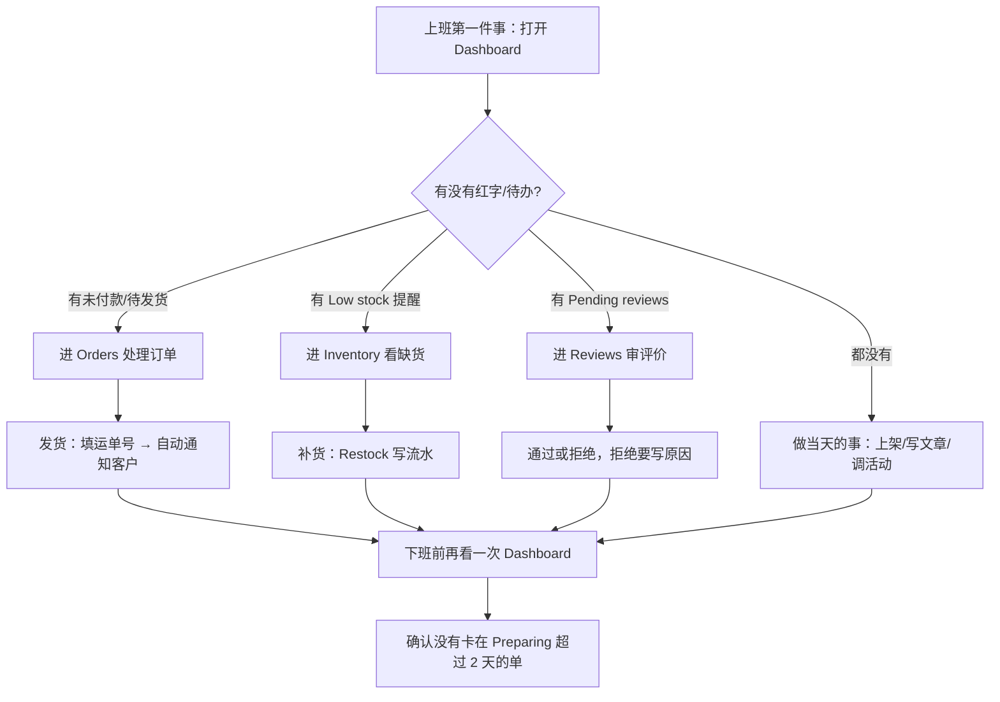

### 2.1 一天里最该看的一个数：**卡住的单**

`Dashboard` 上的待处理订单数。**任何订单在 `Preparing`（已付款、未发货）停留超过 2 个工作日，就是问题**——客户已经付钱了，承诺的处理时长是 1–2 个工作日。

### 2.2 一周里最该做的一件事：**对一次库存**

进 `Inventory`，把系统库存和货架实数对一遍。差 1–2 件是正常的（试戴、样品），差 5 件以上要查 `Stock ledger`（库存流水），那里记着每一次增减和原因。

---

## 3 订单模块（Orders）

这是用得最多的一个模块，也是最不能出错的一个。

### 3.1 一张订单会经过哪几个状态

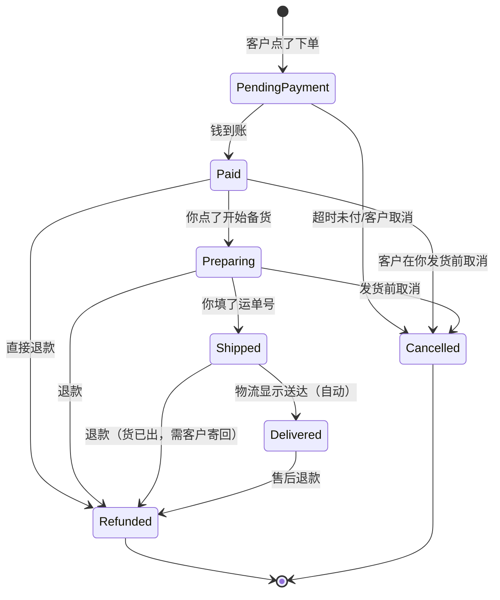

对照表（屏幕上显示的是右列）：

| 系统状态 | 屏幕显示 | 含义 | 你能做什么 |
| --- | --- | --- | --- |
| `pending_payment` | — | 客户提交了但钱没到 | 什么都不用做，超时会自动取消 |
| `paid` | **Paid** | 钱到了，等你备货 | 开始备货 / 取消 / 退款 |
| `fulfilling` | **Preparing** | 你在打包 | 发货 / 取消 / 退款 |
| `fulfilled` | **Shipped** | 已发货，有运单号 | 标记送达 / 退款 |
| `completed` | **Delivered** | 客户收到了 | 只能退款 |
| `refunded` | **Refunded** | 钱退了 | 终态，不能再改 |
| `cancelled` | **Cancelled** | 取消了 | 终态，不能再改 |

> **`Refunded` 和 `Cancelled` 是终点。** 点下去之后这个订单就锁死了，没有任何按钮能把它改回来。系统这么设计是故意的——钱的流向不能来回改。

### 3.2 发货（最高频操作）

1. `Orders` → 找到单 → 点单号进详情。
2. 找到 **Tracking** 区域。
3. 填 **Tracking number**（运单号）和 **Carrier**（承运商，下拉选）。
4. 点 **Save**。

> **一个容易困惑的地方，先讲清楚**：订单**状态徽章**显示的是人话（`Preparing` = 备货中），但**操作按钮**用的是系统里的名字（`Fulfilling`）。所以你会看到「状态写着 Preparing、旁边按钮写着 Fulfilling」——它们是同一件事。看到这个不要以为点错了。

**点 Save tracking 那一刻，系统同时做了三件事：**

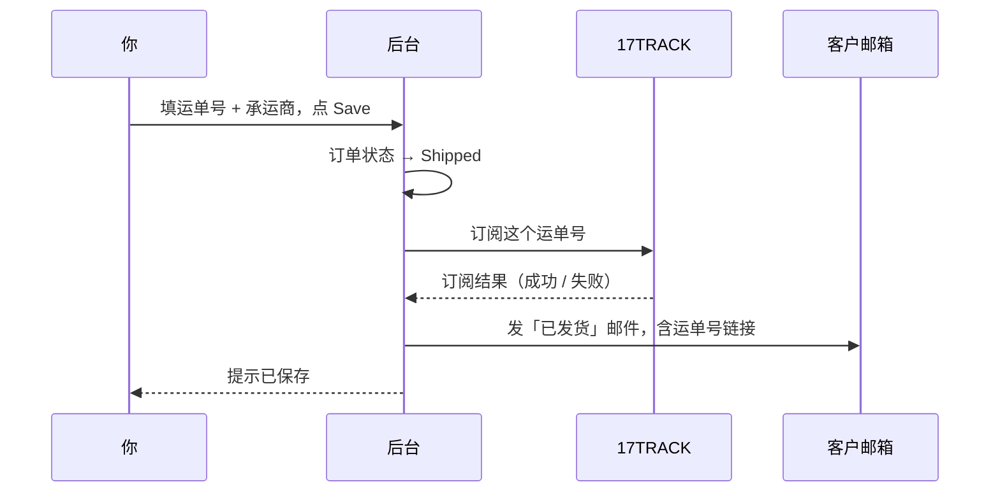

三件事里任何一件失败，**另外两件照样会发生**——邮件发不出去不影响订单状态，17TRACK 订阅失败也不影响发货。

**如果 17TRACK 订阅失败**（配额用完、承运商不认），页面会告诉你，这时：
- 订单照样是 `Shipped`，客户照样收到邮件；
- 但**没有自动轨迹**，客户在查单页看到的是「去承运商官网查」的按钮，而不是空白的轨迹框。

### 3.3 退款

分两种，别点错：

| 类型 | 什么时候用 | 会发生什么 |
| --- | --- | --- |
| **整单退款**（Full refund） | 客户不要了 / 发错货 | 钱全退、库存全回补、券释放、客户消费额冲减 |
| **按行部分退款**（Partial refund） | 多件里退一件、少发一件 | 你填每行退几件；折扣与税按比例分摊；**退最后一件时补退运费** |

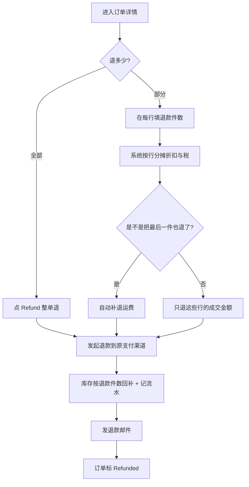

**退款前必须确认的三件事：**

1. **原路退回**。系统退到客户当初付款的那个账户/卡，不能退到别的地方。
2. **税也跟着退**。按行退时，税是按比例算的——不要手工再算一遍，会算重。
3. **库存会回来**。如果货实际没收到（客户寄空包、或根本没有寄回），要人工把库存再扣掉。**但界面只能加不能减**（`Inventory` 只有 `+20`），扣减要让技术用接口做一条负数调整，并同步写进流水。不要用「改数据文件」这种办法。

### 3.4 常见错误与对策

| 屏幕上出现 | 什么意思 | 怎么办 |
| --- | --- | --- |
| `This order has already shipped. Please use the return flow instead.` | 已发货的单客户想自己取消 | 让客户走退货流程，你在后台发起退款 |
| `Only N left in Gold for xxx` | 库存不够了 | 补货，或联系客户换色/退单 |
| `Your total changed since you last reviewed it.` | 客户改了地址，税变了 | 让客户重新看一眼金额再付 |
| 订单列表搜不到 | 关键词打错 | 单号、邮箱、姓名三个字段都能搜；单号可以只打后四位 |

---

## 4 商品模块（Products）

### 4.1 新建一个商品

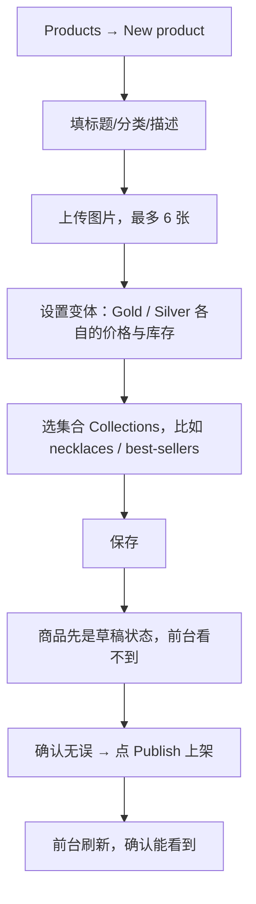

**字段说明（按重要性排）：**

| 字段 | 必填 | 说明 | 新手常错 |
| --- | --- | --- | --- |
| `Title` | 是 | 英文商品名，会出现在前台标题和 Google 里 | 别写中文，也别全大写 |
| `Price` | 是 | 目录价（USD） | 变体价格如果不同，以**变体价**为准 |
| `Cost` | 否 | 成本价，**只有 owner 看得到** | ops 填了也看不到，这是故意的 |
| `SKU` | 是 | 库存单位编码，退款/流水/拣货都认它 | 一改 SKU，历史流水就对不上了 |
| `Stock` | 是 | 每个变体各自的库存 | 不是总数，是分色分开的 |
| `Images` | 是 | 第一张是主图 | 顺序可以拖，第一张决定列表页长什么样 |
| `Collections` | 建议 | 挂到哪些集合里 | 不挂集合，客户只能靠搜索找到它 |
| `Description` | 是 | 商品描述，前台详情页正文 | 曾经「后台写了前端不显示」，已修，但**保存后一定要去前台看一眼** |

### 4.2 六条商品红线

1. **商品卖过之后不能删除**。系统会拒绝：`This product appears in N order(s). Unlist it instead of deleting.` —— 这是保护历史订单。**正确做法是 `Unlist`（下架）**。
2. **不要改卖过的商品的 SKU**。改了之后，库存流水、退款记录、仓库拣货单全都对不上。
3. **图片最多 6 张，单张 5 MB 以内**。上传时前端会自动压缩，压完一般 200–400 KB。
4. **只支持 JPG / PNG / WebP**。传 SVG 会被拒绝——SVG 能塞脚本，是安全隐患。
5. **新建默认是草稿**。保存了不等于上架，必须点 Publish。
6. **改完价格去前台看一次**。前台金额由服务端算，理论上不会错，但你看一眼只要 5 秒。

### 4.3 批量导入 100 款商品（CSV）

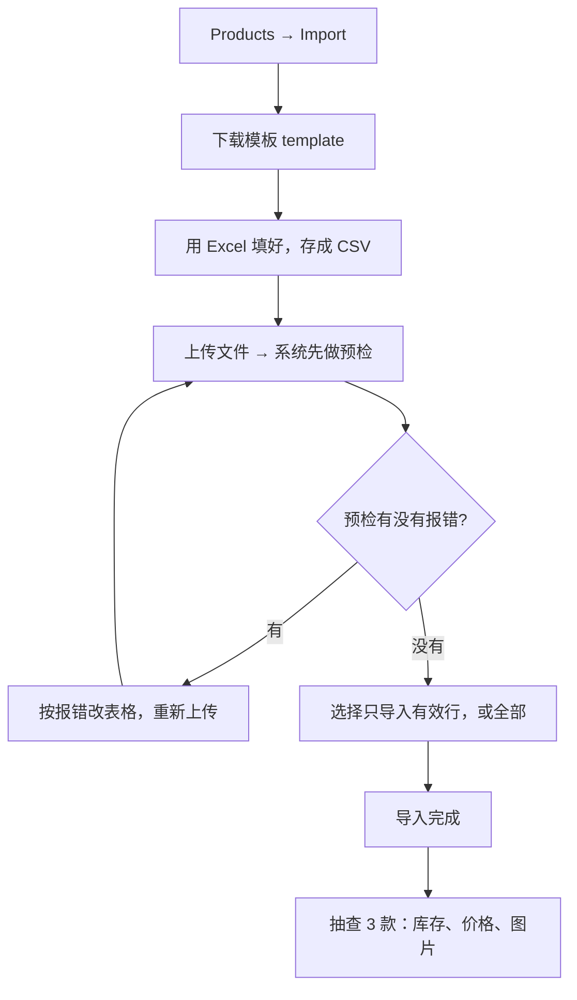

**CSV 必填列**：`group`（归并键，同一个 group 的多行会合并成一个商品的多个变体）、`title`、`metal`、`stock`。

**Excel 存 CSV 的两个坑**：
- 用 Excel 直接打开导出的模板，中文可能乱码——模板带 BOM，用 Excel 打开应该正常；如果乱码，另存为「CSV UTF-8」。
- 描述里有逗号没问题（会自动加引号）；但**描述里有换行**时，某些 Excel 版本会存坏，尽量别在描述里换行。

---

## 5 库存模块（Inventory + Stock ledger）

### 5.1 一条铁律：库存只能通过「流水」改

**不要直接编辑库存数字。** 系统里库存的每一次变化都要留下一条 `Stock ledger`（库存流水）记录，写清「谁、什么时候、因为什么、加减多少、改完剩多少」。

为什么这么严：月底对账时，如果库存对不上而没有流水，你无法判断是丢货、是漏记、还是系统 bug。有流水，一眼就能定位。

### 5.2 补货

`Inventory` 每行右边有一个 **`+20`** 按钮。点一下 = **这个 SKU 增加 20 件**，同时写一条流水（原因记作手工补货）。没有数量输入框，也没有确认弹窗，**点错了就是直接加错**。

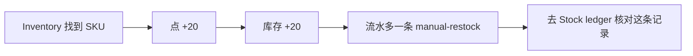

**所以补货有个规矩：**

| 你实际到了多少件 | 怎么操作 |
| --- | --- |
| 正好 20 件 | 点一次 `+20` |
| 40 件 | 点两次 |
| 不合适用 20 整除（比如 17 件） | **点 `+20` 之后，让技术用接口补一条差额调整**，或者记下「本次补货 = 20 的整数倍 + 差额」交给技术统一修 |

> **这是一个已知的界面局限**：补货数量写死 20，仓库实际到货很少正好是 20 的倍数。这属于「能力已经具备、界面还没跟上」——接口本身支持任意数量。培训时把它讲清楚，别让员工以为是自己点错了。

保存后流水里立刻多一条，库存数字变。**这是唯一正确的加库存方式。**

### 5.3 查「为什么少了 3 件」

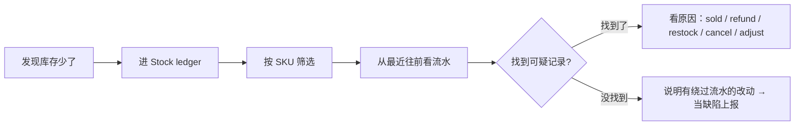

**如果流水里查不到，说明有人直接改了数据文件。** 这是要上报的严重问题，不是「算了」。

---

## 6 营销三件套：Coupons / Reviews / Custom requests

### 6.1 优惠券（Coupons）

| 字段 | 说明 |
| --- | --- |
| `Code` | 客户输入的那串，建议全大写无空格，如 `WELCOME15` |
| `Type` | `percent`（百分比）或 `fixed`（固定金额） |
| `Value` | 15 表示 15% 或 $15，看上一栏 |
| `Min subtotal` | 满多少才能用 |
| `Limit` | 总共能用几次，空了就是不限。**填 0 表示建一张已经发完的券**（预留记录用） |
| `Starts / Ends` | 生效与失效日期 |

**列表里的 `Status` 列是系统算出来的，不是你填的**。可能出现的值：

| 显示 | 含义 |
| --- | --- |
| `Active` | 现在就能用 |
| `Scheduled` | 还没到 `Starts` 那天 |
| `Expired` | 过了 `Ends` 那天 |
| `Exhausted` | 名额用完了（`Used` 触到 `Limit`） |
| `Disabled` | 人工停用（当前只能通过导入数据设置） |

后面跟 `also …` 说明**同时还有另一个原因**，比如 `Expired · also Exhausted`——这张券既过期了、名额也早发完了。看到这种别再跟客户说「下次早点用」，它根本没有下次。

**四个常见坑：**

1. **券的折扣算在运费之前**。满 $95 免邮，客户用了 15% 券后小计变 $85，就要付运费。客户会问「我不是买够了吗」——解释：**免邮看的是折后金额**。
2. **过期优先于未启用**。客户看到 "expired" 比 "not active" 更知道下一步做什么，所以报错顺序是刻意这么排的。
3. **系统允许删券，但用过的券不要删**。删了之后历史订单里那笔折扣就没有出处。
4. **目前没有「停用」按钮**（这是已知缺口）。想临时关掉一张已经建好的券，只能二选一：把 `Ends` 改成一个已经过去的日期，或者把 `Limit` 改成等于当前 `Used`。这两种都绕，**所以建券时把日期和名额想清楚，比事后补救省事**。

### 6.2 评价（Reviews）

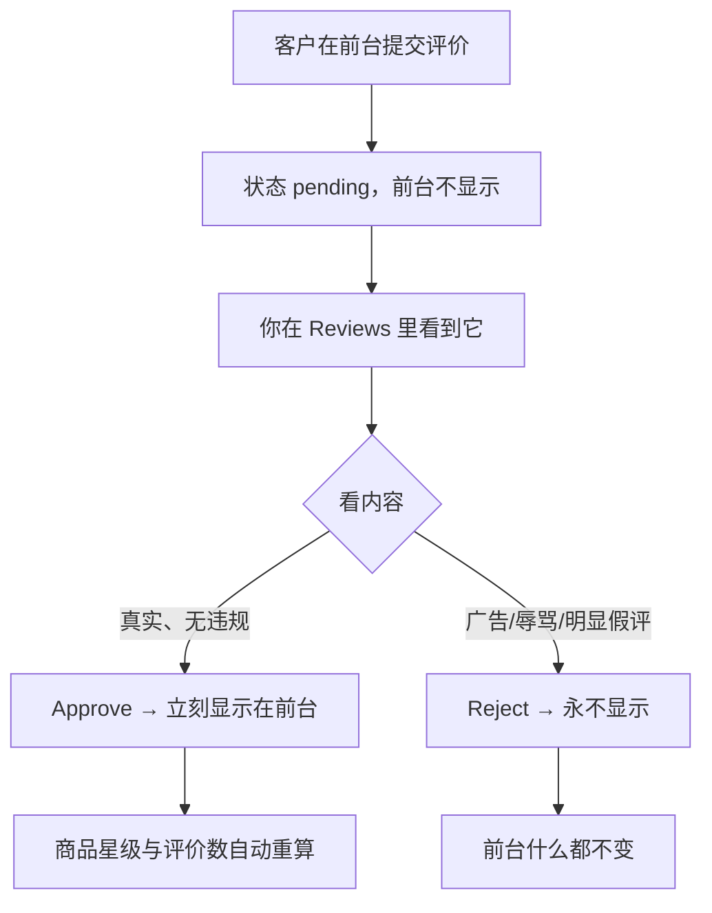

三个按钮的作用：

| 按钮 | 结果 | 什么时候用 |
| --- | --- | --- |
| `Approve` | 立刻显示在前台，商品星级与评价数重算 | 真实评价，包括差评 |
| `Reject` | 永不显示，但记录还在库里 | 广告、辱骂、明显假评 |
| `Send back to pending` | 退回待审（已处理的评价也能撤回） | 点错了，或想先放一放 |

**审核标准（培训时统一口径）：**
- 可以有差评，**差评不删**。删差评是最快失去信任的方式。
- 只处理三类：广告垃圾、人身攻击、明显不是买过的人写的。
- **系统没有「拒绝理由」输入框**（这是已知缺口）。所以拒绝的理由记在你们自己的交接表里，或者直接口头交接给下一个人——别让它只留在你脑子里。

### 6.3 定制需求单（Custom requests）

前台有一个「想要定做」的表单。客户提交后落到这个模块。

处理流程：`New` → 看需求 → 报不了价就回信说明 → 能报价就填报价 → 客户确认 → 转成正式订单 → 标 `Closed`。

**注意**：系统**不做自动报价**。定制件的材料与工时每次都不一样，自动算必然算错，报价永远由人填。

---

## 7 内容与博客（Content / Articles）

### 7.1 Content：首页文案与页面标题

这个模块分两块：

| 区块 | 能改什么 | 注意 |
| --- | --- | --- |
| `Home page copy` | 品牌名、标语、公告条、首屏小标题/大标题/说明、best sellers 上方那行字 | 公告条与首屏大标题都支持用**竖线 `|`** 做分隔（详见下面两条） |
| `Content pages` | 每个内容页的**标题与导语**：about / care / shipping / returns / size-guide / faq / materials / contact / privacy / terms / accessibility —— **11 个在用的** | **正文改不了**，正文在 `pages.js` 里。列表最后还会多出一行 `journal · title`，那是迁移到真路径之前留下的旧键，改了没有效果，忽略它 |

**竖线 `|` 的两个用法**（这条最容易被漏掉）：

- 公告条：`Free shipping over $95 | 30-day returns` → 前台拆成两条轮播，而不是一整行。
- 首屏大标题：`Grows | on you.` → 在竖线处换行。不写竖线就是一整行，窄屏上会被挤成很难看的两截。

**这个模块改不了政策页正文**（隐私政策、退换货条款那些段落）。原因：这一版刻意没做富文本编辑器——没有版本对比和预览的富文本，改坏了只能回滚代码。要改正文，走技术发布流程。

**改完必做**：点右上角 `View store`，去前台看一眼。公告条在页面最顶上，标题在首屏正中。文案改动是**立即生效**的，没有草稿、没有撤销。

### 7.2 Articles：发一篇博客

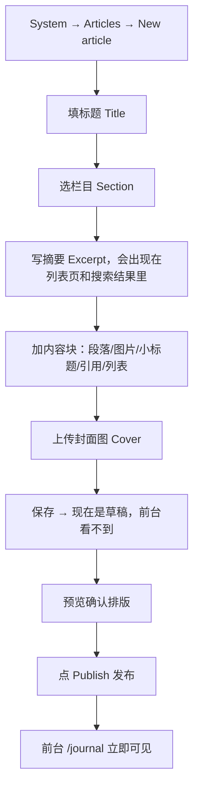

**为什么博客值得认真做**：它是全站唯一能被 Google 正常收录的页面（其余页面是 `#` 后面的地址，爬虫不认）。一篇文章写好，能持续带来搜索流量。

**编辑器是「一块一块」的，7 种块：**

| 块类型 | 用途 | 备注 |
| --- | --- | --- |
| `Paragraph` | 正文段落 | 最常用 |
| `Heading 2` | 大标题 | 一篇文章建议 2–4 个 |
| `Heading 3` | 小标题 | 长文再往下拆一层 |
| `Quote` | 引用、强调句 | 别整段都用它 |
| `List` | 列表 | **一行一条**，不要写 `•` |
| `Image` | 图片 | 必须填 **Alt text**（读屏和 Google 都靠它） |
| `Divider` | 分隔线 | 少用 |

**加粗、斜体、链接直接写在文字里**，不用找按钮：

```
**粗体**        *斜体*        [点这里](/journal/another-post)
```

> 为什么不做成富文本编辑器（所见即所得那种）：那样会有一条「屏幕上看到的样子」和「真正存进去的内容」之间的落差，最典型的后果是粘一段网页内容进来，样式全乱了还查不出原因。现在是「所见即标记」，你写的符号就是存进去的东西。

**四条写作要求：**
- **标题要像人在搜索时会打的词**，不要写品牌口号。让人搜 `stainless steel necklace turn skin green`，而不是 `Our Philosophy`。
- **摘要 1–2 句**，它决定别人在搜索结果里点不点你。
- **封面图宽度 1200px 左右**，正方形或接近正方形的图在社媒上更容易被裁得好看。
- **发布前检查链接**：文章里放的内部链接，点一下确认不是死链。

---

## 8 系统设置与安全

### 8.1 Settings 里每一项是什么

| 区块（屏幕原文） | 里面有什么 | 谁该动 |
| --- | --- | --- |
| `Store settings` | 免邮门槛、标准运费、快递运费、赠品门槛、低库存阈值、公告条、营业开关 | 店主 |
| `Social links` | Instagram / Pinterest / TikTok 链接 | 运营 |
| `Sales tax` | 各州税率与总开关（**没配的州一分不收**） | 店主 + 会计 |
| `17TRACK` | 订阅额度与连通性（**这块是只读的**，配额用完要充值） | 运营只看 |

**社交链接填错的后果**：只接受 `https://` 开头的完整地址。填 `instagram.com/xxx` 会被拒绝并提示 `Missing http(s):// prefix.`。不填就不显示那个图标——**空着比填个假链接好**。

**营业开关（`storeOpen`）**：关掉之后，前台可以浏览但**不能下单**，报价接口直接拒绝。用于放假、搬家、爆单暂停。

### 8.2 员工账号（Staff）

只有 owner 能进。

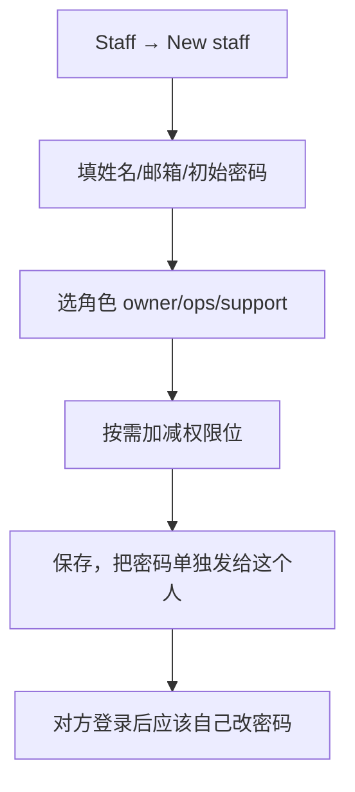

**三条护栏，是系统强制的，不要试图绕过：**
1. **不能停用/删除自己**。
2. **不能停用/删除最后一个 owner**。防止一次手快，后台永久进不去。
3. **不是 owner 的人不能创建 owner**。

**离职处理顺序**：先 `Suspend`（停用，立刻失效登录），把手上活交接完，再决定要不要删。**别直接删**——历史操作记录里那个名字会变成查不到的人。

### 8.3 审计日志（Audit log）

记着最近 200 条后台操作：谁、什么时候、做了什么、改前改后是什么。

**它主要用来回答三类问题**：
- 这个价格是谁改的？
- 这张订单为什么被退款了？
- 客户名单是谁导出去的？（导出客户表会留一条记录，这是合规要求）

### 8.4 忘了密码怎么办（店主操作）

后台没有自助重置。店主在服务器上执行重置脚本，生成新的 scrypt 哈希写进数据文件。**具体命令见《服务器部署手册 v1.2》第 6.4 节。** 重置后对方需要重新登录，旧会话立即失效。

### 8.5 导出数据（四个 CSV）

`Orders`、`Products`、`Customers`、`Sales tax` 四个地方能导出 CSV。

**导出客户表 = 带走一份带邮箱的名单。** 所以每次导出都会记一条审计。**导出的文件不要放在共享盘、不要发微信、用完删掉。** 这是 GDPR / CCPA 的基本要求，不是形式主义。

---

## 9 销售税（Sales tax）

### 9.1 一条必须先讲清的前提

美国销售税是**按收货州**收的，而且只有在某个州达到「经济关联」门槛（一般年销售额 10 万–50 万美元）之后才有代收义务。

所以系统的默认状态是：**一个州都不收**。`Settings → Sales tax` 里没配税率的州，税额是 0。

**这是刻意的：宁可少收（可以事后补申报），不可错收（错收要退款、要修正申报，退比收难十倍）。**

### 9.2 正确使用顺序

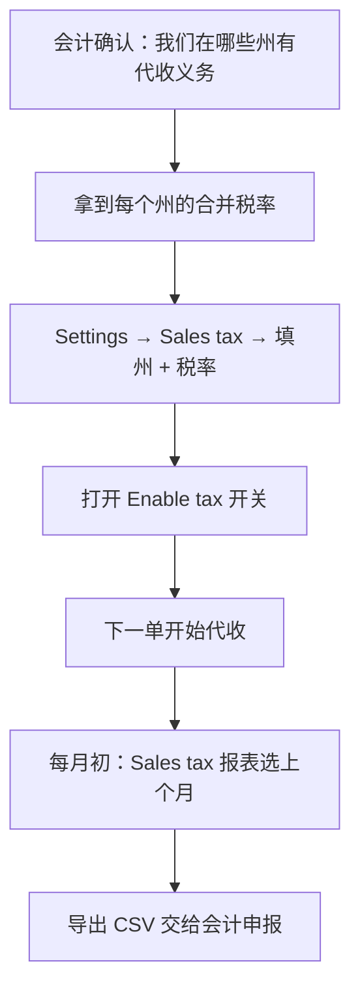

**填税率的格式**：填 `7.25` 会自动存成 `0.0725`（百分数自动换算）。填超过 20% 会被拒绝——那是填错了。

**报表口径（写死的，不要自己另算一套）：**
- 排除未付款、已取消、整单退款的订单；
- 应税销售额 = 订单总额 − 税额；
- 部分退款的订单按原额计入，由报税时按退款明细手工冲减。

> **为什么部分退款不自动冲减**：各州对「退款算哪个申报期」的规则不一样，自动算反而会算错。这条有争议时，以会计口径为准。

---

## 10 库存看板与报表（Dashboard）

`Dashboard` 上有四类东西：

| 区块 | 看什么 | 多久看一次 |
| --- | --- | --- |
| `Revenue · Nd` | 区间销售额，下面一行是跟上个同长度区间比的涨跌 | 每天 |
| `Orders` | 订单数，小字是总件数 | 每天 |
| `Average order` | 客单价（AOV） | 每周 |
| `Refund rate` | 退款率，**超过 8% 会标红** | 每周 |
| `7 / 30 / 90 days` | 换统计窗口 | 对比时用同一窗口 |
| `Needs attention` | 待发货 / 待审评价 / 低库存 三个入口 | 每天两次 |
| `Top products` | 区间内卖得最好的几款 | 每周 |
| `Restock soon` | 低于阈值的 SKU | 每周 |

**为什么要限定 7/30/90 三档**：报表要能被比较。任意天数（比如 17 天 vs 23 天）的「环比」是两个不可比的区间，看久了只会更糊涂。

---

## 11 出了事怎么办（故障速查）

| 现象 | 最可能的原因 | 你该做什么 |
| --- | --- | --- |
| 登录后点菜单被弹回登录页 | 会话过期（12 小时） | 重新登录。页面会告诉你原因 |
| 登录报 `Too many requests` | 密码试错太多，被限流 | 等 5 分钟。别继续试 |
| 后台白屏 | 网络断了，或脚本没加载完 | 刷新一次。还不行就查服务是否在跑 |
| 前台价格和后台不一致 | 极少见，但可能缓存 | 强制刷新（Ctrl+Shift+R）。仍不一致就上报 |
| 客户说没收到发货邮件 | 邮件服务未配置或密钥失效 | 看订单详情有没有运单号；有单号说明状态对了，是邮件问题，让技术查日志 |
| 客户查不到轨迹 | 17TRACK 订阅失败或额度用完 | `Settings → Tracking` 看额度；前台应有「去承运商官网查」按钮 |
| 库存对不上 | 有绕过流水的改动 | 查 `Stock ledger`，查不到就上报 |
| 商品在前台看不到 | 还是草稿，或没挂集合 | 检查是否 Publish、是否挂了集合 |
| 博客文章点开 404 | 还是草稿 | 检查是否 Publish |

---

## 12 十条红线（培训必讲，逐条确认对方听懂）

1. **`Refunded` 和 `Cancelled` 点下去就回不来了。** 退款前把金额念一遍。
2. **卖过的商品不能删，只下架。**
3. **不要改卖过的商品的 SKU。**
4. **库存只能通过 Restock 加，不要直接改数字。**
5. **别删差评。** 只处理广告、辱骂、假评。
6. **导出客户名单会留痕。** 文件不外传、用完删。
7. **后台地址不给客户、不给外包以外的人。**
8. **公用电脑用完点 `Sign out`，不要只关标签页。**
9. **改完文案、改完价格，一定去前台看一次。**
10. **不确定的操作，先问，不要试。** 试错的代价通常是一笔退款或一份泄露的名单。

---

## 13 培训验收清单（新人第一天上手，逐项打勾）

| # | 任务 | 通过标准 |
| --- | --- | --- |
| 1 | 登录后台、找到 Dashboard | 能说出四个 KPI 各是什么 |
| 2 | 找到一张 `Paid` 订单并进入详情 | 能指出运单号该填在哪 |
| 3 | 完成一次发货（测试单） | 状态变 `Shipped`，客户收到邮件 |
| 4 | 新建一个商品并上架（测试商品） | 前台能看到，图片顺序正确 |
| 5 | 改一次库存并说清流水在哪查 | 能报出这次改动的流水记录 |
| 6 | 建一张 10% 折扣券并自己下一单试 | 能算出折后金额与是否免邮 |
| 7 | 审一条评价 | 能说出通过和拒绝的差别 |
| 8 | 发一篇博客草稿 | 能说清草稿和发布的区别 |
| 9 | 导出一次订单 CSV | 能说出「导出去了要删」 |
| 10 | 说出十条红线里的任意五条 | 不看文档能背出来 |

---

## 14 术语表

| 英文 | 中文 | 一句话解释 |
| --- | --- | --- |
| SKU | 库存单位 | 一个具体规格的唯一编码，如 `LG-101-GO`（金色那条） |
| Variant | 变体 | 同一款商品的不同颜色/尺寸，各有各的库存 |
| Collection | 集合 | 商品分组，决定导航栏里有什么 |
| Quote | 报价 | 下单前锁定的价格快照，15 分钟有效 |
| Idempotency | 幂等 | 同一个操作重复提交，只生效一次 |
| Webhook | 回调 | 第三方主动通知我们「事情发生了」 |
| Ledger | 流水 | 每一次变动的流水账 |
| Audit log | 审计日志 | 谁在什么时候改了什么 |
| Unlist | 下架 | 前台看不到，但数据还在、历史订单还能查 |
| Fulfilling | 备货中 | 钱到了，正在打包 |
| Refund | 退款 | 钱退回客户原支付渠道 |

---

— 文档结束 · LG-MAN-001 v1.0 · 覆盖后台 16 个模块 · 与 `app/web/assets/js/admin.js` 的 NAV 定义逐项对照 —
