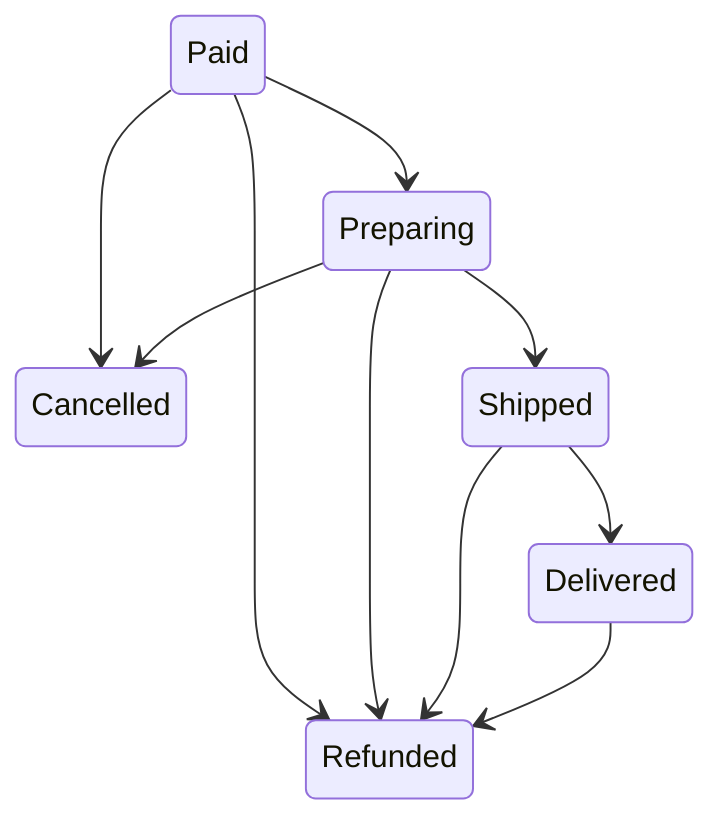
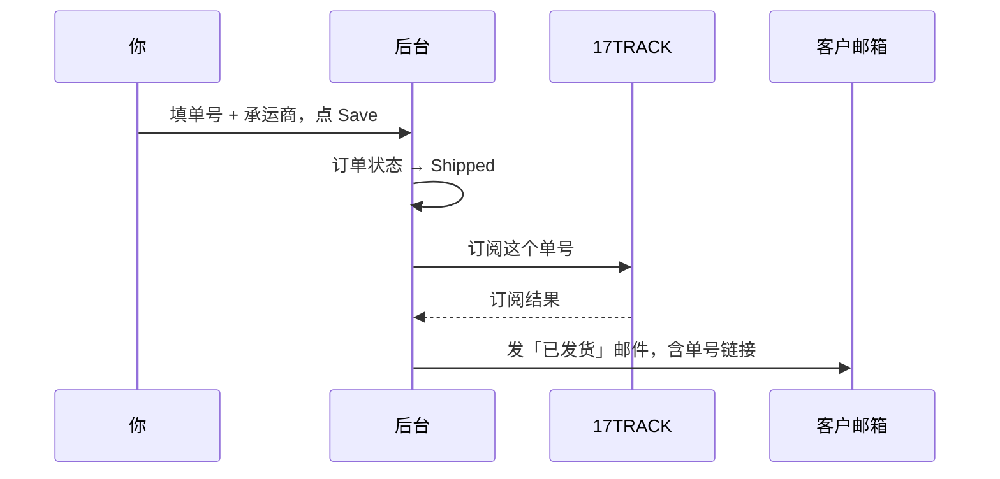
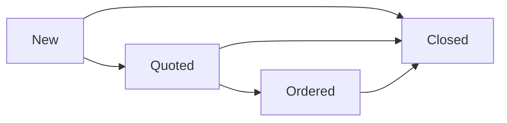
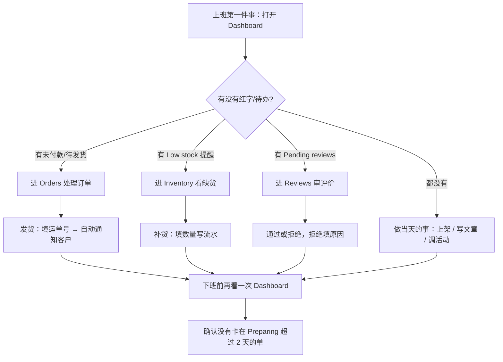

# LASTGROVE 后台操作手册（字段级详解）

| 项 | 内容 |
| --- | --- |
| 文档编号 | LG-MAN-001 |
| 版本 | **v2.0**（替代 v1.0） |
| 日期 | 2026-11-17 |
| 读者 | 店主、运营、客服、仓库对接人（**不需要懂技术**） |
| 适用系统 | `app/web` 后台（`/#/admin`），16 个模块 |
| 这一版改了什么 | 从「流程讲解」升级为「逐字段手册」：每个输入框都写清是什么、填什么、格式上限、留空会怎样、前台出现在哪。同时修正了 v1.0 里三处已过时的说法（补货、停用券、拒绝理由） |

> **界面是英文的，这份文档是中文的。** 文中所有反引号包起来的英文单词，都是你在屏幕上看到的原文。照抄去点，不会错。

---

## 0 怎么用这本手册

### 0.1 三个地址

| 你要去哪 | 地址 | 说明 |
| --- | --- | --- |
| 店铺前台 | `https://lastgrove.com/` | 客户看到的页面 |
| 后台 | `https://lastgrove.com/#/admin` | 你干活的地方，**别把链接发给客户** |
| 博客前台 | `https://lastgrove.com/journal` | 文章列表，独立地址，能被 Google 收录 |

### 0.2 第一次登录

1. 打开后台地址，看到登录页。
2. 填 `Email` 和 `Password`，点 `Sign in`。
3. 登录有效期 **12 小时**。过期后点任何菜单都会被送回登录页，并顶一句提示说明原因——不是你操作错了。

**两个硬限制：**

- **同一网络 5 分钟内最多试 10 次**。第 11 次显示 `Too many requests. Try again in Ns.`，这时候等，别继续试——继续试只会把时间重新往后推。
- **后台没有「忘记密码」自助入口**。忘了只能让店主在服务器上重置（见 §8.5）。

### 0.3 权限决定你看到几个菜单

后台不看「你是主管还是客服」，只看你被勾了哪几项权限。权限不够时操作会被拒绝，显示 `Your account does not have ...`。

| 角色 | 能看到什么 | 适合谁 |
| --- | --- | --- |
| `owner` | 全部 16 个模块，且**永远是全权限** | 老板 |
| `ops` | 除 Staff、Settings、Audit log 之外的全部 | 日常运营、上架、发货 |
| `support` | Dashboard、Orders（只读）、Products（只读）、Customers（只读） | 客服、外包 |

有一个**成本价的特殊规则**：`Cost` 字段只有 `owner` 能看能改。`ops` 打开商品抽屉时，这一格是灰色的。不是坏了，是故意的——成本价泄露给外包，等于把毛利结构交出去。

### 0.4 本手册的字段卡片怎么读

从第 2 章开始，**每个输入框都有一张卡片**，固定六项：

```
字段名        屏幕上那一格的英文原文
是什么        它控制前台的哪一块
填什么        一句可以直接抄的示例
格式          字符上限、只接受什么字符、能不能留空
留空会怎样    不填的时候前台显示什么
别这样写      真实踩过的坑
```

赶时间的人看第 11 章《全站字段格式总表》，一页查完所有限制。

> **一个排版约定**：本手册的表格里，凡是出现 `\|`（反斜杠 + 竖线）的地方，**反斜杠只是为了排版不断列，你实际输入的只有竖线本身**。例如 `Made for\|salt water.` 表示输入框里填的是 `Made for|salt water.`。

---

## 1 后台总览

左侧导航分四组，右侧是当前页面。

```
Overview      Dashboard · Orders
Catalog       Products · Collections · Inventory
Growth        Coupons · Reviews · Custom requests · Customers
System        Content · Articles · Stock ledger · Sales tax · Staff · Audit log · Settings
```

**左上角 ☰**：屏幕窄（笔记本 1366 以下、平板、手机）时侧栏收起，用它展开。

**右上角三个东西**：

- `View store` — 跳前台看效果。**改了任何文案、价格、图片，都必须点这个看一眼。**
- 你的名字 — 只是标识
- `Sign out` — 退出。公用电脑务必点这个，不要只关标签页

> **一个要知道的现状**：侧栏目前只有 `Articles` 和 `Staff` 两项会按权限隐藏，其余菜单对所有能登录的人都显示，点进去才会被拒绝。所以 `support` 账号看到的菜单比它能用的多——这不是故障。遇到 `Not allowed` 页面，是你没有这一项权限。

---

## 2 首页文案（System → Content）

**这是本手册最该细读的一章。** 首页的文字全在这里改，但它只覆盖「文案」，不覆盖「图片」。两者的边界见 §2.9。

进入路径：`System` → `Content`。页面里有两块：上面 `Home page copy`（首页文案），下面 `Content pages`（11 个内容页的标题与导语）。

### 2.1 首页七块内容分别长在哪

先建立这张地图，后面每个字段你才知道改的是哪一块：

```
┌──────────────────────────────────────────────────────────┐
│  Free shipping over $95 · 30-day returns          ← ①公告条 │
├──────────────────────────────────────────────────────────┤
│  LASTGROVE      Shop  New  Necklaces  ...        ← ②页头    │
├──────────────────────────────────────────────────────────┤
│                          │                               │
│  SALT & STEEL            │                               │
│  Salt & Steel            │  ← ③Hero eyebrow 眉标          │
│  Made for                │  ← ④Hero title   大标题        │
│  salt water.             │     （| 左边正体，右边斜体）   │
│  316L stainless steel... │  ← ⑤Hero body    说明段        │
│  [ Shop all ] [What's new]│                              │
│  316L  PVD  1 free  30 days│ ← 卖点行（后台改不了）        │
│                          │  ← 右侧三张图（后台改不了）     │
├──────────────────────────────────────────────────────────┤
│  AS SEEN ON TIKTOK       │ ← ⑥Best sellers eyebrow       │
│  Best sellers            │                               │
│  [商品卡] [商品卡] [商品卡]│ ← 商品数据自动来               │
├──────────────────────────────────────────────────────────┤
│  ...                                                     │
├──────────────────────────────────────────────────────────┤
│  316L stainless steel, made in short runs...  ← 页脚（改不了）│
└──────────────────────────────────────────────────────────┘
```

图上六处带编号的文字里，**①③④⑤⑥ 全部能在后台改**（页头 ② 的品牌名靠 `Brand` 改，导航项靠集合的 `Nav` 开关改）。改不了的只有三样：卖点行、右侧三张图、页脚描述——原因见 §2.9。

### 2.2 `Brand` 品牌名

| | |
| --- | --- |
| **是什么** | 全站品牌名。首屏眉标、页脚字标、浏览器标签页标题、后台左上角都用它 |
| **填什么** | `LASTGROVE` |
| **格式** | 纯文本，**最多 40 字符**。不要加 ® 或 ™ |
| **留空会怎样** | 回落到 `LASTGROVE` |
| **别这样写** | 别写小写 `lastgrove`——字标是大写设计的，小写会显得像拼错。也别在这里写口号，那是 `Tagline` 的位置 |

### 2.3 `Tagline` 说法（一句话定位）

| | |
| --- | --- |
| **是什么** | **首页看不见它**。它只写进网页的 SEO 描述（`<meta description>`），也就是 Google 搜索结果里标题下面那两行灰字 |
| **填什么** | `Waterproof 316L stainless steel jewellery, made in small batches in Portland.` |
| **格式** | **最多 80 字符**。超过 80 字 Google 会在手机上截断 |
| **留空会怎样** | 搜索引擎自己从页面里摘一句，通常摘得很难看 |
| **别这样写** | 别堆关键词（`jewellery, necklace, bracelet, cheap`）——2026 年的搜索会把它判成垃圾描述。用一句完整的人话 |

> 这一格最容易被人忽略，但它决定**别人在 Google 里点不点你**。花五分钟写它。

### 2.4 `Announcement bar` 顶部公告条

| | |
| --- | --- |
| **是什么** | 页面最顶上那条深绿底、白字、一直从右往左滚动的跑马灯 |
| **填什么** | `Free shipping over $95 \| 30-day returns \| Ships from Portland` |
| **格式** | 用**竖线 \|** 分隔多条消息。最多 400 字符。会自动转成大写显示（你写小写也会变大写） |
| **留空会怎样** | **整条公告栏不渲染**，页面直接以页头开始（不会留一条空白） |
| **别这样写** | ①别写长句子——跑马灯只有 38px 高，一条超过 12 个英文词就没法在一屏内读完；②别写促销码以外的时效承诺（`Sale ends tonight` 第二天还挂着，比不写更糟）；③**别用逗号分隔多条**，前台只认 `\|`，逗号会被当成句子的一部分 |

**它到底怎么显示的**：不是一条一条切换的幻灯片，是**所有消息横排成一行，用 `·` 隔开，整体匀速向左滚动，60 秒走完一轮，无限循环**。所以填 3 条是最舒服的，填 6 条会显得拥挤。

**同一个字段有两个入口**：`Settings → Store settings` 里也有一个 `Announcement bar`，改哪个都行，改的是同一个值。**改完记得两边都会变**，不要以为有两套。

### 2.5 `Hero eyebrow` 首屏眉标

| | |
| --- | --- |
| **是什么** | 首屏大标题**上方**那一行小字，全大写、加宽字距、带一条短横线 |
| **填什么** | `Salt & Steel` |
| **格式** | 纯文本，最多 400 字符（但实际 2–4 个词最好）。一律显示为大写 |
| **留空会怎样** | 回落到 `Salt & Steel`（**不是空白**） |
| **别这样写** | 别写完整句子。它的作用是「定调」不是「解释」。别用句号 |

### 2.6 `Hero title` 首屏大标题 ★最容易填错的一格

| | |
| --- | --- |
| **是什么** | 首屏那个最大的标题。它是整个首页的视觉重心 |
| **填什么** | `Made for\|salt water.` |
| **格式** | 用**竖线 \|** 断行。**竖线左边用正体，右边自动变斜体**。最多 400 字符 |
| **留空会怎样** | 回落到 `Made for / salt water.`（旧文案会自己冒出来，不是空白） |
| **别这样写** | ①**不写竖线**：整句挤成一行，窄屏上会被硬折成两截，断在奇怪的词中间；②竖线写两条：只取前两段，第三段被丢掉；③整句全大写：会和 `Hero eyebrow` 撞成两个大写字块，失去层次 |

**三种填法的实际效果：**

| 你填的 | 前台显示 |
| --- | --- |
| `Made for salt water.` | 一行：*Made for salt water.*（窄屏会硬折） |
| `Made for\|salt water.` | 两行，第一行正体 `Made for`，第二行斜体 *salt water.* ← **推荐** |
| `Made for\|salt\|water.` | 只显示两行，`water.` 被丢弃 |

> **为什么第一行正体、第二行斜体**：这是设计定下的节奏——正体给事实，斜体给情绪。所以竖线左边写「名词性的话」，右边写「让它有味道的话」。反着填会读起来别扭：`salt water.\|Made for` 不是不能显示，但斜体落在 `Made for` 上很难看。

### 2.7 `Hero body` 首屏说明段

| | |
| --- | --- |
| **是什么** | 大标题**下面**那段小字，两到三行，讲清楚「你卖什么、凭什么」 |
| **填什么** | `316L stainless steel that never turns your skin green. Waterproof, tarnish-free, and made to be worn every day — shower, swim, sleep.` |
| **格式** | 纯文本，最多 400 字符。**不支持换行、不支持加粗**（换行会被压成一行） |
| **留空会怎样** | **这一块整段消失**，标题下面直接是按钮。不会留白，但首屏会显得空 |
| **别这样写** | ①超过 3 行（约 160 字符）：手机上会把按钮挤出首屏；②写成分点罗列（`· Waterproof · Hypoallergenic`）——那是卖点行的活，见 §2.9；③承诺做不到的事（`lifetime warranty`），详情页对不上会被投诉 |

### 2.8 `Best sellers eyebrow` 畅销区眉标

| | |
| --- | --- |
| **是什么** | 「Best sellers」这个标题**上方**那一行小字 |
| **填什么** | `As seen on TikTok` 或 `Customer favorites` |
| **格式** | 纯文本，最多 400 字符，显示为大写 |
| **留空会怎样** | 回落到 `Customer favorites`（**注意：不是 `As seen on TikTok`**。后台表单里预填的示例值是 `As seen on TikTok`，但你一旦清空，前台回落的是 `Customer favorites`） |
| **别这样写** | 别写没发生过的事。`As seen on TikTok` 意味着真有人在那儿发过你的货——如果没有，这是可被投诉的虚假陈述 |

> **这一格现在没有商品时看不到**。原因见 §2.10。

### 2.9 后台改不了的几样东西

这是运营最容易反复问的问题，一次性讲清：

| 前台元素 | 长什么样 | 为什么改不了 |
| --- | --- | --- |
| **首屏右侧三张轮播图** | 竖构图的项链特写 + 两张方形图，右下角有小圆点，点了才换 | 图是打包进代码的实拍素材（`assets/img/opt/`），不是数据库里的记录。要换图必须走技术发布 |
| **首屏四行卖点** | `316L surgical steel` / `PVD colour lock` / `1 free colour replacement` / `30 days free returns` | 写在页面模板里。每一条都要能被详情页和退换货政策对上，所以不允许单独改一句 |
| **页脚品牌描述** | `316L stainless steel, made in short runs. Silver pieces are unplated; gold is 18k PVD over steel.` | 同上，写在页脚模板里 |
| **三个「世界」入口图** | Best sellers / New in / Ocean 三块方形图 | 图和链接都锁在固定 handle 上 |
| **11 个内容页的正文段落** | 关于我们、运费、退换、护理、尺码……的段落文字 | 正文在 `pages.js`。这一版刻意不做富文本编辑——没有版本对比和预览的富文本，改坏了只能回滚代码 |

**要改这五样，走技术发布流程**，不要让运营在后台找按钮。

### 2.10 为什么刚清空的文案，前台看不到

如果你清掉了商品和集合，再回后台填文案，会发现**前台一点反应都没有**。这不是保存失败。

首页有一道前置判定：**当「已发布商品数 = 0」且「可见集合数 = 0」时，首页只渲染一句 `Nothing on the shelf yet.`**，后面的公告条、首屏文案、卖点、商品区全部跳过。

**正确的顺序是：先建集合 → 再建商品并上架 → 然后回来调文案。** 第一个商品上架的瞬间，完整首页会自动回来，你之前填的文案也一起出现。

> 这条判定是故意加的。空店却摆着一套完整的「畅销卖点 + 客户好评」，等于替运营编了他没写过的文案。

### 2.11 `Content pages` 11 个内容页的标题与导语

下面那块表单，每个内容页有两格：`xxx · title`（标题）和 `xxx · intro`（导语）。

| | |
| --- | --- |
| **是什么** | 11 个独立页面各自的**大标题**和**标题下那句导语**。共 22 个输入框 |
| **哪 11 个** | `about` 关于我们 · `care` 护理 · `shipping` 运费与关税 · `returns` 退换 · `size-guide` 尺码 · `faq` 常见问题 · `materials` 材质 · `contact` 联系 · `privacy` 隐私 · `terms` 条款 · `accessibility` 无障碍 |
| **填什么** | title：`Shipping & duties`；intro：`Everything ships from Portland, Oregon. No customs bill at your door.` |
| **格式** | title **最多 90 字符**，intro **最多 260 字符**。都是纯文本，不支持换行 |
| **留空会怎样** | **不会空白**，会回落到代码里写好的原文（每一页都有一份默认标题和导语）。所以这两格是「覆盖」，不是「必填」 |
| **别这样写** | ①intro 写成正文第一段——它只有一行位置，长句子会被截断感很强；②title 全大写——设计层会再转一次，变成双重大写 |

**这里面有一行要无视**：列表最后可能多出一行 `journal · title`。那是迁移到真路径之前留下的旧键，**改了没有任何效果**。

**正文改不了。** 隐私政策、退换货条款那些段落，改正文请走技术发布流程。

### 2.12 改完必做

1. 点右上角 `View store`。
2. 公告条在页面最顶上，标题在首屏正中，畅销区眉标滚动到第二屏。
3. **刷新一次**（`Ctrl+F5` / `Cmd+Shift+R`），确认不是缓存。

文案改动是**立即生效**的——没有草稿、没有预览、没有撤销。改错了就再改回去，没有历史版本。

---

## 3 商品（Catalog → Products）

### 3.1 商品列表页

顶部一行：`N live · M draft`（已上架 / 草稿数）、搜索框、`Export CSV`、`Import CSV`、`New product`。

表格六列：

| 列 | 含义 |
| --- | --- |
| `Product` | 商品名 + 下面小字是内部 ID 和 handle（URL 用的短名） |
| `Price` | 目录价 |
| `Cost` | 成本价。**`ops` 账号看到的是 `—`，这是设计如此** |
| `Stock` | 所有变体库存之和，自动算，不能手改 |
| `Status` | `Live`（已上架）或 `Draft`（草稿） |
| 按钮 | `Edit` 打开抽屉；`Publish` / `Unlist` 一键上下架 |

**`Unlist` 与删除的区别**：`Unlist` 只是从前台撤下，订单历史、库存、评价全都留着；删除是彻底抹掉。**卖过的商品只能 Unlist，不能删**——系统会拒绝：`This product appears in N order(s). Unlist it instead of deleting.`

### 3.2 新建商品：抽屉里 13 个字段

点 `New product`，右侧滑出抽屉。字段分三组：`Basics`（基本信息）、`Images`（图片）、`Variants & stock`（变体与库存）。

#### `Title` 商品名 ★必填

| | |
| --- | --- |
| **是什么** | 商品名。出现在前台商品卡、详情页大标题、订单明细、Google 搜索结果 |
| **填什么** | `Moonlit Hare Necklace` |
| **格式** | **最多 120 字符**。**必填**，空着保存会报 `Title is required.` |
| **别这样写** | ①中文——前台是全英文站，中英混排会显得像没做完；②全大写（`MOONLIT HARE NECKLACE`）——列表页会自动大写化一部分，双重大写会挤爆；③把材质堆进名字（`Moonlit Hare Necklace 316L Stainless Steel Waterproof`）——材质交给 `Description`，名字超过 5 个词就记不住了 |

**命名公式（建议全店统一）**：`[图案/意象] + [品类]`，例如 `Moonlit Hare Necklace`、`Tide Pool Bracelet`、`Foam Ring`。这样客户在列表页扫一眼就知道是什么东西。

#### `Handle` 网址短名

| | |
| --- | --- |
| **是什么** | 商品页网址里那一段：`lastgrove.com/#/products/moonlit-hare` 最后那截 `moonlit-hare` |
| **填什么** | 留空，让系统从标题自动生成 |
| **格式** | 只能有小写字母、数字、连字符。**必须全站唯一**。建议 60 字符以内 |
| **留空会怎样** | 自动从 `Title` 生成：小写、空格转连字符、去掉符号 |
| **别这样写** | ①**商品上架后不要改**——旧链接会 404，已经分享出去的帖子、邮件、广告全废；②别手写带大写的（`MoonlitHare`），会被拒绝；③撞名会报 `Handle "xxx" is already taken.` |

#### `Category` 类目 ★必填

| | |
| --- | --- |
| **是什么** | 决定商品挂在哪几个大类下。它不是集合（集合可以自建），这是**固定的五个** |
| **能选** | `necklaces` 项链 · `bracelets` 手链 · `anklets` 脚链 · `rings` 戒指 · `hair` 发饰 |
| **填什么** | 按实物选。只能是这五个之一 |
| **别这样写** | 想新建类目（比如 `earrings`）——**做不到**。五个类目写死在代码里。要新品类得走技术发布 |

#### `Price` 目录价 ★必填

| | |
| --- | --- |
| **是什么** | 商品的基础售价（USD）。变体没单独定价时，用这个价 |
| **填什么** | `76` |
| **格式** | 数字，**必须大于 0**。最多两位小数。填 `0` 会报 `Price must be greater than 0.` |
| **别这样写** | ①填带 `$` 的（`$76`）——输入框只收数字；②填低于成本价——系统会拦：`Price $76.00 is below unit cost $90.00.`（`ops` 看到的是不含金额的版本） |

#### `Cost` 成本价

| | |
| --- | --- |
| **是什么** | 你的进货/生产成本。**只用于算毛利，前台完全看不到** |
| **填什么** | `19.5` |
| **格式** | 数字，≥ 0，两位小数。**只有 `owner` 能填**，`ops` 这一格是灰的 |
| **留空会怎样** | 当作 0。后台商品列表显示 `—`，Dashboard 的毛利算不出来 |
| **别这样写** | ①填成售价（会把毛利算成 0）；②忘填——**成本不填，你永远不知道哪款在赔钱**。100 款 SKU 上线第一周就该填完 |

#### `Compare at` 划线原价

| | |
| --- | --- |
| **是什么** | 前台显示一个划掉的价格 + `Save $N` 角标，用于「原价 vs 现价」 |
| **填什么** | 平时**留空**。做活动时才填，比如现价 76、原价 92 |
| **格式** | 数字，**必须严格高于 `Price`**，否则报 `Compare-at price must be higher than the selling price.` |
| **留空会怎样** | 不显示划线价，只显示一个正常价格 |
| **别这样写** | ①**长期挂着划线价**——这是最常见的合规雷区，长期「原价」会被判虚假折扣（FTC 与欧盟都管）；②和 `Price` 填一样；③填一个从没卖过的天价（76 现价、299 原价），一眼假 |

#### `Badge` 角标

| | |
| --- | --- |
| **是什么** | 商品卡左上角那个小标签 |
| **能选** | `None`（无）、`New`、`Bestseller` |
| **填什么** | 一般留 `None` |
| **格式** | 下拉三选一 |
| **⚠️ 已知问题** | **这个字段目前只有很有限的效果，别指望它。** 详见 §3.6——这是本手册必须如实告知的一处 |

#### `Motif` 图案

| | |
| --- | --- |
| **是什么** | 内部标签，记录这款的图案母题（hare / wave / moon / shell）。**前台不显示** |
| **填什么** | `hare` |
| **格式** | 最多 40 字符，建议全小写、单词 |
| **留空会怎样** | 没有影响，只是失去一个筛选维度 |
| **别这样写** | 别写句子。它是标签，不是描述。同一个图案在不同商品上要写成**同一个词**（别一处 `hare`、一处 `rabbit`），否则统计不出来 |

#### `Set / series` 系列

| | |
| --- | --- |
| **是什么** | 内部标签，记录这款属于哪个系列（woodland / ocean / celestial）。**前台不显示** |
| **填什么** | `woodland` |
| **格式** | 最多 40 字符，建议全小写 |
| **留空会怎样** | 没有影响 |
| **别这样写** | 和 `Motif` 混用。`Motif` 是「画的是什么」，`Set` 是「属于哪一组」 |

> `Motif` 和 `Set` 目前只在导出 CSV 里用得上，前台不展示、也不参与筛选。等做「按系列逛」功能时它们才会生效。**现在填的价值是：将来要按系列做专题页时，不用回头重录 100 款。**

#### `Description` 商品描述

| | |
| --- | --- |
| **是什么** | 详情页正文段落 |
| **填什么** | `A hare in mid-leap with a crescent moon tucked behind its ears. Cast in 316L stainless steel, then finished by hand so no two have the same surface.` |
| **格式** | **最多 2000 字符**。支持换行（多段）。**不支持加粗、链接、列表**（写 `**粗体**` 会原样显示星号） |
| **留空会怎样** | 详情页该区块消失，直接到规格表 |
| **别这样写** | ①第一句就写品牌故事——客户想知道的是**这东西长什么样、多大、能不能戴着洗澡**；②堆关键词；③承诺 `waterproof` 却没说清是「316L 不锈钢 + PVD」，出了纠纷你没有依据。**材质与防水性一定要写在描述里**，这是售后沟通的基础 |

**三段式写法（推荐）**：
1. **画面**：这块饰品长什么样，一句。
2. **材质与耐受**：什么钢、什么镀层、能不能碰水。
3. **佩戴场景**：什么时候戴、和什么叠戴。

#### `Sizes` 尺码

| | |
| --- | --- |
| **是什么** | 可选规格，前台详情页让客户选的尺寸 |
| **填什么** | `16in\|18in`（项链）或 `6\|7\|8`（戒指） |
| **格式** | 用**竖线 \|** 或**英文逗号 `,`** 分隔，**最多 5 个**，每个最多 12 字符。系统会自动规范：`16in` → `16"` |
| **留空会怎样** | 详情页不显示尺码选择器（表示均码） |
| **别这样写** | ①用中文逗号 `，`——不认；②写 `16 inches`（带空格的长写法）——会被保留原样，和别的款不一致；③超过 5 个——多出来的被丢掉 |

#### `Collections` 集合

| | |
| --- | --- |
| **是什么** | 打勾挂到哪些集合里。**这是客户能不能找到你的关键** |
| **填什么** | 勾 `necklaces` + `best-sellers` |
| **格式** | 复选框，**最多 12 个**。只能勾已经存在的集合 |
| **留空会怎样** | 商品只能靠搜索和 `Shop all` 找到。**这是新手最常犯的错**——建了 100 款，一个集合都没挂，前台首页一片空白 |
| **别这样写** | ①每款都勾全部集合——等于没分类；②只勾 `necklaces` 不勾运营位，首页畅销区永远空着 |

**挂集合的标准动作**（每款至少三个标签）：

| 必挂 | 例子 | 作用 |
| --- | --- | --- |
| 品类集合 | `necklaces` | 顶部导航「Necklaces」能进 |
| 一个运营位 | `best-sellers` 或 `new` | 首页能露出 |
| 一个系列（可选） | `ocean` | 做专题页时用 |

### 3.3 图片区（Images）

| | |
| --- | --- |
| **是什么** | 最多 6 张商品图。**第一张是主图**，决定列表页长什么样 |
| **格式** | 只收 **JPG / PNG / WebP**。最多 6 张。第一张标着 `Main` |
| **怎么排** | 拖拽排序。任意一张点 `Set main` 可设为主图，点 `×` 删除 |
| **留空会怎样** | 可以保存成草稿，**但上架会被拦**：`Add at least one image before publishing.` |
| **别这样写** | ①传 SVG——被拒绝（SVG 能塞脚本，是安全风险）；②6 张全用同一角度的棚拍——第 2 张起应该给「上身效果」「细节微距」「叠戴」；③主图用白底平铺——前台主图是竖构图裁切，横图会被切掉两头 |

**建议的 6 张顺序**：①竖构图主图（上身或立拍）→ ②细节微距（扣头、表面）→ ③叠戴效果 → ④配色全家福（如果有多个金属色）→ ⑤包装 → ⑥尺寸参照。

### 3.4 变体与库存（Variants & stock）

一张小表，四列：

| 列 | 含义 | 规则 |
| --- | --- | --- |
| `Metal` | 金属色。下拉只有 `Gold` / `Silver` / `Rose Gold` | **只能是这三个值**，写别的会报 `Metal must be Gold, Silver or Rose Gold.` |
| `SKU` | 库存单位编码，**退款、流水、拣货全靠它** | 留空则自动生成。手填格式：3–32 位，**只能大写字母、数字、连字符**。全店唯一 |
| `Price` | 这个变体单独的价 | 留空 = 用上面的 `Price`。填了必须 > 0 |
| `Stock` | 这个变体有几件 | **必须是非负整数**，不能填小数、不能填负数 |

**三个必须知道的规则：**

1. **库存是分变体的，不是总数。** 金 10 件 + 银 8 件 = 商品总库存 18 件，但金卖完银还能卖。**商品列表里的 `Stock` 是自动求和，不能手改。**
2. **一个商品最多 12 个变体。** 超出报 `A product can hold at most 12 variants.`
3. **至少留一个变体。** 全删光报 `At least one variant is required.`

**SKU 命名建议**：`品类缩写-系列-图案-金属`，例如 `NK-WOOD-HARE-G`。这样仓库一眼能认，导出 CSV 也排得整齐。

> **改 SKU 的后果**：历史库存流水是按 SKU 记的。改了之后，那款商品过去的进出记录会和现在对不上。**卖过的款不要改 SKU。**

### 3.5 草稿、上架与三个前置条件

新建的商品**默认是草稿**（`Save draft`），前台看不到。要上架，点列表里的 `Publish`。

**上架前系统会检查三件事，缺一件就拦下来：**

| 报错 | 少了什么 | 怎么办 |
| --- | --- | --- |
| `Add at least one image before publishing.` | 没图 | 先传图 |
| `Set a price before publishing.` | 价格 ≤ 0 | 填价 |
| `Add at least one variant before publishing.` | 没有变体 | 加一个变体并填库存 |

**为什么这么严**：没图没价的商品挂到前台，客户看到的是裂图和「售罄」，比不出现更伤。

### 3.6 ⚠️ `Badge` 字段的真实行为（必须知道）

这是本手册唯一一处「文档要替代码道歉」的地方，如实写清：

**你选 `Bestseller`，前台不会出现 `Best Seller` 角标。** 原因是后台下拉存的值是 `Bestseller`（连写），而商品卡判断的是 `Best Seller`（带空格）。两个字符串不相等，所以这个分支永远不成立。

**你选 `New`，前台也不会直接用它。** 商品卡上的 `New` 角标是**按上架时间自动算的**：上架 40 天内自动显示 `New`，超过 40 天自动消失。跟这个下拉框无关。

**所以现在的实际角标逻辑是（从高到低）：**

| 优先级 | 角标 | 触发条件 | 你能控制吗 |
| --- | --- | --- | --- |
| 1 | `Best Seller` | 永远不触发（字符串不匹配） | ❌ 控制不了 |
| 2 | `Save $N` | 填了 `Compare at` 且高于售价 | ✅ 能 |
| 3 | `New` | 上架 40 天内 | ⏳ 时间自动 |

**当下该怎么办**：

- 想让某款显眼 → **填 `Compare at`** 做划线价，会出现 `Save $N`。
- 新上架的款 → 不用管，40 天内自带 `New`。
- `Badge` 这一格 → **留 `None`**，选了也没用。

> 这一条已登记为待修（把判断改成 `Bestseller`，或把下拉值改成 `Best Seller`）。修好之后本手册会出 v2.1。在那之前，别按「选了 Bestseller 就会显示」来培训员工。

### 3.7 CSV 批量导入

`Products` → `Import CSV` → `Download template` 拿模板。

**一条最重要的规则：一行 = 一个变体，不是一个商品。** 同一个 `group` 的多行会被合并成一个商品的多个变体。

必填 6 列：

| 列名 | 填什么 | 规则 |
| --- | --- | --- |
| `group` | 归并键，同一个商品的多行填**同一个值** | 必填。建议用 handle 同值 |
| `title` | 商品名 | 必填，≤ 120 字符 |
| `category` | `necklaces` / `bracelets` / `anklets` / `rings` / `hair` | 必填，只能是这五个 |
| `price` | 目录价 | 必填，> 0 |
| `metal` | `Gold` / `Silver` / `Rose Gold` | 必填，只能是这三个 |
| `stock` | 这个变体的库存 | 必填，非负整数 |

可选 12 列：

| 列名 | 说明 |
| --- | --- |
| `handle` | 留空从 title 自动生成。**撞名时：手填的会报错，自动生成的会加 `-2` 后缀** |
| `cost` | 成本价。必须 ≤ price，否则报 `cost is above the selling price.` |
| `compareat` | 划线价（注意**没有空格、全小写**）。必须 > price |
| `desc` | 描述，≤ 2000 字符 |
| `motif` | 图案标签，≤ 40 |
| `set` | 系列标签，≤ 40 |
| `badge` | `New` 或 `Bestseller`（**但见 §3.6，实际无效**）。填别的会警告并忽略 |
| `images` | 图片路径，多张用竖线分隔，最多 6 张。**必须 `uploads/…` 或 `assets/img/…` 开头** |
| `sizes` | 尺码，竖线分隔，最多 5 个 |
| `collections` | 集合 handle，竖线分隔。**不存在的集合会被跳过并警告** |
| `sku` | 3–32 位大写字母/数字/连字符，全店唯一 |
| `variantprice` | 变体单独定价（注意**全小写、无分隔**） |

**导入流程**：上传 → **系统先预检，不写库** → 看报错（精确到行号和列名）→ 改表格重传，或选择「只导入有效行」→ 确认导入 → 抽查 3 款。

**Excel 的两个坑**：
- 模板带 BOM，用 Excel 直接打开中文不乱码。若乱码，另存为「CSV UTF-8」。
- **描述里不要换行**。部分 Excel 版本会存坏，导致整行错位。

---

## 4 集合（Catalog → Collections）

**集合就是贴在商品身上的标签**，不是独立建的表。所以列表里的「商品数」永远是现算的，不会和商品对不上。

### 4.1 集合列表

五列：

| 列 | 含义 |
| --- | --- |
| `Collection` | 集合名 + 下面的 handle |
| `Products` | 挂了几款商品（实时算） |
| `Nav` | `in nav` = 出现在顶部菜单；`hidden` = 只能在首页/页脚进 |
| `Order` | 菜单里的排序，小的在前 |
| `Level` | 层级，1 = 一级菜单 |

右侧按钮：`Edit` 进编辑页，`Show` / `Hide` 一键切换导航显示，`Delete`（**仅当集合里没有商品时才出现**）。

### 4.2 新建集合的四个字段

| 字段 | 是什么 | 填什么 | 规则 |
| --- | --- | --- | --- |
| `Title` | 集合名，显示在导航和集合页大标题 | `Gifts under $80` | **必填**，≤ 80 字符 |
| `Handle` | 网址短名 | 留空自动生成 | 小写字母/数字/连字符，**全站唯一**，≤ 60 字符。撞名报 `A collection with handle "xxx" already exists.` |
| `Order` | 导航里排第几 | 留空 = 自动排在最后 | 整数，小的在前 |
| `Description` | 集合页标题下的一句说明 | `Small pieces that still feel like a gift.` | ≤ 400 字符 |

### 4.3 编辑页的五个字段

比新建多一个 `Navigation` 下拉（`Show in header navigation` / `Hidden from navigation`），其余相同。`Handle` 在这一页是**锁死的**，不能改。

### 4.4 三条集合红线

1. **集合里有商品时删不掉**。报 `N products still sit in this collection. Move them out first.` 这是故意的——删掉集合，里面的商品会从前台那个入口静默消失，很难联想到原因。
2. **导航开关立刻生效**。点 `Hide`，前台顶部菜单马上少一项。发布前确认别把主入口藏了。
3. **不要在商品上架后再改 handle**。和商品一样，旧链接会 404。

### 4.5 建站初期该建哪些集合

| 集合 handle | 标题 | 进导航 | 用途 |
| --- | --- | --- | --- |
| `necklaces` | Necklaces | 是 | 品类主入口 |
| `bracelets` | Bracelets | 是 | 品类主入口 |
| `anklets` | Anklets | 是 | 品类主入口 |
| `rings` | Rings | 是 | 品类主入口 |
| `hair` | Hair accessories | 是 | 品类主入口 |
| `best-sellers` | Best sellers | 是 | 运营位，首页会读它 |
| `new` | New in | 是 | 运营位，首页会读它 |
| `ocean` | Ocean | 否 | 系列专题 |

> **`best-sellers` 和 `new` 这两个 handle 是写死的运营位**，首页的「三个世界」入口和 `What's new` 按钮直接认它们。名字可以改，handle 不能改。

---

## 5 库存（Catalog → Inventory / System → Stock ledger）

### 5.1 一条铁律：库存只能通过「流水」改

系统里库存的每一次变化都会写一条 `Stock ledger`（库存流水）：谁、什么时候、因为什么、加减多少、改完剩多少。

**为什么这么严**：月底对账时，如果库存对不上又没有流水，你无法判断是丢货、漏记、还是系统 bug。有流水，一眼定位。

### 5.2 Inventory 页面

三张 KPI 卡：

| 卡片 | 含义 |
| --- | --- |
| `SKUs tracked` | 在管 SKU 总数 |
| `Sold out` | 库存为 0 的 SKU 数 |
| `At or below threshold` | 库存 ≤ 低库存阈值的 SKU 数 |

表格六列：`Product` 商品名 · `SKU` · `Finish` 金属色 · `On hand` 现有件数 · `Risk` 风险 · 操作。

**`Risk` 三档的判定**（这是运营最该懂的自动标签）：

| 显示 | 条件 | 该做什么 |
| --- | --- | --- |
| `Out` | 库存 = 0 | 立刻补货，或先 Unlist 免得客户点了发现售罄 |
| `Reorder` | 0 < 库存 ≤ 低库存阈值（默认 8） | 排进下一批采购 |
| `Healthy` | 库存 > 阈值 | 不用管 |

> 阈值在 `Settings → Low stock threshold` 改。**改了之后风险标签立刻全站重算**，不需要等。

### 5.3 补货怎么填（v1.0 这里写错了，以本节为准）

每行右边有一个数量框 + `Add` 按钮。

| 字段 | 是什么 | 填什么 | 规则 |
| --- | --- | --- | --- |
| 数量框（无标签，默认 `20`） | 这次要加减几件 | `15` | **任意非零整数** |
| `Add` 按钮 | 提交 | 点它 | — |

**三个要点：**

1. **数字是可以改的**。默认 20，但你可以填 15、37、100——不用再凑 20 的倍数。
2. **可以填负数**。填 `-3` = 核减 3 件（盘点少了、退货缺件、样品拿走）。系统会拒绝 0。
3. **没有确认弹窗**。点 `Add` 就直接生效，同时写一条流水（原因记为 `Manual restock`）。

**所以补货前先看一眼数字框里填的是多少。** 这是本模块唯一容易误操作的地方。

### 5.4 Stock ledger：六种原因

| 屏幕上显示 | 什么时候出现 | 方向 |
| --- | --- | --- |
| `Opening balance` | 建站初始化 | + |
| `Sale` | 客户下单扣库存 | − |
| `Refund returned` | 退款时库存回补 | + |
| `Order cancelled` | 取消订单回补 | + |
| `Manual restock` | 你在 Inventory 手动加减 | ± |
| `Purchase order` | 采购单入库（如启用） | + |

每行还带 `Balance`（这笔之后的余额）和 `Source`（来源单据号/操作人）。

**查「为什么少了 3 件」的标准动作**：`Stock ledger` → 按 SKU 筛选 → 从最近往前看 → 找到那条 `-3`，看它的 `Reason` 和 `Source`。

**如果流水里查不到，说明有人绕过系统直接改了数据文件。这是要立刻上报的严重问题，不是「算了」。**

---

## 6 订单（Overview → Orders）

### 6.1 七个状态

| 系统状态 | 屏幕显示 | 含义 | 你能做什么 |
| --- | --- | --- | --- |
| `pending_payment` | **Awaiting payment** | 客户提交了但钱没到 | 什么都不用做，超时自动取消 |
| `paid` | **Paid** | 钱到了，等你备货 | `Mark as Preparing` / 取消 / 退款 |
| `fulfilling` | **Preparing** | 你在打包 | `Mark as Fulfilled`（= 发货）/ 取消 / 退款 |
| `fulfilled` | **Shipped** | 已发货，有运单号 | `Mark as Completed` / 退款 |
| `completed` | **Delivered** | 客户收到了 | 只能退款 |
| `refunded` | **Refunded** | 钱退了 | 终态，锁死 |
| `cancelled` | **Cancelled** | 取消了 | 终态，锁死 |



> **`Refunded` 和 `Cancelled` 是终点**，点下去就锁死，没有任何按钮能改回来。这是故意的——钱的流向不能来回改。

**一个容易困惑的地方**：状态徽章显示人话（`Preparing`），旁边的操作按钮用系统里的名字（`Mark as Fulfilled`）。它们是同一件事，不是两个状态。

### 6.2 发货：两个字段

订单详情页找到 `Carrier` + `Tracking number` 那一行。

#### `Carrier` 承运商

| | |
| --- | --- |
| **是什么** | 决定客户点「查物流」时跳到哪个网站 |
| **能选** | `USPS` · `UPS` · `FedEx` · `DHL Express` · `Canada Post` · `Royal Mail` · `Other carrier` |
| **填什么** | 按实际选。**填错比不填更糟**——客户拿着单号去错的网站查不到，直接开投诉 |
| **格式** | 下拉，默认 `USPS` |
| **别这样写** | 别「不确定就留 USPS」。不确定就选 `Other carrier`，它会跳 17TRACK 通用查询页，什么都查得到 |

#### `Tracking number` 运单号

| | |
| --- | --- |
| **是什么** | 承运商给你的那串号。客户在「已发货」邮件和查单页看到的就是它 |
| **填什么** | 原样粘贴，不要自己加空格或前缀 |
| **格式** | 纯文本。**必填**，空着保存会报 `Tracking number is required.` |
| **别这样写** | ①**系统不会替你生成单号**（以前会自动造一串 `9400…` 冒充 USPS，已删除这个行为）；②别把内部订单号填进去；③别填多个单号——一张订单一个号，拆包要拆成两张订单 |

**点 `Save tracking` 那一刻，系统同时做三件事：**



三件事互不阻塞：邮件发不出去不影响订单状态，17TRACK 订阅失败也不影响发货。

**如果 17TRACK 订阅失败**（配额用完、承运商不认），页面会显示原因，这时：订单照样是 `Shipped`，客户照样收到邮件，只是客户看到的是「去承运商官网查」的按钮而不是轨迹列表。

### 6.3 退款：两种

| 类型 | 按钮 | 什么时候用 | 会发生什么 |
| --- | --- | --- | --- |
| 整单退 | `Refund whole order` | 客户不要了 / 发错货 | 钱全退、库存全回补、券释放、客户消费额冲减 |
| 按行部分退 | `Refund selected` | 多件里退一件 | 你填每行件数；折扣与税按比例分摊；**退最后一件时补退运费** |

**按行退怎么操作**：在 `Refund` 那一列填要退的件数（不能超过该行剩余件数），点 `Refund selected`。金额由服务端算，**不要自己算**。

**退款前必须确认三件事：**

1. **原路退回**。系统退到客户当初付款的账户，不能退到别的地方。
2. **税跟着退**。按行退时税按比例算，别手工再加一遍。
3. **库存会回来**。如果货实际没收到（客户寄空包、根本没寄回），要人工在 `Inventory` 填负数核减掉。

**退完不能再退**：`Already refunded.` / `Cancelled orders cannot be refunded.` 都是终态保护。

### 6.4 订单列表

搜索框（`Search number, email or name`）能搜三样：单号、邮箱、姓名。**单号可以只打后四位。**

上方标签筛选状态，下方分页（每页 25 单）。右上 `Export CSV` 导出当前筛选结果。

---

## 7 营销（Growth）

### 7.1 优惠券（Coupons）

#### 建券的六个字段

| 字段 | 是什么 | 填什么 | 规则 |
| --- | --- | --- | --- |
| `Code` | 客户在结算页输入的那串 | `WELCOME15` | **3–24 位，只能大写字母、数字、`-`、`_`**。全站唯一。小写会自动转大写 |
| `Type` | 折扣类型 | `Percent off` 或 `Fixed amount off` | 二选一 |
| `Value` | 折多少 | `15` = 15% 或 $15 | **必须 > 0**。百分比**不能超过 100** |
| `Min spend (0 = none)` | 满多少才能用 | `75` | 整数，0 = 无门槛。**注意看的是折后小计** |
| `Usage limit` | 总共能用几次 | `100` | **留空 = 不限；填 0 = 一张已关死的券**（预留记录用） |
| `Note` | 内部备注 | `Instagram story, week of Nov 20` | ≤ 200 字符。**客户看不到**，是给下一个人看的 |

#### 列表里的 `Status` 是算出来的，不是你填的

| 显示 | 含义 | 怎么来的 |
| --- | --- | --- |
| `Active` | 现在就能用 | 在有效期内且没发完 |
| `Scheduled` | 还没到开始日 | 按 `Starts` 日期派生 |
| `Expired` | 过了结束日 | 按 `Ends` 日期派生 |
| `Exhausted` | 名额用完 | `Used` 触到 `Limit` |
| `Disabled` | 人工停用 | 点了 `Disable` |

后面跟 `also …` 说明**同时还有另一个原因**，比如 `Expired · also Exhausted`——既过期又发完了。看到这种别跟客户说「下次早点用」，它没有下次。

#### 停用券（v1.0 说没有按钮，现在有了）

列表每行右侧有 `Disable` / `Enable` 按钮。点 `Disable` 立刻停用，`Used`、`Limit`、日期全都不动——**这是唯一正确的临时关券方式**。

不要再改 `Ends` 到昨天，也不要改 `Limit` 等于 `Used`，那两种做法会把你记录的事实改坏。

#### 四个常见坑

1. **券的折扣算在运费之前**。满 $95 免邮，客户用 15% 券后小计变 $85，就要付运费。客户会问「我不是买够了吗」——**免邮看的是折后金额**。
2. **过期优先于未启用**。报错顺序是刻意排的：客户看到 `expired` 比看到 `not active` 更知道下一步做什么。
3. **用过的券不要删**。删了之后历史订单里那笔折扣就没有出处。要停就 `Disable`。
4. **一张券可以既过期又发完**，两种原因都会留痕，别只看第一个。

### 7.2 评价（Reviews）

前台提交 → 状态 `pending` → 你在后台审 → `Approve` 才显示。

| 按钮 | 结果 | 什么时候用 |
| --- | --- | --- |
| `Approve` | 立刻显示在前台，商品星级与评价数重算 | 真实评价，**包括差评** |
| `Reject` | 永不显示，记录留在库里 | 广告、辱骂、明显假评 |
| `Send back to pending` | 退回待审（已处理的也能撤回） | 点错了，或想先放一放 |

**拒绝时会弹一个输入框**：

> `Why reject this review? (optional, kept internally)`

| 你的动作 | 结果 |
| --- | --- |
| 填一句理由 → 确定 | 拒绝，理由存在内部。**客户看不到**，但后台卡片上会显示 `Rejected: 你写的理由`，下一个人能看到 |
| 留空 → 确定 | 拒绝，不写理由。**垃圾评论一眼可判时这样做最快** |
| 点取消 | **什么都不发生**，状态不变 |

**审核标准（培训统一口径）**：

- 可以有差评，**差评不删**。删差评是最快失去信任的方式。
- 只处理三类：广告垃圾、人身攻击、明显不是买过的人写的。
- 想留档就让理由写具体（`疑似竞品刷评，同一天 5 条 1 星`），别写 `spam`——那比空着更没用。

### 7.3 定制需求单（Custom requests）

前台「想要定做」表单提交后落到这里。

**四个状态，单向流转**：



| 状态 | 屏幕 | 含义 |
| --- | --- | --- |
| `new` | `New` | 刚提交，还没报价 |
| `quoted` | `Quoted` | 已报价，等客户确认 |
| `ordered` | `Ordered` | 客户确认，转成正式订单 |
| `closed` | `Closed` | 结案（无论成交与否） |

**详情页两个可填字段**：

| 字段 | 是什么 | 填什么 | 规则 |
| --- | --- | --- | --- |
| `Quote (USD)` | 报价金额 | `120` | 数字，≥ 0，两位小数。**系统不会自动算**——材料与工时每次都不同，自动算必然算错 |
| `Internal note` | 内部备注 | `Factory: 义乌爱佳，交期 18 天，需先付 50%` | ≤ 600 字符，客户看不到 |

客户提交的内容（名字、邮箱、风格、数量、期望日期、需求描述、参考链接）在这一页只读，改不了。

### 7.4 客户（Customers）

自动生成，**不能手工新增**，按邮箱归并（同一邮箱只有一条）。

五列：`Customer` · `Orders` 订单数 · `Spent` 累计消费 · `Tier` 分层 · `Last order` 最近一单。

`Tier` 是按累计消费自动分的（`New` / 回头客等），你不用管。右上 `Export CSV` 导出全表。

---

## 8 系统设置（System → Settings）

这一页有四块：`Store settings`、`Social links`、`Sales tax`、`Tracking quota`。**只有 `owner` 和拿到 `settings:write` 的人能进。**

### 8.1 `Store settings` 六个字段

| 字段 | 是什么 | 填什么 | 规则 / 留空后果 |
| --- | --- | --- | --- |
| `Free shipping threshold` | 满多少免标准运费（USD） | `95` | 整数，≥ 0。**填 0 = 全场免邮**。填很大 = 实际不免邮 |
| `Standard shipping` | 标准运费 | `6.95` | 小数，≥ 0 |
| `Express shipping` | 快递运费 | `19.95` | 小数，≥ 0 |
| `Free gift threshold` | 满多少送赠品 | `120` | 整数，≥ 0。**填 0 = 一进来就送**，一般不要填 0 |
| `Low stock threshold` | 库存低于多少算「要补货」 | `8` | 整数，≥ 0。影响 `Inventory` 的 `Reorder` 标签和缺货提醒 |
| `Announcement bar` | 顶部公告条 | 同 §2.4 | 和 `Content` 页里那个是同一个值 |
| `Store is accepting orders` | 营业开关 | 勾上 | **取消勾选 = 全店停止接单**：能浏览，但结算与报价接口直接拒绝。用于放假、搬家、爆单暂停 |

> **改这一页最影响钱的是免邮门槛。** 动它之前先算一遍：门槛 − 平均客单价 = 你要不要承担那部分运费。填错一次，可能一天里所有订单的运费都是你出的。

**这一页缺两个字段，得知道**：

| 想改的 | 现状 | 影响 |
| --- | --- | --- |
| 退货窗口天数（`returnWindowDays`） | **界面上没有输入框**，接口支持 | 政策页写的 `30 days` 和系统实际判定可能不一致。要改走技术 |
| 法定主体名称与地址（`legalName` / `legalAddr`） | **完全没有入口**，只能改代码 | 隐私政策必须披露法定主体；收单机构（PayPal / Stripe）审核会核对网站主体与开户主体是否一致。**上线前必须确认这两个值正确** |

### 8.2 `Social links` 三个字段

| 字段 | 填什么 | 规则 |
| --- | --- | --- |
| `Instagram` | `https://www.instagram.com/lastgrove` | **必须 `https://` 开头**。填 `instagram.com/xxx` 会被拒绝：`Missing http(s):// prefix.` |
| `Pinterest` | 同上格式 | 同上 |
| `TikTok` | 同上格式 | 同上 |

**留空 = 页脚不显示那个图标。** 这不是「还没填」，是「没有这个账号」。**空着比填个假链接好。**

### 8.3 `Sales tax` 四个字段

先说一句必须讲清的前提：**只填你已经注册（registered）的州。** 美国销售税按目的州征收，只有过了该州的经济关联门槛（economic nexus）才有义务收。**在没有注册的州收税，这笔钱不属于任何人，最后要退给客户——比不收更糟。**

| 字段 | 是什么 | 填什么 | 规则 |
| --- | --- | --- | --- |
| `Collect sales tax at checkout` | 总开关 | 勾上 | 不勾 = 一分税不收，`Sales tax` 报表永远是空的 |
| `Shipping is taxable in these states` | 运费是否也计税 | 一般勾上 | 多数州把运费计入应税金额 |
| `Rates — one state per line` | 各州税率 | `CA 7.25`<br>`NY 8.00`<br>`TX 8.25` | **一行一个州**：两字母州码 + 空格 + 百分比数字。**直接填 7.25，不要填 0.0725**（系统会自动除以 100）。上限 20%，超过报错 |
| `Internal note` | 内部备注 | `注册于 CA、NY；季度申报` | ≤ 300 字符 |

**三个格式要点：**

1. **州码写全称也认**：填 `California` 会自动存成 `CA`。
2. **删掉一个州**：把那一行清空再保存，就删了。
3. **税率填错会被拦**：`Tax rate for CA looks wrong (725). Max is 0.2 (20%).` 说明你把 7.25 写成了 725。

> **一个能力边界**：这里一个州只有一个税率，**不区分县/市**。要精确到 ZIP 需要接税务引擎（TaxJar、Avalara）。现在的口径是「州 + 地方的平均综合税率」，报税时够用，收款时会有几分钱误差。

### 8.4 `Tracking quota`（只读）

显示 17TRACK 免费额度：`shipments left this month`（本月还剩几次）/ `used`（已用）/ `monthly allowance`（月度总额度，100）。

- **只有「首次登记运单号」扣 1 次**。之后查详情、刷新、承运商回推，全都不扣。
- **每月 1 号重置，不累积**。
- 剩下 ≤ 20 时数字变红。归零后新单**照常发货、照常发邮件**，只是没有自动轨迹，等下个月 1 号恢复。

**这一块改不了，只能看。** 要充值走 17TRACK 官网。

### 8.5 员工账号（Staff）

#### 列表页

五列：`Name` · `Email` · `Role` · `Status` · `Perms`（权限数）· `Last sign-in`。

三张 KPI 卡里 `Owners` 那张最该看：**只有 1 个 owner 是危险的**（这个人出意外，没人能改设置）。**上线后第一件事就是加第二个 owner。**

#### 新增账号的四个字段

| 字段 | 是什么 | 填什么 | 规则 |
| --- | --- | --- | --- |
| `Name` | 显示名 | `小林` | **至少 2 个字符** |
| `Email` | 登录账号 | `lin@lastgrove.com` | 必须是合法邮箱，**全站唯一**。**创建后不能改** |
| `Role` | 角色预设 | `support` | `owner` / `ops` / `support`。**只是勾权限的快捷方式，实际生效的是下面那些勾** |
| `Initial password` | 初始密码 | 建议一段 16 位的随机串 | **至少 8 位**。明文显示（方便你抄给对方），提醒对方首次登录后改掉 |

#### 12 个权限位

| 权限 | 能做什么 |
| --- | --- |
| `metrics:read` | 看 Dashboard 数字 |
| `orders:read` | 看订单 |
| `orders:write` | 改订单状态 / 填运单号 |
| `orders:refund` | 发起退款 |
| `products:read` | 看商品 |
| `products:write` | 建/改商品 |
| `inventory:write` | 调库存 |
| `customers:read` | 看客户 |
| `coupons:write` | 建/改优惠券 |
| `settings:write` | 改店铺设置 |
| `staff:read` | 看员工账号 |
| `staff:write` | 增删改员工 |

**`owner` 永远是全权限，勾不勾都一样。**

#### 改密码 / 重置密码

- **改自己的**：要同时填 `Current password` 和 `New password`。这是防止「登录态被偷」后直接改密码夺号。
- **重置别人的**（仅 owner）：只填 `New password`，**不需要旧密码**，且会把这个账号在所有设备上踢下线。

#### 两件系统不让你做的事

1. **停用/删除自己的账号**。按钮是灰的。锁死自己就再也进不来了——后台没有找回密码。
2. **删掉最后一个 owner**。系统会拦：`This is the only owner. Add another owner first.`

**正确的交班顺序**：加第二个 owner → 确认他能登录 → 再把第一个降级。顺序反了会把自己关在门外。

---

## 9 文章（System → Articles）

### 9.1 为什么要认真写

**博客是全站唯一能被 Google 正常收录的部分**。其余页面都是 `#` 后面的地址，爬虫不认。一篇文章写好，能持续带来搜索流量。

### 9.2 十个字段

| 字段 | 是什么 | 填什么 | 规则 |
| --- | --- | --- | --- |
| `Title` | 文章标题 | `How to stop stainless steel jewellery turning green` | **必填，≤ 90 字符**。要像人在搜索时会打的词，不要写品牌口号 |
| `Slug` | 文章网址短名 | 留空自动生成 | ≤ 80 字符，小写字母/数字/连字符。**发布后别改** |
| `Excerpt` | 摘要，出现在列表页和搜索结果 | `It is not the steel. Here is what actually causes it, and the two-minute fix.` | ≤ 200 字符。**它决定别人在搜索结果里点不点你** |
| `Section` | 栏目分类 | 从下拉选 | 决定文章归到博客的哪一栏 |
| `Cover image` | 封面图 | 点上传 | 只读框，必须走上传按钮 |
| `Cover alt` | 封面图的替代文字 | `Silver hare necklace on a linen cloth` | ≤ 200 字符。**必填**——读屏和 Google 都靠它 |
| `SEO title` | 搜索结果里的标题 | `Stainless Steel Turning Green? Causes & Fix` | ≤ 70 字符。不填则用 `Title` |
| `SEO description` | 搜索结果里的描述 | 一句带关键词的人话 | ≤ 158 字符。**超过会被 Google 截断** |
| `CTA label` | 文末按钮文字 | `Shop necklaces` | ≤ 60 字符 |
| `CTA href` | 文末按钮链接 | `/#/collections/necklaces` | ≤ 300 字符。**站内链接用 `/#/` 开头** |

### 9.3 正文：7 种内容块

编辑器是「一块一块」的，不是富文本。

| 块类型 | 用途 | 备注 |
| --- | --- | --- |
| `Paragraph` | 正文段落 | 最常用 |
| `Heading 2` | 大标题 | 一篇建议 2–4 个 |
| `Heading 3` | 小标题 | 长文再往下拆一层 |
| `Quote` | 引用、强调句 | 别整段都用它 |
| `List` | 列表 | **一行一条**，不要自己写 `•` |
| `Image` | 图片 | 必须填 **Alt text** |
| `Divider` | 分隔线 | 少用 |

**加粗、斜体、链接直接写在文字里**，不用找按钮：

```
**粗体**        *斜体*        [点这里](/journal/another-post)
```

### 9.4 发布流程

```mermaid
flowchart LR
    A[填标题/摘要/选栏目] --> B[加内容块]
    B --> C[传封面 + 填 Alt]
    C --> D[保存 → 草稿，前台看不到]
    D --> E[Preview 确认排版]
    E --> F[Publish]
    F --> G[/journal 立即可见]
```

**发布前必查**：文内所有内部链接点一遍，确认不是死链。

---

## 10 报表与审计

### 10.1 Dashboard（Overview → Dashboard）

看四个数：`GMV` 成交额、`Orders` 订单数、`Units` 件数、待发货与卡住的单。还有一个销量 Top 榜。

**每天第一件事看「卡住的单」**：任何订单在 `Preparing` 停留超过 2 个工作日就是问题——客户已经付钱，承诺的处理时长是 1–2 个工作日。

#### 一天的节奏



#### 一周里最该做的一件事：对一次库存

进 `Inventory`，把系统库存和货架实数对一遍。差 1–2 件正常（试戴、样品），差 5 件以上去 `Stock ledger` 查原因。**对不上又没有流水记录，是要上报的问题。**

### 10.2 Sales tax 报表（System → Sales tax）

**用途**：把报税从「翻订单」变成「打开一页、点导出」。

两个筛选框：`From` / `To`（申报期）。下面两张表：`By state`（按州）、`By month × state`（按月×州）。右上 `Export CSV` 导出。

**统计口径（三句话记住）**：

1. **不含** `pending_payment`（钱没到）、`cancelled`（取消了）、`refunded`（整单退了）。
2. **应税销售额 = 订单总额 − 税额**（总额含运费和税）。
3. **部分退款的订单按原额计入**，退款部分要你手工冲减——因为各州对退税额算哪个申报期的规定不一样，自动算反而会错。

**这个报表不做的三件事**（页面上也写着）：不算县/市税、不自动冲减退款、不代你申报。申报还是要上各州官网。

### 10.3 Audit log（System → Audit log）

谁在什么时候改了什么。五列：`When` · `Staff` · `Area`（Auth/Orders/Catalog/Marketing/Reviews/Settings）· `Action` · `Target`。

**出了事先看这里。** 显示最近 200 条，按时间倒序。

---

## 11 附录 A：全站字段格式总表

**一页查完所有限制。** 按模块排。

### 首页文案

| 字段 | 上限 | 特殊规则 | 留空回落 |
| --- | --- | --- | --- |
| `Brand` | 40 | — | `LASTGROVE` |
| `Tagline` | 80 | 只进 SEO，首页不显示 | 空 |
| `Announcement bar` | 400 | \| 分隔多条，自动大写 | 整条不显示 |
| `Hero eyebrow` | 400 | 自动大写 | `Salt & Steel` |
| `Hero title` | 400 | \| 断行，右侧变斜体 | `Made for / salt water.` |
| `Hero body` | 400 | 单段，不支持换行 | 整段不显示 |
| `Best sellers eyebrow` | 400 | 自动大写 | `Customer favorites` |
| 内容页 `title` | 90 | `pages.js` 里的原文 | 覆盖式，不是必填 |
| 内容页 `intro` | 260 | 同上 | 覆盖式，不是必填 |

### 商品

| 字段 | 上限 / 取值 | 必填 | 备注 |
| --- | --- | --- | --- |
| `Title` | 120 | ✅ | — |
| `Handle` | 60，小写字母/数字/`-` | ❌ | 唯一；上架后别改 |
| `Category` | 5 选 1 | ✅ | `necklaces` `bracelets` `anklets` `rings` `hair` |
| `Price` | > 0，2 位小数 | ✅ | — |
| `Cost` | ≥ 0 | ❌ | 仅 owner；不能 > Price |
| `Compare at` | > Price | ❌ | 长期挂有合规风险 |
| `Badge` | 3 选 1 | ❌ | **前台不生效，见 §3.6** |
| `Motif` | 40 | ❌ | 仅内部/导出 |
| `Set` | 40 | ❌ | 仅内部/导出 |
| `Description` | 2000 | ❌ | 支持换行，不支持 Markdown |
| `Sizes` | 5 个 × 12 字符 | ❌ | \| 或 `,` 分隔 |
| `Collections` | 12 个 | ❌ | 只能勾已存在的 |
| `Images` | 6 张 | 上架时必填 | JPG/PNG/WebP |
| 变体 `Metal` | 3 选 1 | ✅ | `Gold` `Silver` `Rose Gold` |
| 变体 `SKU` | 3–32，大写/数字/`-` | ❌ | 全店唯一 |
| 变体 `Price` | > 0 | ❌ | 留空用商品 Price |
| 变体 `Stock` | 非负整数 | ✅ | — |
| 变体数 | ≤ 12，≥ 1 | ✅ | — |

### 集合

| 字段 | 上限 | 备注 |
| --- | --- | --- |
| `Title` | 80 | 必填 |
| `Handle` | 60 | 唯一；创建后不可改 |
| `Order` | 整数 | 小的在前 |
| `Description` | 400 | — |
| `Navigation` | 2 选 1 | 立即生效 |

### 优惠券

| 字段 | 取值 | 备注 |
| --- | --- | --- |
| `Code` | 3–24，`A-Z 0-9 - _` | 唯一，自动转大写 |
| `Type` | `percent` / `fixed` | — |
| `Value` | > 0 | percent 不能 > 100 |
| `Min spend` | ≥ 0 | 0 = 无门槛 |
| `Usage limit` | ≥ 0 或空 | 空 = 不限；0 = 关死 |
| `Note` | 200 | 内部可见 |

### 设置

| 字段 | 取值 | 备注 |
| --- | --- | --- |
| `Free shipping threshold` | ≥ 0 整数 | 0 = 全场免邮 |
| `Standard / Express shipping` | ≥ 0 小数 | — |
| `Free gift threshold` | ≥ 0 整数 | 0 = 一直送 |
| `Low stock threshold` | ≥ 0 整数 | 影响 Reorder 标签 |
| 社交链接 | 200 | **必须 `https://` 开头** |
| 税率行 | `CA 7.25` | 百分比数字，上限 20 |
| `Internal note`（税） | 300 | — |

### 员工

| 字段 | 取值 | 备注 |
| --- | --- | --- |
| `Name` | ≥ 2 字符 | — |
| `Email` | 合法邮箱 | 唯一；创建后不可改 |
| `Role` | 3 选 1 | 只作预设 |
| `Password` | ≥ 8 | — |

### 文章

| 字段 | 上限 | 备注 |
| --- | --- | --- |
| `Title` | 90 | 必填 |
| `Slug` | 80 | 发布后别改 |
| `Excerpt` | 200 | — |
| `Cover alt` | 200 | 必填 |
| `SEO title` | 70 | — |
| `SEO description` | 158 | — |
| `CTA label` | 60 | — |
| `CTA href` | 300 | — |
| 图片块 `alt` / `caption` | 200 | alt 必填 |

---

## 12 附录 B：后台改不了的东西（一张清单）

这一页专门用来回答「这个能不能在后台改」。

| 想改的 | 能改吗 | 在哪改 / 为什么不能 |
| --- | --- | --- |
| 首页公告条文字 | ✅ | `Content → Announcement bar` 或 `Settings` |
| 首页大标题 / 眉标 / 说明 | ✅ | `Content → Home page copy` |
| 畅销区眉标 | ✅ | 同上 |
| 品牌名 | ✅ | `Content → Brand` |
| 网页 SEO 描述 | ✅ | `Content → Tagline` |
| 11 个内容页的标题与导语 | ✅ | `Content → Content pages` |
| 商品的一切 | ✅ | `Products` |
| 集合 | ✅ | `Collections` |
| 运费、免邮门槛、营业开关 | ✅ | `Settings` |
| 社交链接 | ✅ | `Settings → Social links` |
| 各州税率 | ✅ | `Settings → Sales tax` |
| 首页首屏三张轮播图 | ❌ | 打包素材 `assets/img/opt/`，需技术发布 |
| 首屏四行卖点（316L / PVD…） | ❌ | 页面模板硬编码 |
| 页脚品牌描述 | ❌ | 页脚模板硬编码 |
| 三个「世界」入口的图与文案 | ❌ | 模板硬编码，只认固定 handle |
| 11 个内容页的**正文段落** | ❌ | 正文在 `pages.js`，需技术发布 |
| 商品类目新增（如 earrings） | ❌ | 五个类目写死在代码里 |
| 商品详情页的规格表（material/chain/weight） | ❌ | **后台没有对应输入框**。这一版只能通过数据导入写入，界面改不了 |
| 退货窗口天数 | ❌ | 接口支持，后台没有输入框 |
| 法定主体名称 / 地址（隐私政策用） | ❌ | 后台完全没有入口，只能改代码。**合规必查项** |
| 导航菜单的层级（二级菜单） | ⚠️ 部分 | 后台只能开关显示和调顺序；`Level` / 父级关系不可编辑 |
| 支付方式（PayPal / 信用卡） | ❌ | `.env` 配置，需技术操作 |
| 邮件模板文字 | ❌ | 模板文件，需技术发布 |
| 后台界面语言 | ❌ | 全英文，无多语言 |

---

## 13 十条红线（培训必讲，逐条确认听懂）

1. **库存只通过流水改。** 不要动数据文件，不要「反正我知道实际有几件」。
2. **卖过的商品不删除、不改 SKU。** 下架用 `Unlist`。
3. **`Refunded` 和 `Cancelled` 是终点。** 点之前想清楚，点了没有退路。
4. **运单号只能是承运商给的真实单号。** 系统不会替你生成，也不要手编。
5. **凭证不截图、不发群、不进文档。** 密码、API Key 只存在于服务器和密码管理器里。
6. **成本价不外传。** `ops` 看不到是设计，不要绕过去截图给外包。
7. **文案改动立刻生效、没有撤销。** 改大改动前先在记事本里写好，确认了再贴进去。
8. **改完必须去前台看一眼。** `View store` 是免费的，猜是昂贵的。
9. **只在你已注册的州收税。** 多收的钱不属于你，最后要退。
10. **不要删差评。** 只处理广告、辱骂、假评三类。

---

## 14 培训验收清单

新人第一天上手，逐项打勾。**没打满不许独立值班。**

**登录与权限**
- [ ] 能独立登录，知道登录 12 小时过期
- [ ] 知道自己的角色和权限范围
- [ ] 知道忘记密码要找店主，后台没有自助入口

**订单（最重要）**
- [ ] 能说出 7 个状态和其中 2 个终态
- [ ] 独立完成一次发货：填对承运商 + 单号
- [ ] 独立完成一次按行部分退款，说清税和运费怎么算
- [ ] 知道为什么不能整单退一件

**商品**
- [ ] 独立建一款商品，挂对 3 个集合
- [ ] 知道上架的三个前置条件
- [ ] 知道 `Badge` 现在不生效（§3.6）
- [ ] 会用 CSV 导入，能读懂预检报错的行号列名

**库存**
- [ ] 知道库存只能通过流水改
- [ ] 会用数量框补货，会填负数核减
- [ ] 能在 `Stock ledger` 里查出某次减少的原因

**内容**
- [ ] 会改首页六块文案，知道 `|` 的两个用法
- [ ] 知道空店状态下改文案看不到效果（§2.10）
- [ ] 知道哪五样后台改不了（§12）
- [ ] 知道改完要 `View store` + 刷新

**营销**
- [ ] 建过一张券，知道 `Limit` 留空/填 0 的区别
- [ ] 知道停用券用 `Disable`，不要改日期
- [ ] 审过一条评价，填过拒绝理由
- [ ] 处理过一张定制需求单，填过报价

**安全**
- [ ] 能背出十条红线里的任意三条
- [ ] 知道公用电脑必须 `Sign out`

---

## 变更记录

| 版本 | 日期 | 改了什么 |
| --- | --- | --- |
| v1.0 | 2026-11-16 | 首版，以流程为主 |
| **v2.0** | 2026-11-17 | 改为**字段级手册**：每个输入框增加「是什么 / 填什么 / 格式 / 留空后果 / 别这样写」六项说明；新增首页文案七字段详解与页面地图、商品 13 字段详解、全站字段格式总表（§11）、后台能力边界清单（§12）；**修正 v1.0 三处过时描述**——补货数量可自定义且可填负数（旧版说写死 +20）、优惠券已有 `Disable` 按钮（旧版说没有）、评价拒绝可填理由（旧版说不能）；**新增一条代码缺陷披露**——`Badge` 字段前台不生效（§3.6） |

